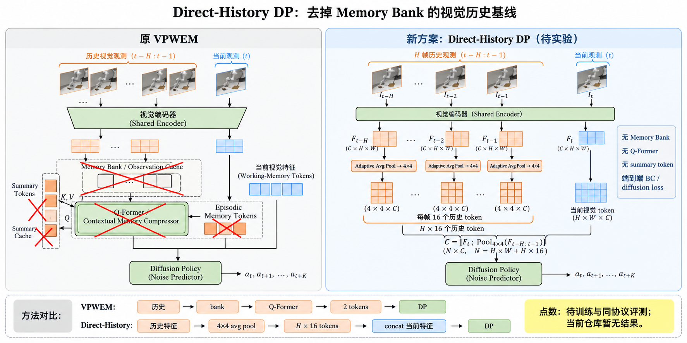

# Direct-History DP：4×4 历史视觉池化基线

> 状态：方案图；当前仓库尚无对应实现、训练 checkpoint 或成功率结果。

## 核心改动

原 VPWEM 的长期路径为：

`历史观测 → memory bank/cache → Q-Former → 2 个 episodic memory tokens → DP`

新基线改为：

`H 帧历史观测 → 共享视觉编码器 → 每帧 AdaptiveAvgPool(4,4) → 每帧 16 tokens → 与当前视觉 tokens 拼接 → DP`

即：

`C = [F_t ; Pool_4×4(F_{t-H:t-1})]`

删除的模块包括 memory bank、summary cache、summary tokens、Q-Former 和固定 2 个
episodic memory tokens。训练仍使用原 DP 的行为克隆 / diffusion denoising loss。

## 这条基线实际检验什么

它检验的不是“另一种 memory bank 是否更好”，而是：在不做学习式记忆压缩的情况下，
给 DP 直接增加低分辨率历史视觉 token，是否足以达到或超过 VPWEM。

如果它优于 VPWEM，可能说明历史视觉覆盖本身比 Q-Former 压缩更重要；如果它在相同
计算预算下明显更差，才支持学习式压缩器的必要性。

## 跑点前必须固定的公平口径

1. 固定历史帧数 `H` 和采样间隔，避免不同方法看到不同时间范围。
2. 明确 4×4 pooling 发生在 backbone feature map 上，而不是对 RGB 原图池化。
3. 当前帧与历史帧必须共享同一个视觉编码器。
4. 历史 token 数为 `16H`，不再是 VPWEM 的 2 tokens；需要同时报告 token 数、显存和推理延迟。
5. 为区分“更多 token”与“方法更好”，建议增加 token-matched 对照，例如只保留 2 个 pooled history tokens。
6. 使用与 VPWEM 相同的训练 seed、checkpoint 预算、episode seeds、action chunk 和 evaluator。

## 实现时需要注意

当前 VPWEM 的 condition encoder 通常已经把一帧图像变成单个 256 维 token。要实现图中的
4×4 pooling，必须从视觉 backbone 的空间 feature map（pooling/SpatialSoftmax 之前）取特征；
不能对已经压成 256 维的 `dp_emb` 再做二维池化。

此外，原 `LongMemChiTransformerPTP` 的条件位置编码和 attention mask 按
`1 + Tm + To` 的长度建立。改为 `16H + 当前视觉 token 数` 后，需要同步扩展条件长度、
位置编码和 mask，否则只是数据侧拼接，策略网络仍无法正确接收这些 token。

## 当前结果

暂无。仓库搜索未发现 `AdaptiveAvgPool(4,4)`、对应配置、checkpoint 或评测产物，不能填入
任何成功率点数。
