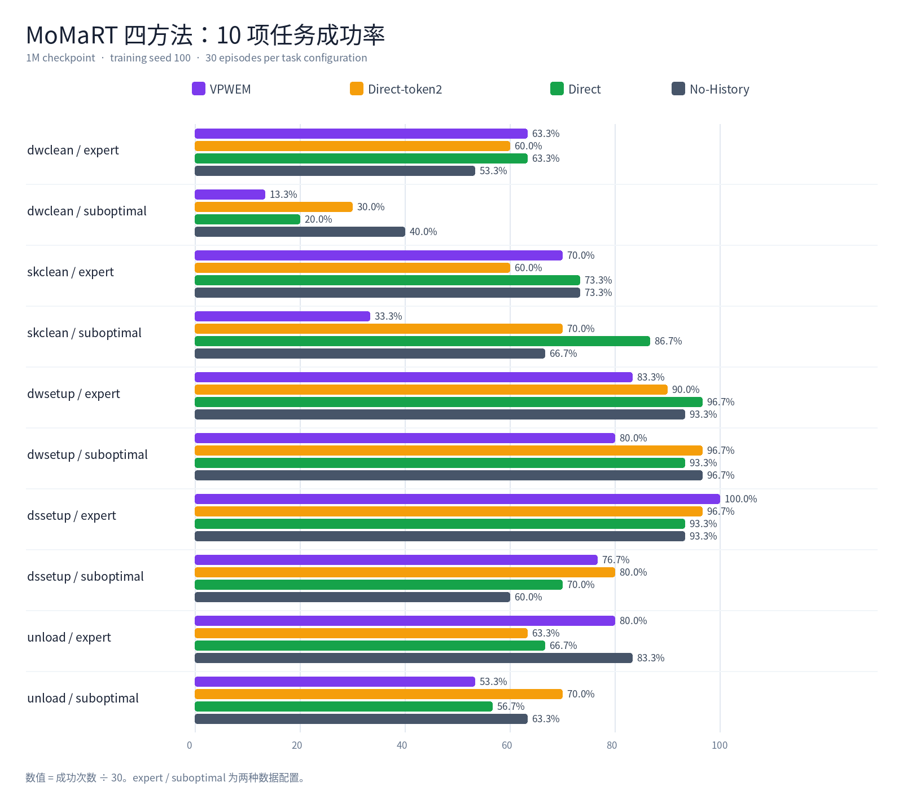
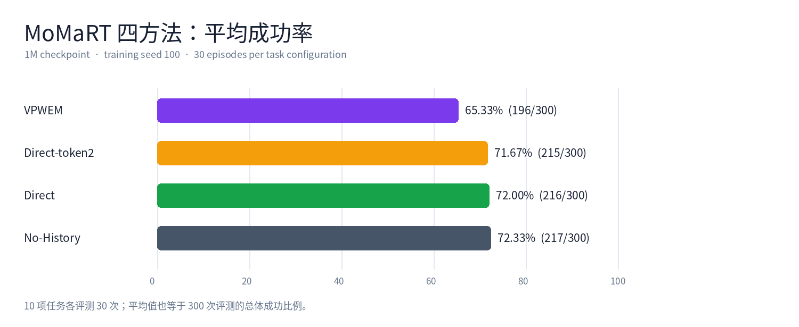

# MoMaRT 四方法网络结构与超参数

> 范围：当前 MoMaRT 1M 多任务实验中的 No-History、Direct、Direct-token2、VPWEM。图示依据实际训练入口与 PyTorch 模块结构。图中的 B 表示 batch size。

## 飞书可编辑树状结构：四种方法

以下四幅树状图直接排在文档正文中，使用等宽文本块呈现；箭头表示数据流，汇合处表示当前观测与长期历史共同条件化动作网络。每幅图后面都标出相对前一种方法的结构改动。

### ① No-History｜近期观测基线

```text
最近 2 帧 raw 观测
├─ 正面 RGB ───────→ ResNet-18 ─┐
├─ 腕部 RGB ───────→ ResNet-18 ─┤
├─ 正面深度 ───────→ ResNet-18 ─┤
├─ 腕部深度 ───────→ ResNet-18 ─┼→ 特征拼接 → MLP
├─ proprio ─────────────────────┤                 │
└─ scan ───────────→ 扫描编码 ──┘                 ▼
                                      最近观测 [B,2,256]
                                               │
                                      加 task embedding
                                               │
历史观测 ── 不读取；Tm=0 ────────────────────────┤
                                               ▼
                                 PTP Decoder ×8 → DDPM ×50
                                               │
                                               ▼
                                           执行 8 步动作
```

**这一法的定义**：长期历史路径关闭；动作 Transformer 保留。

### ② Direct｜完整空间历史

```text
最近 2 帧 raw 观测 ── 多模态全局编码 + task embedding
                                      │
                                      └→ 当前条件 [B,2,256] ──┐
                                                               │
最多 16 帧历史；每帧四路视觉                                   │
├─ 正面 RGB ──────→ ResNet 主干 → 4×4 网格 ─┐                  │
├─ 腕部 RGB ──────→ ResNet 主干 → 4×4 网格 ─┤                  │
├─ 正面深度 ──────→ ResNet 主干 → 4×4 网格 ─┼→ 每格投影至256维  │
└─ 腕部深度 ──────→ ResNet 主干 → 4×4 网格 ─┘         │        │
                                          空间位置+视角编码     │
                                                   │           │
                           16帧×4路×16格 = 1024 token         │
                                                   │           │
                                                   └───────────┤
                                                               ▼
                                          PTP Decoder ×8 → DDPM ×50
                                                               │
                                                               ▼
                                                           执行 8 步动作
```

**相对 No-History 的改动**：增加长期视觉分支，并让 Decoder 直接读取最多 1024 个空间历史 token；历史 proprio 与 scan 不进入这条分支。

### ③ Direct-token2｜无参数历史压缩

```text
最近 2 帧 raw 观测 ── 全局编码 + task embedding
                         │
                         └→ 当前条件 [B,2,256] ──────────────┐
                                                              │
最多 16 帧历史；四路视觉                                      │
     │                                                        │
     ▼                                                        │
与 Direct 相同的 ResNet 主干、4×4 网格及位置/视角编码          │
     │                                                        │
     ▼                                                        │
空间历史 [B,1024,256]                                         │
     │                                                        │
     ▼                                                        │
AdaptiveAvgPool1d(2) 〔无可学习参数〕                          │
     │                                                        │
     └→ 2 个历史 token [B,2,256] ─────────────────────────────┤
                                                              ▼
                                         PTP Decoder ×8 → DDPM ×50
                                                              │
                                                              ▼
                                                          执行 8 步动作
```

**相对 Direct 的改动**：只在历史进入 Decoder 前沿 token 轴平均池化，`1024 → 2`；视觉编码器仍可训练。

### ④ VPWEM｜Q-Former 学习历史摘要

```text
最近 2 帧预计算 dp_emb [B,2,256]
     │
     └─ 加 task embedding ────────────────────────────────────┐
                                                              │
历史 dp_emb [B,最多16帧,256]                                  │
     │                                                        │
     ▼                                                        │
加 episode 时间的正弦位置编码                                  │
     │                                                        │
     ▼                                                        │
FIFO 观测缓存〔容量 8〕                                       │
     │                                                        │
     ├──────────→ 观测证据 ──────────────────┐                │
     │                                      │                │
2 个可学习 query ←── 历史 query 摘要缓存     │                │
     │                                      │                │
     └───────────────┬──────────────────────┘                │
                     ▼                                       │
              2 层 Q-Former                                  │
              ├─ 自注意力：读取 query 摘要                    │
              ├─ 交叉注意力：读取观测证据                     │
              └─ 前馈网络：更新 query                         │
                     │                                       │
                     ▼                                       │
             2 个记忆 token [B,2,256] ───────────────────────┤
                                                             ▼
                                        PTP Decoder ×8 → DDPM ×50
                                                             │
                                                             ▼
                                                         执行 8 步动作
```

**相对 Direct-token2 的改动**：以 FIFO 与可学习 Q-Former 替代固定平均池化。当前 VPWEM 还使用预计算 `dp_emb`，输入编码链路与前三法不同；Q-Former 状态在新 episode 开始时重置。

## 一页看懂：四种方法改了哪里

| 方法 | 长期历史路径 | 进入动作网络的历史 token | 独立记忆模块 | 设计目的 |
|---|---|---:|---|---|
| No-History | 不读取长期历史 | 0 | 无 | 测量近期观测是否足够 |
| Direct | 保留四路视觉的 4×4 空间网格 | 最多 1024 | 无 | 测量完整空间历史的价值与成本 |
| Direct-token2 | 与 Direct 同源的空间历史，经固定平均池化 | 2 | 无 | 测量简单、无参数压缩的效果 |
| VPWEM | 历史 embedding 写入 FIFO，经 Q-Former 学习压缩 | 2 | 两层 Q-Former | 测量学习式固定容量记忆的效果 |

**共同骨干**：最近 2 帧观测条件化 8 层 PTP Transformer Decoder；输入 9 个带噪动作位置，预测 10 维动作噪声，经 50 步 DDPM 反向去噪，在线执行其中 8 步。Decoder 的动作自注意力使用因果掩码，观测交叉注意力使用时间对齐的 PTP 掩码。条件排列为「扩散时间步 → 长期历史 → 最近两帧观测」。

## 01 · No-History：关闭长期历史路径


**模块流向**：四路视觉与本体状态、scan → 全局多模态编码 → 最近 2 帧各 1 个 256 维 token → 加任务 embedding → PTP 扩散动作网络。

**结构改动**：长期历史输入为空，历史 token 数 `Tm=0`；不实例化 Q-Former。它保留完整动作 Transformer，因此是长期记忆的消融基线。

**关键尺寸**：近期条件 `[B,2,256]`；长期条件 `[B,0,256]`；动作噪声预测 `[B,9,10]`。

## 02 · Direct：保留完整空间历史


**模块流向**：

| 路径 | 网络模块 | 输出 |
|---|---|---|
| 当前观测 | 四路视觉 ResNet-18、proprio、scan → 拼接与 MLP → 任务 embedding | `[B,2,256]` |
| 长期历史 | 四路历史视觉 → ResNet 主干 → 每路 4×4 空间池化 → 256 维投影 → 空间位置与视角 embedding | 最多 `[B,1024,256]` |
| 动作 | 当前观测 + 所有历史 token → PTP Decoder → DDPM | `[B,9,10]` |

**相对 No-History 的改动**：新增空间历史分支，并将历史 token 全部送入 Decoder 的交叉注意力。每帧 `4 路 × 4 × 4 = 64` 个 token；16 帧上限为 `16 × 64 = 1024` 个。历史分支只使用四路视觉，不加入历史 proprio 或 scan。

## 03 · Direct-token2：固定压缩为两个 token


**模块流向**：与 Direct 相同的四路视觉主干及空间编码 → 1024 个历史 token → 沿 token 轴做 `AdaptiveAvgPool1d(2)` → 2 个历史 token → PTP Decoder。

**相对 Direct 的改动**：只改变进入 Decoder 前的历史 token 数，从最多 1024 压为 2。池化操作本身无可学习参数；上游视觉编码器、任务 embedding 与动作网络仍可训练。该压缩会混合不同时间及空间位置的信息。

**关键尺寸**：池化前最多 `[B,1024,256]`；池化后 `[B,2,256]`。

## 04 · VPWEM：学习式情景记忆


**模块流向**：预计算的当前与历史 `dp_emb`（256 维）→ 加任务 embedding；历史再加 episode 时间的正弦位置编码 → FIFO 观测缓存 → 两层 Q-Former → 2 个记忆 token → PTP Decoder。

**Q-Former 内部**：2 个可学习 query 先通过自注意力读取历史 query 摘要，再通过交叉注意力读取观测缓存，最后经前馈网络更新。观测缓存与各层 query 摘要缓存均有界；在线执行时跨动作块保留状态，新 episode 开始时重置。

**相对 Direct-token2 的改动**：将无参数平均池化换成可学习的 Q-Former 压缩，并引入在线缓存。当前 1M 实验还更换了输入链路：VPWEM 读取预计算 embedding，其余三法训练 raw-image 视觉编码器；这项差异需要与记忆模块差异分开理解。

**关键尺寸与结构**：`2` 个 query、`2` 层、`8` 个注意力头、`256` 维隐藏层、`1024` 维前馈层、FIFO 容量 `8`、Q-Former dropout `0.1`；输出 `[B,2,256]`。

## 统一骨干与训练超参数

| 模块 / 参数 | 配置及设计含义 |
|---|---|
| 动作生成 | DDPM；预测噪声；50 个反向去噪步 |
| PTP Decoder | 8 层 Transformer Decoder；隐藏维度 256；4 头注意力；前馈维度 1024；注意力 dropout 0.3 |
| 时间窗口 | 最近观测 2 帧；训练动作长度 9；在线动作块长度 8；动作维度 10 |
| 历史采样 | 历史预算最多 16 帧；训练数据按 20 步时间区间抽样，不是固定逐 20 帧取样 |
| 任务条件 | 5 类语义任务的可学习 256 维 task embedding |
| 训练预算 | 1,000,000 次优化器更新；训练 seed 100 |
| 优化器 | AdamW；初始学习率 `1×10⁻⁴`；β₁=0.9、β₂=0.999；余弦退火 |
| 正则与稳定性 | 短期/长期条件 dropout 各 0.3；EMA 衰减 0.999 |
| 有效 batch size | No-History、Direct、Direct-token2 为 64；当前 VPWEM 为 256 |
| raw-image 感知 | 四路 90×120 RGB/深度图；75×100 随机裁剪；ResNet-18 与 GroupNorm；当前观测融合 proprio 和 scan |

**参数量口径**：No-History 54,946,422；Direct 55,748,214；Direct-token2 55,477,384；VPWEM 11,860,616。VPWEM 的数值不包含生成预计算 `dp_emb` 的外部视觉编码器，因此不能把这四个数字直接视作完整系统的同口径参数量。

**比较边界**：当前四法实验可比较完整系统的表现。VPWEM 与其余三法之间同时存在输入编码链路和有效 batch size 差异，不能仅凭结果差异判断 Q-Former 与固定池化的优劣。

## 代码与配置依据

- 训练配置：`configs/dp/momart/fair_history_multitask/base.yaml`、`configs/dp/momart/fair_history_multitask_emb/base.yaml`
- 条件与空间历史编码：`cleandiffuser/nn_condition/momart_history_condition.py`
- 动作去噪网络：`cleandiffuser/nn_diffusion/longmem_chitransformerptp.py`
- 学习式记忆：`cleandiffuser/nn_memory/qformer_memory.py`
- 实际 PyTorch 网络打印与参数量：`reports/momart_architecture_prints_20260920/`

## 最终评测：10 项任务 × 四种方法

以下是 **1M checkpoint、训练 seed 100** 的 MoMaRT 多任务评测。每个任务配置各评测 30 个 episode；单元格写为「成功率（成功次数/30）」。`expert` 与 `suboptimal` 是同一语义任务的两种示范数据配置。

| 任务配置 | VPWEM | Direct-token2 | Direct | No-History |
|---|---:|---:|---:|---:|
| dwclean / expert | 63.33%（19/30） | 60.00%（18/30） | 63.33%（19/30） | 53.33%（16/30） |
| dwclean / suboptimal | 13.33%（4/30） | 30.00%（9/30） | 20.00%（6/30） | 40.00%（12/30） |
| skclean / expert | 70.00%（21/30） | 60.00%（18/30） | 73.33%（22/30） | 73.33%（22/30） |
| skclean / suboptimal | 33.33%（10/30） | 70.00%（21/30） | 86.67%（26/30） | 66.67%（20/30） |
| dwsetup / expert | 83.33%（25/30） | 90.00%（27/30） | 96.67%（29/30） | 93.33%（28/30） |
| dwsetup / suboptimal | 80.00%（24/30） | 96.67%（29/30） | 93.33%（28/30） | 96.67%（29/30） |
| dssetup / expert | 100.00%（30/30） | 96.67%（29/30） | 93.33%（28/30） | 93.33%（28/30） |
| dssetup / suboptimal | 76.67%（23/30） | 80.00%（24/30） | 70.00%（21/30） | 60.00%（18/30） |
| unload / expert | 80.00%（24/30） | 63.33%（19/30） | 66.67%（20/30） | 83.33%（25/30） |
| unload / suboptimal | 53.33%（16/30） | 70.00%（21/30） | 56.67%（17/30） | 63.33%（19/30） |
| **十项平均** | **65.33%（196/300）** | **71.67%（215/300）** | **72.00%（216/300）** | **72.33%（217/300）** |

任务缩写：`dwclean` = table_cleanup_to_dishwasher；`skclean` = table_cleanup_to_sink；`dwsetup` = table_setup_from_dishwasher；`dssetup` = table_setup_from_dresser；`unload` = unload_dishwasher_to_dresser。由于各配置均为 30 次评测，十项成功率的宏平均等于 300 次评测的总体成功比例。

### 逐任务柱状图



### 四方法平均柱状图



**结果边界**：以上为单个训练 seed 的诊断级结果。No-History、Direct、Direct-token2 使用 raw-image、有效 batch 64；当前 VPWEM 使用预计算 embedding、有效 batch 256。因此表格与图展示的是四个已运行系统的分数，不能把差异单独归因于历史记忆机制。逐项原始汇总见 `reports/momart_1m_four_methods/report_feishu.md` 第 7 节。

## 可编辑流程图文件

文档附件 **`architectures_detailed.drawio`** 含四个独立页面：No-History、Direct、Direct-token2、VPWEM。每条分支从输入到输出逐模块标注内容和张量维度；矩形、文字和箭头均可编辑。下载后可在 [diagrams.net](https://app.diagrams.net/) 网页版打开，选择顶部页面标签切换方法。仓库文件：`docs/assets/momart_four_methods_1m/architectures_detailed.drawio`。旧版 `architectures.drawio` 为概览图。

## 模块级尺寸索引（与详细可编辑图一致）

`B` 为批量，`H` 为本次取用的历史帧数（最多 16），`Tm` 为送入动作网络的历史 token 数。尺寸均按实际张量轴顺序书写。

| 当前观测模块 | 输入内容与尺寸 | 输出内容与尺寸 |
|---|---|---|
| 正面/腕部 RGB，各自裁剪 | 各 `[B,2,3,90,120]` | 各 `[B,2,3,75,100]` |
| 正面/腕部深度，各自裁剪 | 各 `[B,2,1,90,120]` | 各 `[B,2,1,75,100]` |
| 四路独立 ResNet-18 + 全局池化 | 四路裁剪图像 | 每路 trunk 特征图 `[B,2,512,3,4]`，池化后视觉向量 `[B,2,512]` |
| 机器人本体状态 / ScanCore | proprio `[B,2,10]`；scan `[B,2,1,100]` | 本体状态 `[B,2,10]`；扫描经 Conv1d `32→64→64` 与 SpatialSoftmax 得 `[B,2,64]` |
| 特征拼接 + 两层 MLP | `4×512+10+64=2122`，即 `[B,2,2122]` | `[B,2,256]` |
| 加任务 embedding | `[B,2,256]` + 任务向量 `[B,256]` | 最近观测 token `[B,2,256]` |

以上当前观测链路用于 No-History、Direct、Direct-token2。VPWEM 的当前输入为预计算 `dp_emb [B,2,256]`，加同维任务 embedding 后直接形成 `[B,2,256]` 近期条件。

| 长期历史模块 | 输入内容与尺寸 | 输出内容与尺寸 |
|---|---|---|
| No-History | 长期历史关闭 | `Tm=0`，无历史 token |
| Direct 四路历史视觉 | 各 RGB `[B,H,3,90,120]`、深度 `[B,H,1,90,120]` | 裁剪至 `75×100` → ResNet trunk 特征图 `[B,H,512,3,4]` |
| Direct 空间池化与投影 | 每路 512 通道特征图 | 每路 4×4=16 个 256 维 token，`[B,H,16,256]` |
| Direct 视角、空间位置及任务编码 | 四路空间 token | `[B,H,64,256]`；规整至 16 帧并展平为 `[B,1024,256]` |
| Direct-token2 固定压缩 | 与 Direct 相同的 `[B,1024,256]` | 沿 token 轴平均池化至 `[B,2,256]` |
| VPWEM 历史预计算向量 | `dp_emb [B,H,256]` | 加任务向量与 episode 正弦时间编码，仍为 `[B,H,256]` |
| VPWEM FIFO 观测缓存 | 逐帧写入历史向量 | 最多 8 帧 `[B,≤8,1,256]`，展平后 `[B,≤8,256]` |
| VPWEM 两层 Q-Former | 2 个可学习 query `[B,2,256]`；观测缓存与每层 query 摘要缓存 | 自注意力 → 交叉注意力 → 前馈网络；输出记忆 token `[B,2,256]` |

Direct 与 Direct-token2 的长期分支只读取历史四路视觉；历史 proprio 和 scan 不参与。VPWEM 的每层 query 摘要缓存最多保留 8 个时间位置，每个位置 2 个 256 维 query。

| 共用动作模块 | 输入内容与尺寸 | 输出内容与尺寸 |
|---|---|---|
| 条件投影与拼接 | 扩散时间步 `[B,1,256]` + 历史 `[B,Tm,256]` + 近期 `[B,2,256]` | `[B,1+Tm+2,256]`；四法依次为 3、1027、5、5 个条件 token |
| 条件 MLP | `[B,1+Tm+2,256]` | 加位置编码，逐 token `256→1024→256`（Mish），维度不变 |
| 带噪动作映射 | 归一化动作 `[B,9,10]` | `Linear 10→256` + 动作位置编码，`[B,9,256]` |
| PTP Transformer Decoder | 动作 token + 条件 token | 8 层、4 头、FFN `256→1024→256`；动作隐状态 `[B,9,256]` |
| 噪声预测头 | `[B,9,256]` | LayerNorm + `Linear 256→10`，预测噪声 `[B,9,10]` |
| 采样和执行 | 预测噪声 `[B,9,10]` | DDPM 反向去噪 50 步，产生 `[B,9,10]`；在线执行前 8 步 `[B,8,10]` |

动作自注意力使用因果掩码；历史 token 对所有动作位置可见；近期第 `j` 帧只对第 `j` 个及以后的动作位置可见。

## 附录：DP 与 DP-PTP 的模块级张量流

这两页按 MoMaRT 单任务 raw-image 配置及网络类绘制；它们没有多任务 task embedding，也不读取长期历史。附件 `dp_dpptp_detailed.drawio` 含 DP、DP-PTP 两个可编辑页面，仓库文件为 `docs/assets/momart_four_methods_1m/dp_dpptp_detailed.drawio`。DP 的 raw-image 训练入口 `pipelines/dp_momart_image.py` 当前不在仓库中，因此 DP 页是配置与模块的组合示意，不是已核实的可运行入口。

| 输入到输出模块 | 输入内容与尺寸 | 输出内容与尺寸 |
|---|---|---|
| 最近 2 帧正面/腕部 RGB | 各 `[B,2,3,90,120]` | 各自裁剪至 `[B,2,3,75,100]` |
| 最近 2 帧正面/腕部深度 | 各 `[B,2,1,90,120]` | 各自裁剪至 `[B,2,1,75,100]` |
| 四路独立 ResNet-18 | 各路裁剪图像 | 每路 trunk `[B,2,512,3,4]`，全局池化后 `[B,2,512]` |
| proprio 与 ScanCore | 本体状态 `[B,2,10]`；scan `[B,2,1,100]` | `[B,2,10]`；扫描经 Conv1d、SpatialSoftmax 得 `[B,2,64]` |
| 拼接与多模态 MLP | `4×512+10+64=2122`，即 `[B,2,2122]` | `2122→256→256`，最近观测 `[B,2,256]` |
| 扩散时间步与条件编码 | 时间步 `[B]`；观测 `[B,2,256]` | 时间步 `[B,1,256]`；拼接 `[τ,o₀,o₁]` 为 `[B,3,256]`；位置编码 + 逐 token MLP 后仍为 `[B,3,256]` |
| 带噪动作编码 | `[B,9,10]` | `Linear 10→256` + 动作位置编码，`[B,9,256]` |
| 动作 Transformer Decoder | 动作 `[B,9,256]`；条件 `[B,3,256]` | 8 层、4 头、FFN `256→1024→256`，输出 `[B,9,256]` |
| 预测、采样和执行 | `[B,9,256]` | LayerNorm + `Linear 256→10` 得噪声 `[B,9,10]`；DDPM 50 步得动作 `[B,9,10]`；现有 DP-PTP raw 评测执行索引 `1:9` 的 8 步 `[B,8,10]` |

| 可见性差异 | DP | DP-PTP |
|---|---|---|
| 动作自注意力 `[9,9]` | 因果掩码 | 因果掩码 |
| 条件交叉注意力 `[9,3]`，列为 `[τ,o₀,o₁]` | 所有 9 个动作位置均可读取三个条件 token | 动作位置 0 只能读取 `τ,o₀`；位置 1–8 可以读取 `τ,o₀,o₁` |
| 方法改动 | 条件观测全可见 | 仅改变条件交叉注意力掩码，限制未来观测的可见性 |

### 代码核对：DP 的实际入口与示意图的边界

仓库中实际存在的 DP 训练入口是 `pipelines/dp_momart_image_emb.py`：直接读取预计算 `dp_emb [B,2,256]`，使用 `ChiTransformer(act_dim=10, obs_dim=256, Ta=8, To=2)`，训练动作目标为 `[B,8,10]`，不经过图中的四路 ResNet 与 ScanCore。该入口的 DDPM 采样先验也是 `[B,8,10]`；其评测脚本执行采样结果的索引 `0:8`。因此，不能将本节 raw-image DP 示意图中的 `[B,9,10]` 和四路视觉编码表述为当前 DP 训练入口的真实前向路径。DP 的“条件观测全可见”结论来自 `ChiTransformer` 的交叉注意力掩码；DP-PTP 的 `1:9` 动作切片来自 `pipelines/dpptp_momart_image_eval.py`。
