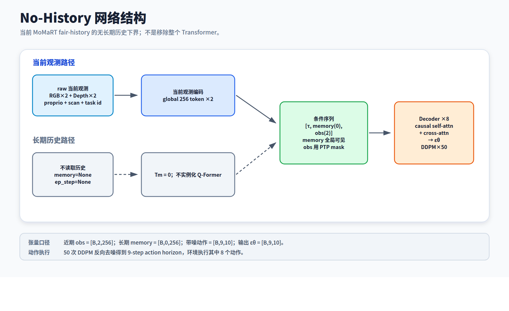
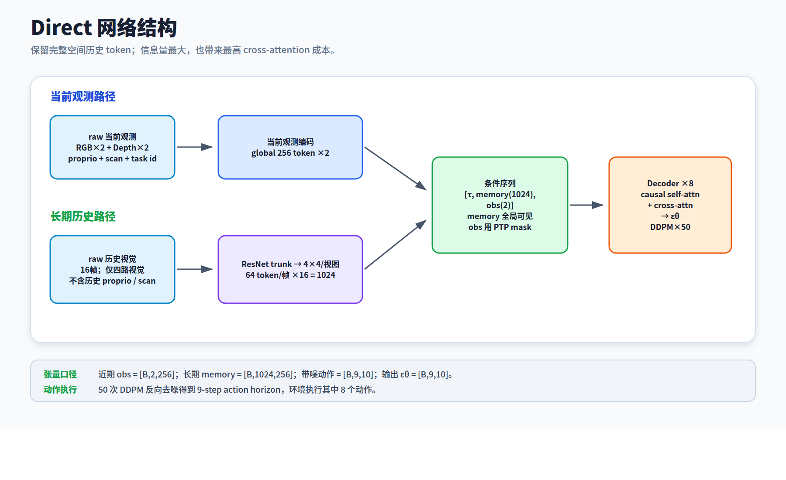
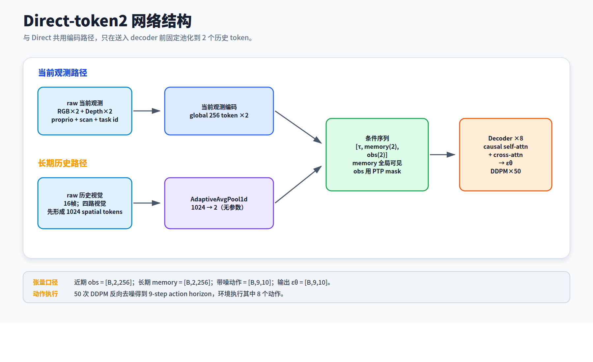
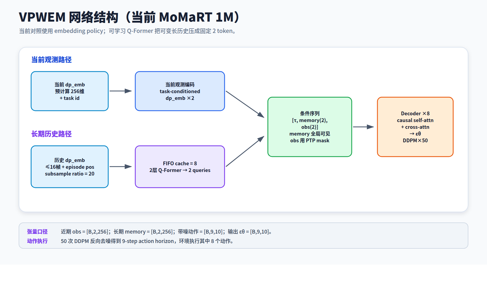

# MoMaRT 四方法网络结构与超参数

> 范围：当前 MoMaRT 1M 多任务实验中的 No-History、Direct、Direct-token2、VPWEM。图示依据实际训练入口与 PyTorch 模块结构。图中的 B 表示 batch size。

## 一页看懂：四种方法改了哪里

| 方法 | 长期历史路径 | 进入动作网络的历史 token | 独立记忆模块 | 设计目的 |
|---|---|---:|---|---|
| No-History | 不读取长期历史 | 0 | 无 | 测量近期观测是否足够 |
| Direct | 保留四路视觉的 4×4 空间网格 | 最多 1024 | 无 | 测量完整空间历史的价值与成本 |
| Direct-token2 | 与 Direct 同源的空间历史，经固定平均池化 | 2 | 无 | 测量简单、无参数压缩的效果 |
| VPWEM | 历史 embedding 写入 FIFO，经 Q-Former 学习压缩 | 2 | 两层 Q-Former | 测量学习式固定容量记忆的效果 |

**共同骨干**：最近 2 帧观测条件化 8 层 PTP Transformer Decoder；输入 9 个带噪动作位置，预测 10 维动作噪声，经 50 步 DDPM 反向去噪，在线执行其中 8 步。Decoder 的动作自注意力使用因果掩码，观测交叉注意力使用时间对齐的 PTP 掩码。条件排列为「扩散时间步 → 长期历史 → 最近两帧观测」。

## 01 · No-History：关闭长期历史路径

**模块流向**：四路视觉与本体状态、scan → 全局多模态编码 → 最近 2 帧各 1 个 256 维 token → 加任务 embedding → PTP 扩散动作网络。

**结构改动**：长期历史输入为空，历史 token 数 `Tm=0`；不实例化 Q-Former。它保留完整动作 Transformer，因此是长期记忆的消融基线。

**关键尺寸**：近期条件 `[B,2,256]`；长期条件 `[B,0,256]`；动作噪声预测 `[B,9,10]`。

## 02 · Direct：保留完整空间历史

**模块流向**：

| 路径 | 网络模块 | 输出 |
|---|---|---|
| 当前观测 | 四路视觉 ResNet-18、proprio、scan → 拼接与 MLP → 任务 embedding | `[B,2,256]` |
| 长期历史 | 四路历史视觉 → ResNet 主干 → 每路 4×4 空间池化 → 256 维投影 → 空间位置与视角 embedding | 最多 `[B,1024,256]` |
| 动作 | 当前观测 + 所有历史 token → PTP Decoder → DDPM | `[B,9,10]` |

**相对 No-History 的改动**：新增空间历史分支，并将历史 token 全部送入 Decoder 的交叉注意力。每帧 `4 路 × 4 × 4 = 64` 个 token；16 帧上限为 `16 × 64 = 1024` 个。历史分支只使用四路视觉，不加入历史 proprio 或 scan。

## 03 · Direct-token2：固定压缩为两个 token

**模块流向**：与 Direct 相同的四路视觉主干及空间编码 → 1024 个历史 token → 沿 token 轴做 `AdaptiveAvgPool1d(2)` → 2 个历史 token → PTP Decoder。

**相对 Direct 的改动**：只改变进入 Decoder 前的历史 token 数，从最多 1024 压为 2。池化操作本身无可学习参数；上游视觉编码器、任务 embedding 与动作网络仍可训练。该压缩会混合不同时间及空间位置的信息。

**关键尺寸**：池化前最多 `[B,1024,256]`；池化后 `[B,2,256]`。

## 04 · VPWEM：学习式情景记忆

**模块流向**：预计算的当前与历史 `dp_emb`（256 维）→ 加任务 embedding；历史再加 episode 时间的正弦位置编码 → FIFO 观测缓存 → 两层 Q-Former → 2 个记忆 token → PTP Decoder。

**Q-Former 内部**：2 个可学习 query 先通过自注意力读取历史 query 摘要，再通过交叉注意力读取观测缓存，最后经前馈网络更新。观测缓存与各层 query 摘要缓存均有界；在线执行时跨动作块保留状态，新 episode 开始时重置。

**相对 Direct-token2 的改动**：将无参数平均池化换成可学习的 Q-Former 压缩，并引入在线缓存。当前 1M 实验还更换了输入链路：VPWEM 读取预计算 embedding，其余三法训练 raw-image 视觉编码器；这项差异需要与记忆模块差异分开理解。

**关键尺寸与结构**：`2` 个 query、`2` 层、`8` 个注意力头、`256` 维隐藏层、`1024` 维前馈层、FIFO 容量 `8`、Q-Former dropout `0.1`；输出 `[B,2,256]`。

## 统一骨干与训练超参数

| 模块 / 参数 | 配置及设计含义 |
|---|---|
| 动作生成 | DDPM；预测噪声；50 个反向去噪步 |
| PTP Decoder | 8 层 Transformer Decoder；隐藏维度 256；4 头注意力；前馈维度 1024；注意力 dropout 0.3 |
| 时间窗口 | 最近观测 2 帧；训练动作长度 9；在线动作块长度 8；动作维度 10 |
| 历史采样 | 历史预算最多 16 帧；训练数据按 20 步时间区间抽样，不是固定逐 20 帧取样 |
| 任务条件 | 5 类语义任务的可学习 256 维 task embedding |
| 训练预算 | 1,000,000 次优化器更新；训练 seed 100 |
| 优化器 | AdamW；初始学习率 `1×10⁻⁴`；β₁=0.9、β₂=0.999；余弦退火 |
| 正则与稳定性 | 短期/长期条件 dropout 各 0.3；EMA 衰减 0.999 |
| 有效 batch size | No-History、Direct、Direct-token2 为 64；当前 VPWEM 为 256 |
| raw-image 感知 | 四路 90×120 RGB/深度图；75×100 随机裁剪；ResNet-18 与 GroupNorm；当前观测融合 proprio 和 scan |

**参数量口径**：No-History 54,946,422；Direct 55,748,214；Direct-token2 55,477,384；VPWEM 11,860,616。VPWEM 的数值不包含生成预计算 `dp_emb` 的外部视觉编码器，因此不能把这四个数字直接视作完整系统的同口径参数量。

**比较边界**：当前四法实验可比较完整系统的表现。VPWEM 与其余三法之间同时存在输入编码链路和有效 batch size 差异，不能仅凭结果差异判断 Q-Former 与固定池化的优劣。

## 代码与配置依据

- 训练配置：`configs/dp/momart/fair_history_multitask/base.yaml`、`configs/dp/momart/fair_history_multitask_emb/base.yaml`
- 条件与空间历史编码：`cleandiffuser/nn_condition/momart_history_condition.py`
- 动作去噪网络：`cleandiffuser/nn_diffusion/longmem_chitransformerptp.py`
- 学习式记忆：`cleandiffuser/nn_memory/qformer_memory.py`
- 实际 PyTorch 网络打印与参数量：`reports/momart_architecture_prints_20260920/`
