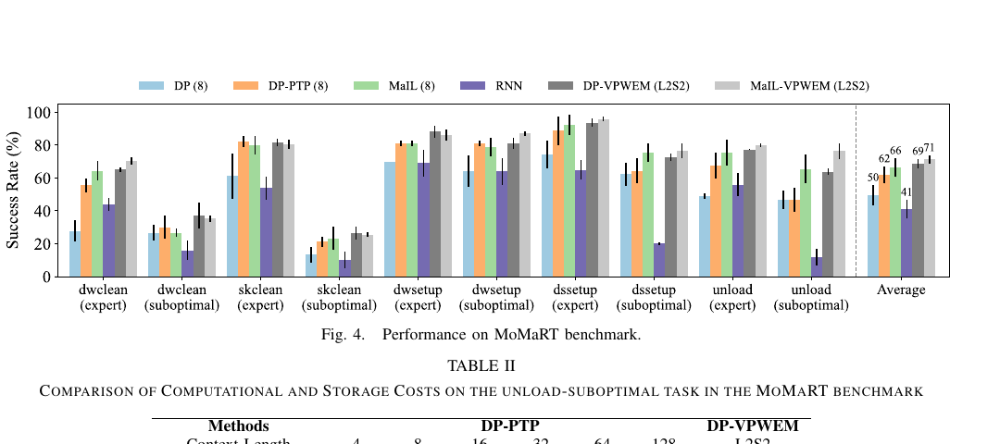
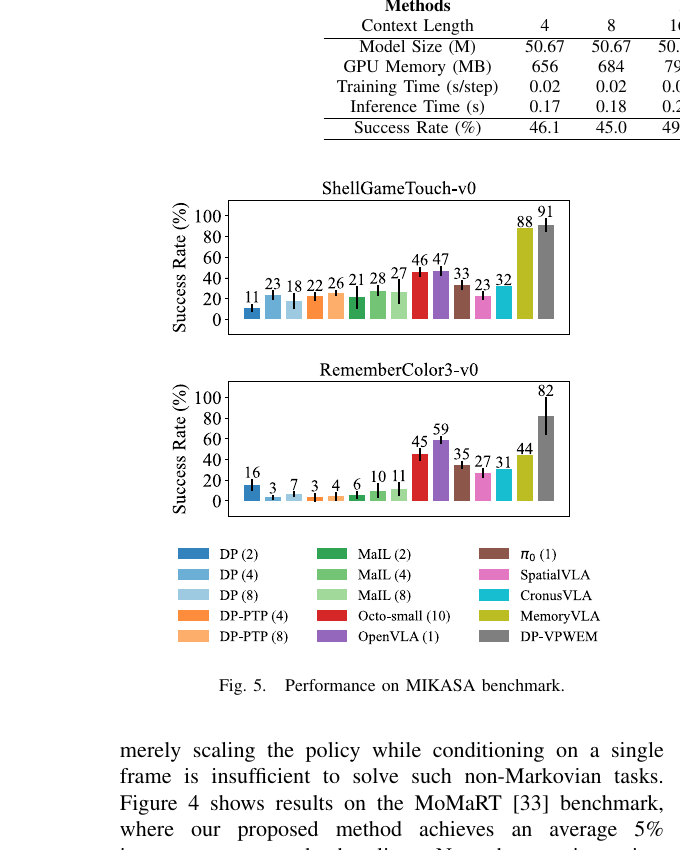
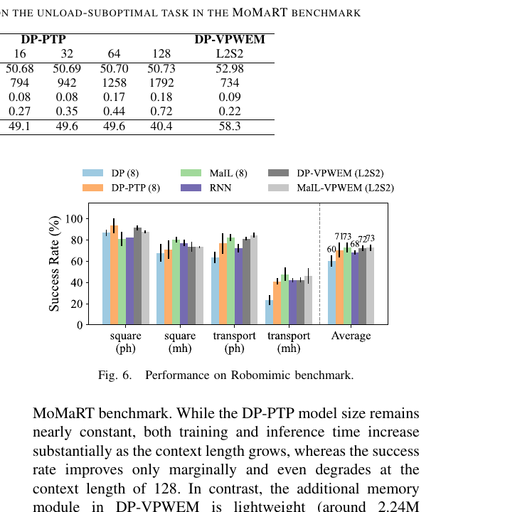

# VPWEM 完全讲解：从论文原理到源码、训练、推理与实验设计（飞书版）

> 文档定位：这不是只复述论文摘要的笔记，而是一份可以沿着仓库逐步读懂 VPWEM 的“论文—公式—代码—配置—实验”统一导读。
>
> 核对时间：2026-08-14
>
> 代码根目录：`/home/wjr/code/vpwem`
>
> 原论文：`literature/vpwem/vpwem.pdf`，arXiv:2603.04910v1

---

## 0. 先给出一句话结论

VPWEM 要解决的问题不是“怎样把更多帧塞进 Diffusion Policy”，而是：

> 在非马尔可夫视觉操作任务中，如何保留已经离开当前视野、但未来决策仍会用到的单回合历史，同时让在线策略的记忆容量和逐步计算保持有界。

它的核心做法是：

1. 最近 `L` 个观测不压缩，作为高分辨率 working memory；
2. 更早的历史按一定间隔进入有界 cache；
3. Q-Former 用固定数量 `M` 个 learned queries 把历史压成 episodic memory tokens；
4. diffusion timestep、episodic tokens 和近期 observation tokens 一起作为 Transformer decoder 的条件；
5. 模型仍用动作 diffusion loss 训练，没有额外的记忆重建监督。


读完整份文档后，应该能够回答：

- VPWEM 为什么不是普通长上下文策略；
- working memory 与 episodic memory 分别是什么；
- Q-Former 到底压缩了什么，cache 中真正存了什么；
- 一个 batch 如何从 HDF5 走到 diffusion loss；
- 一个 rollout step 如何更新长期记忆并生成 action chunk；
- 论文公式分别对应哪段代码；
- 论文配置、当前 YAML 和本地 checkpoint 有哪些差异；
- 哪些结论已有代码或实验支持，哪些仍只是合理解释；
- 下一步怎样从真正理解代码走向新 idea。

---

## 1. 为什么这个问题成立

### 1.1 普通短上下文策略隐含了什么假设

常见视觉运动策略近似学习：

```text
a_t ~ pi(o_{t-L+1}, ..., o_t)
```

也就是假设最近 `L` 帧足以确定当前动作。这在近似马尔可夫任务中通常成立：物体位置、机械臂状态和目标都还在当前画面里。

但在 ShellGameTouch、RememberColor、遮挡后抓取、计数或阶段依赖任务中，可能出现：

```text
相同的当前观测 + 不同的过去事件 -> 不同的正确动作
```

例如，球最初位于左杯下，之后被遮挡。决策时画面中的三个杯子完全相同，答案只存在于历史中。此时策略需要根据观测历史估计当前不可见的任务状态。

### 1.2 为什么不能只把 context 拉长

最直接的方法是把更多历史帧直接送入 Transformer，但有三个问题：

- 计算与显存随 context 增长，标准全注意力随长度近似二次增长；
- 大量相邻帧高度冗余，关键事件可能被噪声淹没；
- 更长历史可能带来动作复制、轨迹身份或机器人姿态等伪相关特征。

因此，VPWEM 的研究问题应写成：

> 能否用固定预算保留对未来动作有用的历史状态，而不是无差别保留完整历史？

### 1.3 “长任务”不等于“记忆任务”

- 一个任务可以很长，但当前画面始终包含充分信息，此时它仍接近马尔可夫；
- 一个任务可以不长，但决定性线索只在开头出现，此时它强依赖记忆；
- 因而只在长 horizon 数据集上涨分，不能自动证明模型学会了记忆。

严格证据应同时包含强记忆正对照、近似马尔可夫负对照、历史干预和状态可读性分析。

---

## 2. 方法的最小数学表达

### 2.1 两条记忆通路

最近 `L` 个观测构成 working memory：

```text
W_t = [o_{t-L+1}, ..., o_t]
```

更早的历史由记忆压缩器 `C_phi` 变成固定数量的 episodic tokens：

```text
E_t = C_phi(o_0, ..., o_{t-L})
E_t in R^(M x D)
```

策略根据两者预测未来 action chunk：

```text
a_{t:t+H} ~ pi_theta(W_t, E_t)
```

| 符号 | 含义 | 常见 Robomimic 设置 |
| --- | --- | ---: |
| `L / To` | working-memory observation 数 | 2 |
| `M / Tm` | 输出 episodic token 数 | 2 |
| `D` | token 隐层维度 | 256 |
| `Ta` | 训练动作序列长度 | 9 |
| `action_steps` | rollout 实际执行动作数 | 8 |
| `S` | observation/summary cache 上限 | 8 |
| `r` | 历史写入或采样间隔 | Robomimic 常用 20 |

这里的 episodic memory 是单个 episode 内的轨迹记忆，不是跨 episode 的终身经验库。每个新 episode 都会清空 cache。

### 2.2 Q-Former 的计算意图

对第 `n` 层 Q-Former，可将论文公式概括为：

```text
q_1,t = learned_query

x_1,n = q_n,t
        + SelfAttention(q_n,t, historical_summary_cache_n)

x_2,n = x_1,n
        + CrossAttention(x_1,n, observation_cache)

q_(n+1),t = x_2,n + FFN(x_2,n)

E_t = OutputProjection(q_N,t)
```

直觉上：

- self-attention 让当前 query 读取过去形成的摘要；
- cross-attention 让 query 回看有界 observation cache 中的证据；
- FFN 更新表示；
- `M` 个 query 最终对应 `M` 个固定长度记忆 token。

这些 token 没有被人工指定为“目标、物体或阶段”。所有 queries 同构，其职责由动作损失自由形成。

### 2.3 动作 diffusion 目标

先对真实动作序列 `a_0` 加噪：

```text
a_k = sqrt(alpha_bar_k) * a_0
    + sqrt(1 - alpha_bar_k) * epsilon
```

网络根据带噪动作、diffusion step、working memory 和 episodic memory 预测噪声：

```text
epsilon_hat = epsilon_theta(a_k, k, W_t, E_t)

L_action = mean((epsilon_hat - epsilon)^2)
```

重要结论：原 VPWEM 没有记忆重建 loss、未来状态预测 loss 或“关键帧”标签。Q-Former 是否学到有意义状态，完全由动作预测目标间接决定。

### 2.4 PTP 是什么

代码中的 VPWEM 建立在 `ChiTransformerPTP` 变体上。PTP 是 Past Token Prediction。

常见配置：

```text
obs_steps    = 2
action_steps = 8
horizon      = obs_steps + action_steps - 1 = 9
```

训练目标中包含 9 个动作位置；rollout 时从索引 `obs_steps - 1` 开始取未来 8 步。PTP 是动作序列建模机制，不等于长期记忆；长期信息来自额外的 memory compressor 和 memory tokens。

---

## 3. 一张图看完整代码数据流

```text
HDF5 / ReplayBuffer
        |
        v
LongMemSequenceSampler
  |-- 当前训练序列 action[Ta]
  |-- 最近观测 dp_emb[To]
  `-- 更早历史 dp_emb_mem[Tmem] + ep_step[Tmem]
        |
        v
dynamic_batch_collate_fn
        |
        v
training pipeline
  condition = dp_emb[:, :To]          [B, To, 256]
  memory    = dp_emb_mem               [B, Tmem, 256]
  action    = normalized action        [B, Ta, A]
        |
        v
LongMemDDPM.update
        |
        +--> add_noise(action)          [B, Ta, A]
        |
        +--> QFormerMemory(memory)
        |      `--> episodic tokens     [B, M, 256]
        |
        `--> LongMemChiTransformerPTP
               condition sequence:
               [diffusion-step token, M memory tokens, To obs tokens]
                              |
                              v
                      predicted noise   [B, Ta, A]
                              |
                              v
                         diffusion MSE
```

核心文件依赖关系：

```text
pipelines/longmemdpptp_robomimic_image_emb.py
  -> cleandiffuser/dataset/robomimic_dataset_longmem.py
     -> cleandiffuser/dataset/dataset_utils.py
  -> cleandiffuser/nn_memory/qformer_memory.py
  -> cleandiffuser/nn_diffusion/longmem_chitransformerptp.py
  -> cleandiffuser/diffusion/longmem_ddpm.py
```

---

## 4. 从数据集开始逐段读代码

### 4.1 数据从哪里来

Robomimic long-memory 数据集类位于：

```text
cleandiffuser/dataset/robomimic_dataset_longmem.py
```

`LongMemRobomimicImageDataset` 先把 HDF5 转成 `ReplayBuffer`，再创建 `LongMemSequenceSampler`。`__getitem__` 最终返回：

```text
batch = {
  "obs": {
    "dp_emb":       当前短窗口 embedding,
    "dp_emb_mem":   更早历史 embedding,
    "ep_step":      每个历史帧在 episode 内的时间位置
  },
  "action":         动作训练序列
}
```

使用 `*_emb.py` pipeline 时，`dp_emb` 已由短上下文视觉策略预计算。长期策略训练不会再次端到端训练 ResNet。

### 4.2 sampler 实际怎样取历史

关键实现：

```text
cleandiffuser/dataset/dataset_utils.py
LongMemSequenceSampler.sample_sequence()
```

它先找到当前样本所在 episode 的起点，保证历史不跨 episode。随后把从 episode 起点到当前窗口之前的历史按 `subsample_ratio` 分段，并在每段随机取一帧：

```text
[0, r), [r, 2r), [2r, 3r), ...
每段随机选一个 timestamp
```

所有 observation modalities 共用同一组 `selected_frame_idx`，避免 RGB、wrist RGB 和 proprioception 在时间上错位。

若 `preserve_episode_anchor=True`，第一个采样点固定成 episode 首帧。若历史超过 `maximum_memory_length`，当前代码保留：

```text
第一帧 anchor + 最近 maximum_memory_length - 1 个采样帧
```

### 4.3 一个必须牢记的论文—代码差异

论文容易让人理解成“训练时处理从 episode 开始到当前的完整历史”。当前代码更准确的描述是：

> 从当前时刻之前的单回合历史中分段随机采样，再截断到 `maximum_memory_length`；pipeline 未显式配置时默认上限为 16。

所以不能把当前训练样本称为任意长度的逐帧完整历史。

### 4.4 为什么需要动态 batch

不同训练时刻拥有不同历史长度。仓库使用 `SortedByLengthSampler` 和 `dynamic_batch_collate_fn`，尽量把相近历史长度的样本放在同一 batch，减少 padding 和无效计算。这是工程优化，不是论文方法创新。

---

## 5. QFormerMemory 源码完全拆解

关键文件：

```text
cleandiffuser/nn_memory/qformer_memory.py
```

### 5.1 三层对象关系

```text
QFormerMemory
  `-- QFormer
        `-- QFormerLayer × num_layers
```

- `QFormerMemory`：位置编码、时间采样、observation cache、训练/在线接口和 reset；
- `QFormer`：维护 learned query tokens，串联多层 compressor；
- `QFormerLayer`：summary self-attention、observation cross-attention、FFN 和本层 query cache。

### 5.2 初始化参数分别控制什么

```python
QFormerMemory(
    mem_compress_length=M,
    emb_dim=256,
    num_layers=N,
    num_heads=8,
    cache_compress="fifo",
    cache_max_length=S,
    use_pos_emb="sin_pos",
    subsample_ratio=r,
)
```

| 参数 | 作用 | 容易误解之处 |
| --- | --- | --- |
| `mem_compress_length` | learned queries 数，也是输出 token 数 | 不是内部 cache 长度 |
| `num_layers` | Q-Former 层数 | 不等于 diffusion Transformer 层数 |
| `cache_max_length` | condition 和每层 query cache 的时间容量 | 每个时间点还可能含 `M` 个 queries |
| `cache_compress` | cache 满后的管理方式 | 原主线通常为 FIFO，不是 learned selection |
| `subsample_ratio` | 在线每隔多少环境 step 写入一次 | 训练 sampler 也有同名间隔，必须一致 |
| `use_pos_emb` | 给历史 observation 加 episode 时间编码 | learned 版本只初始化 2048 个位置 |

### 5.3 learned queries

`QFormer` 中的：

```python
self.query_tokens = nn.Parameter(
    torch.randn(1, n_queries, d_model)
)
```

forward 时从 `[1, M, D]` 扩展到 `[B, M, D]`。这些向量是可训练参数，不是从某几帧直接复制出来的关键帧。输出是 learned queries 读取历史之后形成的 latent summaries。

### 5.4 observation cache

`QFormerMemory._update_condition_cache()` 接收 `[B, 1, 1, D]`。写入前调用 `detach()`，沿时间维追加为：

```text
condition_cache: [B, Tcache, 1, D]
```

超过 `S` 后按配置压缩：

- `fifo`：删除最旧位置；
- `random`：随机位置用最新值替代后缩短；
- `kmeans`：在线聚类中心；
- `adjsim`：合并相邻高相似内容；
- `none`：不压缩，会失去有界性质。

随后 reshape 为 `[B, Tcache, D]`，作为 Q-Former cross-attention 的 key/value。

### 5.5 每层 query cache

每个 `QFormerLayer` 还维护：

```text
query_cache: [B, Tcache, M, D]
```

本轮 `M` 个 query 作为 self-attention query，历史和当前 summaries 作为 key/value：

```text
current queries [B, M, D]
        attend to
all cached summaries [B, (Tcache + 1) * M, D]
```

随后再 cross-attend observation cache。

因此，VPWEM 并不是只保留 `M` 个递归状态。更准确的内部结构是：

```text
固定 M 个策略输出 tokens
+ 有界 observation cache
+ 每层各自的有界 query-summary cache
```

### 5.6 单层的真实顺序

`QFormerLayer.forward()` 的顺序是：

```text
pre-norm
-> self-attention over current + cached summaries
-> residual
-> pre-norm
-> cross-attention over observation cache
-> residual
-> pre-norm
-> FFN
-> residual
```

输出仍为 `[B, M, D]`，再交给下一层。最后经过 LayerNorm 和 Linear output projection。

### 5.7 训练 forward 怎样运行

`QFormerMemory.forward(memory, ep_step)` 首先调用 `reset()`，所以每个训练 batch 都从空 cache 重演采样历史：

```text
memory [B, Tmem, D]
  + positional embedding(ep_step)
  -> for t_idx in Tmem:
       写入 observation cache
       Q-Former 读取当前有界历史
       得到 [B, M, D]
  -> 只返回最后一次的 compressed memory
```

### 5.8 detach 的准确含义

observation cache 和 query cache 写入时都会 `detach()`。这意味着：

- 不对整个历史做跨时间 BPTT；
- 旧 cache 内容在之后步骤中被当作常量；
- Q-Former 当前调用的权重仍由最终动作 loss 优化；
- 不能描述成“梯度穿过所有历史状态端到端回传”；
- 在预计算 embedding pipeline 中，历史视觉 embedding 本来也不由该 loss 更新。

“compressor 与 policy 联合训练”指两者参数位于同一个 optimizer 和动作 loss 调用链中，不代表无限历史梯度流。

### 5.9 在线 inference

`QFormerMemory.inference(new_memory)` 不会每次 reset。它维护 episode 内状态，并只在：

```text
self.step % subsample_ratio == 0
```

时写入新 observation。写入后更新两个 cache，运行 Q-Former，保存 `self.cp_memory`。每个新 episode 必须显式调用 `reset()`，否则会发生跨 episode 记忆污染。评估 pipeline 的确同时 reset 普通模型与 EMA 模型的 memory。

### 5.10 复杂度应怎样准确表述

可以声称：

> 当 `cache_max_length=S` 固定且使用非 `none` 管理方式时，cache 达上限后，单步存储和 Q-Former 计算不再随 episode 长度继续增长。

不能声称“所有过去信息始终只存储在 `M` 个 token 中”，因为内部仍有 observation cache 和每层 query cache。

---

## 6. Memory tokens 怎样进入 Diffusion Policy

关键文件：

```text
cleandiffuser/nn_diffusion/longmem_chitransformerptp.py
```

### 6.1 四类输入

`LongMemChiTransformerPTP.forward()` 接收：

```text
x         [B, Ta, action_dim]   带噪动作序列
noise     [B]                   diffusion timestep
condition [B, To, obs_dim]      最近观测
memory    [B, Tm, obs_dim]      压缩历史
```

若 condition 或 memory 为 `None`，代码使用对应形状的零 token，使接口长度稳定。

### 6.2 条件序列怎样拼接

```text
t_emb   = map_noise(noise)          [B, 1, D]
mem_emb = Linear(memory)             [B, Tm, D]
obs_emb = Linear(condition)          [B, To, D]
act_emb = Linear(x)                  [B, Ta, D]
```

条件序列严格按下列顺序拼接：

```text
[diffusion timestep token, episodic memory tokens, working-memory tokens]
```

即 `[B, 1 + Tm + To, D]`。条件 encoder 对其编码，动作 tokens 作为 Transformer decoder 的 target，通过 cross-attention 读取条件序列。

### 6.3 两种 mask

- `self.mask`：动作 target 的 causal mask；
- `self.memory_mask`：控制不同动作位置可以读取哪些条件位置，延续 PTP 的时序对齐约束。

最后经过 LayerNorm 和 Linear head，恢复为 `[B, Ta, action_dim]` 的预测噪声。

### 6.4 memory 不是独立动作分支

memory tokens 只是 diffusion Transformer 的条件。最终性能是否依赖记忆，取决于 decoder 是否真正使用这些 tokens。因此仅看成功率不能证明记忆被使用，还需要 zero、跨 batch shuffle、状态 probe 等干预。

---

## 7. LongMemDDPM：训练如何闭环

关键文件：

```text
cleandiffuser/diffusion/longmem_ddpm.py
```

### 7.1 三个子模型

```text
model["condition"]  观测编码器；embedding pipeline 中可为 None
model["memory"]     QFormerMemory
model["diffusion"]  LongMemChiTransformerPTP
```

`AdamW(self.model.parameters())` 接收三个模块的可训练参数，因此 memory compressor 与 diffusion backbone 在同一动作损失下更新。同时维护 `model_ema`，推理默认使用 EMA 参数。

### 7.2 loss 完整顺序

```text
真实 action x0
  -> 随机 diffusion timestep t
  -> 加噪得到 xt 和真实 epsilon

近期 condition
  -> condition encoder 或直接使用 dp_emb
  -> short-condition dropout

历史 memory
  -> condition encoder 或直接使用 dp_emb_mem
  -> QFormerMemory
  -> long-condition dropout

(xt, t, condition, compressed_memory)
  -> diffusion network
  -> epsilon_hat
  -> mean((epsilon_hat - epsilon)^2)
  -> backward -> optimizer.step -> EMA update
```

### 7.3 两路 condition dropout

配置通常包含：

```text
short_cond_dropout: 0.3
long_cond_dropout:  0.3
```

它们让模型训练时偶尔缺失某一路条件，意图是降低单一路径依赖，但不是显式的“强迫使用长期记忆”损失。

### 7.4 当前新增损失不等于原论文

当前 `LongMemDDPM` 还支持 `memory_aux_coeff`、`counterfactual_memory_coeff` 和 wrong-memory batch roll。这些是后续 PER/机制验证扩展；系数为 0 时才退化到原 VPWEM 主目标。解释原论文时不能把新增功能倒写成原方法贡献。

---

## 8. 训练 pipeline 从入口到 optimizer

Robomimic embedding 训练入口：

```text
pipelines/longmemdpptp_robomimic_image_emb.py
```

### 8.1 初始化顺序

```text
Hydra 读取 YAML
-> set_seed
-> LongMemRobomimicImageDataset
-> DataLoader
-> LongMemChiTransformerPTP
-> 按 mem_compress_method 创建 memory
-> LongMemDDPM agent
-> cosine learning-rate scheduler
-> 自动恢复 checkpoint
```

### 8.2 每个 batch 的关键变量

```python
condition = nobs["dp_emb"][:, :obs_steps, :]
memory = nobs["dp_emb_mem"]
mem_steps = nobs["ep_step"]
update_log = agent.update(naction, condition, memory, mem_steps)
```

| 张量 | 形状 | 含义 |
| --- | --- | --- |
| `condition` | `[B, To, 256]` | 最近工作窗口 |
| `memory` | `[B, Tmem, 256]` | sampler 提取的更早历史 |
| `mem_steps` | `[B, Tmem]` | episode 内相对时间 |
| `naction` | `[B, Ta, A]` | 归一化动作序列 |
| `compressed_memory` | `[B, M, 256]` | Q-Former 输出 |
| `eps_hat` | `[B, Ta, A]` | 预测噪声 |

### 8.3 预计算 embedding 的真实边界

在 `longmemdpptp_robomimic_image_emb.py` 中 `nn_condition=None`。所以这一路训练的是：

```text
Q-Former memory + diffusion backbone
```

不是视觉 ResNet、Q-Former、diffusion 全部端到端联合训练。这关系到论文中“端到端”的准确措辞。

---

## 9. 在线推理与 rollout

Robomimic 评估入口：

```text
pipelines/longmemdpptp_robomimic_image_emb_eval.py
```

### 9.1 episode 开始

评估代码执行：

```python
agent.reset_cache()
agent.model["memory"].reset()
agent.model_ema["memory"].reset()
```

分别清理近期 condition cache、普通模型 memory cache 和 EMA memory cache。

### 9.2 第一次与后续 sample

`LongMemDDPM.sample()` 的逻辑：

1. 在线观测经 condition encoder 得到 embeddings；
2. 最后 `obs_steps` 个 embedding 保留为 working memory；
3. 更早部分送入 `memory.inference()`；
4. memory 按 `subsample_ratio` 决定是否写 cache；
5. 初始化高斯 action sequence；
6. 完整执行 DDPM 反向去噪；
7. 返回动作 chunk。

网络生成长度 `horizon` 的动作序列，但实际执行：

```text
action_pred[:, obs_steps - 1 : obs_steps - 1 + action_steps]
```

例如 `To=2, action_steps=8, horizon=9` 时，执行索引 1 到 8 的八个动作。

### 9.3 记忆干预接口

| 模式 | 操作 | 能回答的问题 |
| --- | --- | --- |
| `none` | 原样使用 | 正常性能 |
| `zero` | memory 全部置零 | 是否需要非零 memory |
| `shuffle_batch` | 换成其他样本的 memory | 是否需要样本匹配的历史 |
| `reverse_tokens` | 翻转压缩 token 顺序 | 只测试 token 顺序敏感性 |

Q-Former 输出 token 不天然按历史时间排列，所以 `reverse_tokens` 不能直接叫“时间打乱”。

---

## 10. 论文公式—源码映射

| 论文计算项 | 当前源码位置 | 说明 |
| --- | --- | --- |
| learned queries | `QFormer.query_tokens` | `[1, M, D]` 可训练参数 |
| input projection | `QFormer.input_proj` | observation feature 投影 |
| summary self-attention | `QFormerLayer.self_attn` | 当前 query 读取 query cache |
| observation cross-attention | `QFormerLayer.cross_attn` | query 读取 condition cache |
| FFN | `linear1 -> activation -> linear2` | pre-norm residual |
| output projection | `norm -> output_proj` | 输出 `[B, M, D]` |
| observation cache | `_update_condition_cache` | detach，有容量上限 |
| per-layer summary cache | `QFormerLayer.query_cache` | 每层独立维护 |
| 时间位置编码 | `mem_pos_emb(ep_step)` | 训练和推理均使用 |
| working/episodic 拼接 | `LongMemChiTransformerPTP.forward` | `[t, memory, observation]` |
| diffusion 加噪 | `LongMemDDPM.add_noise` | 前向扩散 |
| diffusion MSE | `LongMemDDPM.loss` | 原主目标 |
| 联合参数更新 | `LongMemDDPM.update` | optimizer 覆盖 ModuleDict |
| 在线越窗更新 | `LongMemDDPM.sample` | condition cache + memory inference |
| episode reset | eval pipeline `inference()` | 普通和 EMA memory 均清空 |

---

## 11. 配置怎样控制真实模型

Robomimic 配置目录：

```text
configs/dp/robomimic_multi_modal/chi_transformer_ptp_longmem/
```

关键关系：

```text
horizon = obs_steps + action_steps - 1

diffusion_num_layers
  -> diffusion Transformer decoder 层数

qformer_num_layers
  -> Q-Former compressor 层数

mem_compress_length
  -> 输出 memory token 数 Tm

qformer_cache_max_length
  -> observation/query cache 时间上限 S

dataset_memory_subsample_ratio
  -> 训练历史分段间隔
  -> 同时传给 QFormerMemory 作为在线写入间隔
```

### 11.1 论文主设置、当前 YAML 和 checkpoint 不能混为一谈

| 项目 | 论文 Table I | 当前 `transport_abs_emb.yaml` | 本地既有标准 checkpoint |
| --- | ---: | ---: | ---: |
| diffusion layers | 8 | 8 | 多数为 4 |
| Q-Former layers | 2 | 1 | 审计汇总者多为 2 |
| working tokens | 2 | 2 | 多数为 2 |
| episodic tokens | 2 | 2 | 多数为 2 |
| cache size | 8 | 8 | 多数为 8 |
| cache method | FIFO | FIFO | 多数为 FIFO |
| Robomimic subsample ratio | 20 | 20 | 多数为 20 |

因此：

- 不能只看当前 YAML 推断旧 checkpoint；
- 不能把 4-layer 本地结果称为论文 8-layer 严格复现；
- 每个 checkpoint 都应保存 resolved Hydra config，并用 state dict 核对实际层数。

---

## 12. 论文实验为什么这样设计

### 12.1 四类数据集的证据角色

| 研究问题 | 数据集 | 证据角色 |
| --- | --- | --- |
| 线索消失后记忆是否有用 | MIKASA ShellGameTouch、RememberColor3 | 强记忆正对照 |
| 自然长时程任务是否受益 | MoMaRT | 现实复杂验证 |
| 不需要长期记忆时是否伤害 | Robomimic Square、Transport | 近似马尔可夫负对照 |
| 哪个记忆因素起作用 | LongSquare | 可控消融平台 |

论文希望建立：

```text
强记忆任务：明显提升
自然长时程任务：有所提升
近似 Markov 任务：基本不退化
```

如果所有任务都同幅度上升，反而要怀疑参数量、训练预算或 backbone 差异。

### 12.2 效率实验

论文把长 context DP-PTP 与固定 token VPWEM 比较，目标是证明收益不只是因为看了更多历史，而是压缩历史能以更低成本保留有效信息。

论文在 MoMaRT unload-suboptimal 报告：

| 方法 | GPU 显存 | 推理时间 | 成功率 |
| --- | ---: | ---: | ---: |
| DP-PTP，context 128 | 1792 MB | 0.72 s | 40.4% |
| VPWEM，L2S2 | 734 MB | 0.22 s | 58.3% |

这些是论文报告值，当前工作区没有对应完整原始 benchmark 产物，应标为“论文结果”，不是“本地复现”。

### 12.3 消融分别检验什么

- `L`：近期高分辨率窗口是否足够；
- `M`：固定 summary token 容量；
- Q-Former 层数：压缩器表达能力；
- cache size：可回看的历史证据容量；
- FIFO/Random/KMeans/AdjSim：历史保留策略；
- context length：直接延长上下文的成本与收益。

理想消融必须固定 backbone、训练步数和总 token 预算。







---

## 13. 已确认事实与证据边界

### 13.1 有明确代码支持

- 最近观测与长期记忆走两条条件路径；
- 历史 observation 加 episode 时间编码；
- Q-Former 使用 trainable queries；
- 每层有 summary cache，外层有 observation cache；
- 输出给策略的是固定 `M` 个 memory tokens；
- memory 与近期 observation 共同条件化 diffusion decoder；
- Q-Former 和 diffusion 参数都进入同一个 optimizer；
- cache 写入 detach，避免跨完整历史反传；
- 在线 cache 每个 episode reset；
- FIFO、Random、KMeans、AdjSim 等管理方式确有实现。

### 13.2 只能部分成立

- “完整历史”：在线递归状态可能携带更早信息，但训练 sampler 有随机采样和默认 16 帧上限；
- “固定容量”：输出 token 固定，内部 caches 也有上限，但不只存 `M` 个 token；
- “过滤无关信息”：架构能学习压缩，但没有显式去相关或保真目标；
- “端到端”：memory 与 diffusion 联合优化成立；embedding pipeline 不训练视觉 encoder，cache detach 也阻断跨时间梯度。

### 13.3 当前证据不能支持

- memory tokens 已明确表示目标、对象、阶段或计数；
- Q-Former 一定优于等预算关键帧选择或检索；
- 提升一定来自抽象任务状态，而不是轨迹检索或样本身份；
- 当前 checkout 已严格复现论文全部结果；
- LongSquare 已在本地复现论文约 70%；
- MaIL-VPWEM 在当前仓库有完整训练—评估—结果链。

---

## 14. 当前本地复现状态

| 任务 | 本地三 seed success | 结构 | 判断 |
| --- | ---: | --- | --- |
| Square/ph | `94.44% +/- 1.92%` | diffusion 4、Q-Former 2 | 有效本地变体 |
| Square/mh | `76.67% +/- 3.33%` | diffusion 4、Q-Former 2 | 有效本地变体 |
| Transport/ph | `90.00% +/- 5.77%` | diffusion 4、Q-Former 2 | 有效本地变体 |
| Transport/mh | `36.67% +/- 6.67%` | diffusion 4、Q-Former 2 | 有效本地变体 |
| LongSquare/ph | `1.11% +/- 1.92%` | diffusion 4、Q-Former 2 | 复现失败 |
| LongSquare/ph 8-layer | seed 100 为 `0%` | diffusion 8、Q-Former 2 | 单 seed，仍失败 |

本地变体不能覆盖论文原始报告，也不能改标为严格论文复现。MIKASA 和 MoMaRT 在当前工作区缺少完整原始 result 文件，应引用论文而不是写成本地验证结论。

---

## 15. 如何真正把代码读懂

### 第一遍：只画概念图

回答什么是当前 observation、什么是越窗历史、哪部分被压缩、哪个模块最终输出动作。

### 第二遍：只追张量形状

从 `condition, memory, ep_step, action` 一路跟到 `compressed_memory, cond_emb, eps_hat, loss`。先确认每个维度为什么存在。

### 第三遍：只看 memory 状态

重点读：

```text
QFormerMemory.forward
QFormerMemory.inference
QFormerMemory._update_condition_cache
QFormerLayer.forward
reset
```

手动画出一次新帧到达后 observation cache、query cache 和输出 tokens 如何变化。

### 第四遍：对照训练与推理

| 项目 | 训练 | 推理 |
| --- | --- | --- |
| 历史来源 | dataset sampler | 在线 observation stream |
| 历史选择 | 每段随机一帧 | 固定间隔写入 |
| reset | 每个 forward 开头 | 每个 episode 开头 |
| 视觉 encoder | emb 版不训练 | eval 版在线编码图像 |
| 参数 | 普通 model 更新、EMA 跟随 | 默认使用 EMA |

### 第五遍：把公式贴到代码旁边

逐项验证 learned query、self-attention、cross-attention、FFN、projection 和 diffusion loss。无法映射的论文句子应标记为“解释”或“实验主张”。

### 第六遍：主动做反事实预测

在实验前先预测：

- `zero memory` 会下降多少；
- `shuffle_batch` 应比 zero 更差还是更好；
- cache 从 8 改成 2 会伤害哪类任务；
- subsample ratio 变大后计算和关键事件 recall 如何变化；
- Q-Former 换成 recent 或 anchor+recent 后会怎样。

能在看到结果前解释这些变化，才接近真正看懂。

---

## 16. 最小可验证实验路线

### 16.1 接口烟雾测试

验证：

- dataset 不跨 episode；
- 多模态历史 timestamp 对齐；
- variable-length batch 能 collate；
- Q-Former 输入输出形状正确；
- cache 超限后长度不继续增长；
- reset 后状态彻底清空；
- normal 与 EMA 模型都 reset。

### 16.2 单 seed 哨兵实验

检查 loss、checkpoint 恢复、训练/评估层数、写入间隔、online memory 更新和 action 截取位置。它只能说明 pipeline 可行，不能支撑论文结论。

### 16.3 冻结配置后跑三 seed

至少保存：

```text
git commit
resolved config
training seed
evaluation seed
checkpoint step
state-dict structure
episode-level result
hardware/software environment
```

### 16.4 机制验证优先

建议最先比较：

```text
normal
zero memory
shuffle_batch memory
recent-frame baseline
anchor + recent baseline
equal-token Q-Former baseline
```

若 normal 与 zero/shuffle 没有稳定差距，应先查清模型是否使用记忆，而不是继续设计复杂 compressor。

---

## 17. 从读懂 VPWEM 到产生 idea

### 17.1 原方法留下的开放问题

1. **何时写入？** 当前在线 Q-Former 按固定间隔写入，不判断事件价值。
2. **保留什么？** FIFO、Random、KMeans、AdjSim 都不是由未来动作需求直接监督。
3. **token 表示什么？** 同构 learned queries 没有对象、阶段、计数等显式职责。
4. **压缩是否可逆？** summary 丢失关键证据后没有可靠回查机制。
5. **记忆是否真实有效？** 成功率不足以排除 trajectory lookup 或 nuisance correlation。
6. **训练与推理是否一致？** 随机分段采样与在线周期写入存在分布差异。
7. **能否长度外推？** 默认训练上限 16 使它尤其需要单独验证。

### 17.2 idea 应从具体限制开始

```text
找到代码中的具体限制
-> 写成可证伪假设
-> 设计最小替代机制
-> 找到能放大差异的任务
-> 设计等预算基线与干预
```

例如：

```text
限制：固定间隔会漏掉短暂关键事件
假设：未来预测误差触发写入，在相同 cache 预算下提高关键事件 recall
改动：只替换 write gate，保留 Q-Former 和 diffusion backbone
任务：线索短暂出现且延迟使用
对照：fixed interval、feature delta、random、oracle event
证据：成功率 + event recall + 写入率 + zero/shuffle 干预
```

### 17.3 值得验证的方向

- prediction-surprise 或 action-influence 写入；
- 少量真实 evidence anchors + learned belief tokens；
- object/state/phase typed slots；
- 冲突检测与旧状态修正；
- 等 token 预算下 learned compression vs explicit retrieval；
- 从 memory tokens 预测隐藏任务变量的 probe；
- train horizon 到更长 test horizon 的长度外推。

---

## 18. 常见误区速查

| 错误理解 | 准确理解 |
| --- | --- |
| VPWEM 保存所有历史帧 | 训练分段采样且有长度上限；在线 cache 也有上限 |
| 最终只有 2 个 token，所以内部只存 2 个 | 内部还有 observation cache 和每层 query cache |
| Q-Former 自动找到关键帧 | 它输出 latent summaries，没有显式关键帧监督 |
| episodic memory 是跨 episode 经验库 | 它是单 episode 历史，新 episode reset |
| embedding 版是视觉端到端训练 | 使用预计算 `dp_emb`，不训练视觉 encoder |
| PTP 就是长期记忆 | PTP 是动作时序结构，长期记忆来自 Q-Former |
| reverse tokens 是时间反转 | learned tokens 不天然按时间排序 |
| 成功率提升证明保存了任务状态 | 还需 zero、shuffle、probe 和 OOD 证据 |
| 当前默认 YAML 就是论文配置 | YAML、论文表格与旧 checkpoint 存在漂移 |
| cache 固定说明计算严格常数 | 达上限后逐步成本有界，常数仍随 `S/M/N/D` 变化 |

---

## 19. 读完后的自测题

1. 为什么 ShellGameTouch 是非马尔可夫，而普通 Square 近似马尔可夫？
2. `L、M、S、r` 分别控制什么？
3. observation cache 和 query cache 有什么区别？
4. 为什么输出固定 token，但内部不只有 `M` 个状态？
5. Q-Former 单层为什么既需要 self-attention 又需要 cross-attention？
6. cache 的 `detach()` 切断了哪部分梯度，又保留哪些参数更新？
7. 训练 sampler 与在线 inference 的历史选择有什么差异？
8. memory tokens 在 diffusion Transformer 中位于什么位置？
9. `horizon=9、obs_steps=2、action_steps=8` 为什么不矛盾？
10. embedding pipeline 中哪些模块会训练，哪些不会？
11. 为什么 `shuffle_batch` 比 `zero` 更能检验样本匹配的记忆？
12. 为什么当前 LongSquare 结果不能称为论文复现？
13. 若 `cache_compress=none`，哪条效率主张失效？
14. 若 Q-Former 与 recent baseline 相同，应怎样解释？
15. 怎样区分“任务状态记忆”和“训练轨迹查表”？

---

## 20. 关键文件阅读顺序

### 必读：理解原 VPWEM

```text
1. literature/vpwem/vpwem.pdf
2. cleandiffuser/dataset/dataset_utils.py
3. cleandiffuser/dataset/robomimic_dataset_longmem.py
4. cleandiffuser/nn_memory/qformer_memory.py
5. cleandiffuser/nn_diffusion/longmem_chitransformerptp.py
6. cleandiffuser/diffusion/longmem_ddpm.py
7. pipelines/longmemdpptp_robomimic_image_emb.py
8. pipelines/longmemdpptp_robomimic_image_emb_eval.py
9. configs/dp/robomimic_multi_modal/chi_transformer_ptp_longmem/
```

### 进阶：理解扩展与论文边界

```text
cleandiffuser/nn_memory/per_memory.py
cleandiffuser/nn_memory/learned_retention_memory.py
docs/vpwem_claim_code_experiment_audit_2026-08-09.md
docs/VPWEM_PER_全量实验逐点对照_2026-08-13_飞书版.md
literature/vpwem/cross_domain_memory_transfer_to_vpwem.md
literature/vpwem/vpwem_p0_2024_2026/deep_reading_and_ideas.md
```

---

## 21. 最终总结

VPWEM 的研究逻辑可以压缩为：

```text
当前观测不足以决定动作
-> 需要单 episode 历史
-> 完整长 context 代价高且冗余
-> 最近观测保真，早期历史压缩
-> Q-Former 用固定 queries 读取有界 observation/summary caches
-> 固定 memory tokens 条件化 Diffusion Policy
-> 只用动作 diffusion loss 联合优化
-> 用记忆正对照、Markov 负对照、效率实验和消融建立证据链
```

真正理解这篇工作，最重要的不是记住“Q-Former + Diffusion Policy”这个组合，而是看清三条边界：

1. **方法边界**：固定间隔、有界缓存、同构 latent queries，并没有主动事件选择或显式状态结构；
2. **梯度边界**：memory 与 policy 联合训练，但历史 cache detach，embedding 版也不训练视觉 encoder；
3. **证据边界**：代码结构成立不等于所有论文解释已验证，本地变体结果也不等于严格论文复现。

从这里出发再读 MemoryVLA、HAMLET、MemER、RoboMME、Scene Graph Memory 或 predictive memory 工作，才容易把差异转化为真正可验证的 idea。

---

## 附录 A：本文依据的现有材料

```text
literature/vpwem/vpwem_research_workflow.md
docs/vpwem_claim_code_experiment_audit_2026-08-09.md
docs/VPWEM_PER_全量实验逐点对照_2026-08-13_飞书版.md
docs/VPWEM_PER_最新实验审计_2026-08-13_飞书版.md
literature/vpwem/cross_domain_memory_transfer_to_vpwem.md
literature/vpwem/vpwem_p0_idea_fusion_feishu.md
```

本文将这些材料重新组织成一条完整学习路径，并以 2026-08-14 当前工作区源码复核关键调用链。代码继续修改后，应优先重新核对 sampler、Q-Former cache、训练/推理写入频率、YAML 和 checkpoint 结构。

