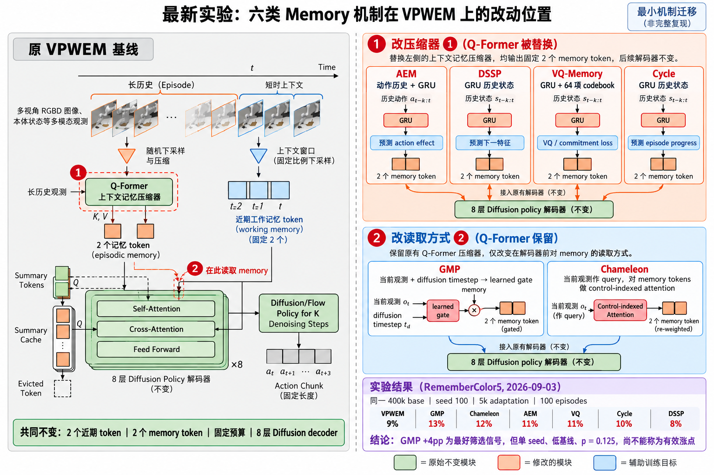
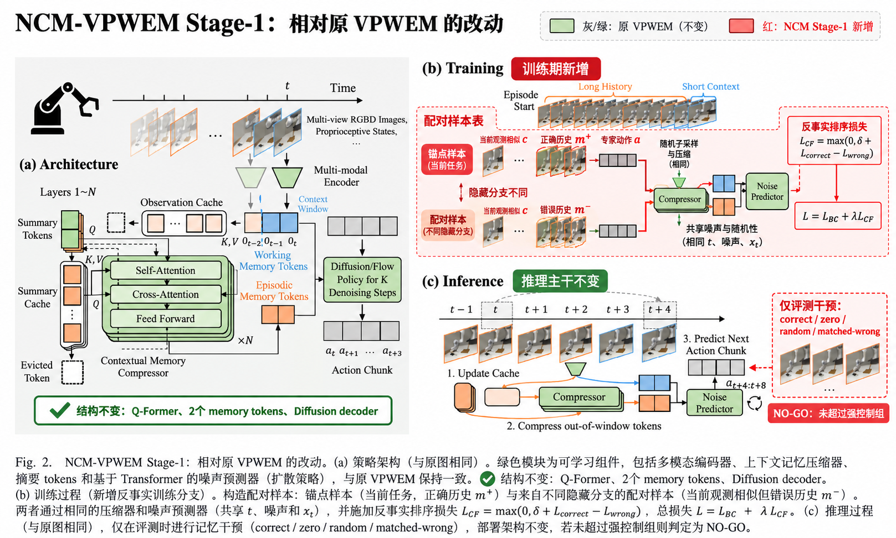

# VPWEM 最新六类 Memory 实验：结构改动图解

> 口径：按服务器正式实验目录的完成时间，最新一轮是 2026-09-03 的
> RememberColor5 六类 memory 最小机制迁移筛选。它晚于 NCM Stage-1，且不是六篇
> 原论文的完整复现。

## 1. 一句话结论

这轮实验没有重做整个 VPWEM，而是在两个接口做最小替换：

1. **替换历史压缩器**：AEM、DSSP、VQ-Memory、Cycle 用 recurrent memory
   替换 Q-Former，但仍输出固定 2 个 memory tokens；
2. **替换 memory 读取方式**：GMP、Chameleon 保留 Q-Former，只改变 diffusion
   decoder 读取两个 memory tokens 的方式。

近期观测分支、固定 token 预算、8 层 diffusion decoder、动作输出接口均保持一致。

## 2. 原 VPWEM 基线

原 VPWEM 把当前窗口之前的长历史交给 Q-Former/contextual memory compressor，压成
固定数量的 episodic memory tokens；最近两帧形成 working-memory tokens。两部分共同
条件化 diffusion policy 生成动作。

本轮共同协议是：同一个 400k base checkpoint、训练 seed 100、5k adaptation、同一组
100 个 RememberColor5 physical-hold episodes。因而它是低成本筛选，不是论文级充分验证。

## 3. 改动点 ①：替换 Q-Former 压缩器

| 方法 | 相对 VPWEM 的最小改动 | 训练辅助目标 | 输出契约 |
| --- | --- | --- | --- |
| AEM | 历史视觉 embedding 加入对齐的 action history，经 GRU 编码 | 预测相邻历史的 action effect | 固定 2 tokens |
| DSSP | 用 GRU 维护全历史状态 | 预测下一时刻 feature | 固定 2 tokens |
| VQ-Memory | 历史先离散到 64 项 codebook，再经 GRU | codebook + commitment loss | 固定 2 tokens |
| Cycle | 用 GRU 维护历史状态 | 预测归一化 episode progress | 固定 2 tokens |

这些版本真正改变的是原图中的 `Contextual Memory Compressor`。其后的 diffusion decoder
接口没有改变。

## 4. 改动点 ②：保留 Q-Former，只改变读取

| 方法 | 相对 VPWEM 的最小改动 | 直观含义 |
| --- | --- | --- |
| GMP | 用当前观测与 diffusion timestep 产生逐维 sigmoid gate，再乘到 memory embeddings | 当前控制状态决定“读多少记忆” |
| Chameleon | 当前观测作为 query，对 Q-Former memory tokens 做 multi-head attention，再与原 memory 融合 | 当前控制状态决定“读哪部分记忆” |

这两种方法不更换历史压缩器；变化发生在 memory tokens 送入 decoder 之前。

## 5. 实验结果及正确解读

| 方法 | Success | 相对 VPWEM |
| --- | ---: | ---: |
| VPWEM | 9% | 0 |
| GMP | 13% | +4pp |
| Chameleon | 12% | +3pp |
| AEM | 11% | +2pp |
| VQ-Memory | 11% | +2pp |
| Cycle | 10% | +1pp |
| DSSP | 8% | -1pp |

GMP 是这一轮最好的筛选点，但只有一个训练 seed，VPWEM 基线仅 9%，而且 GMP 与
VPWEM 的配对检验 `p=0.125`。因此当前只能说“GMP 值得在强基线任务上继续复验”，
不能说“新方法已经稳定提高 VPWEM”。

## 6. 与前一条 NCM 实验线的区别

NCM Stage-1 没有改变 Q-Former 或 decoder 结构；它在训练时新增 correct/wrong history
的 counterfactual ranking loss，并在评测时增加 correct、zero、random、matched-wrong
memory intervention。它是“改监督与评测协议”，而最新六类迁移是“改压缩器或读取器”。

