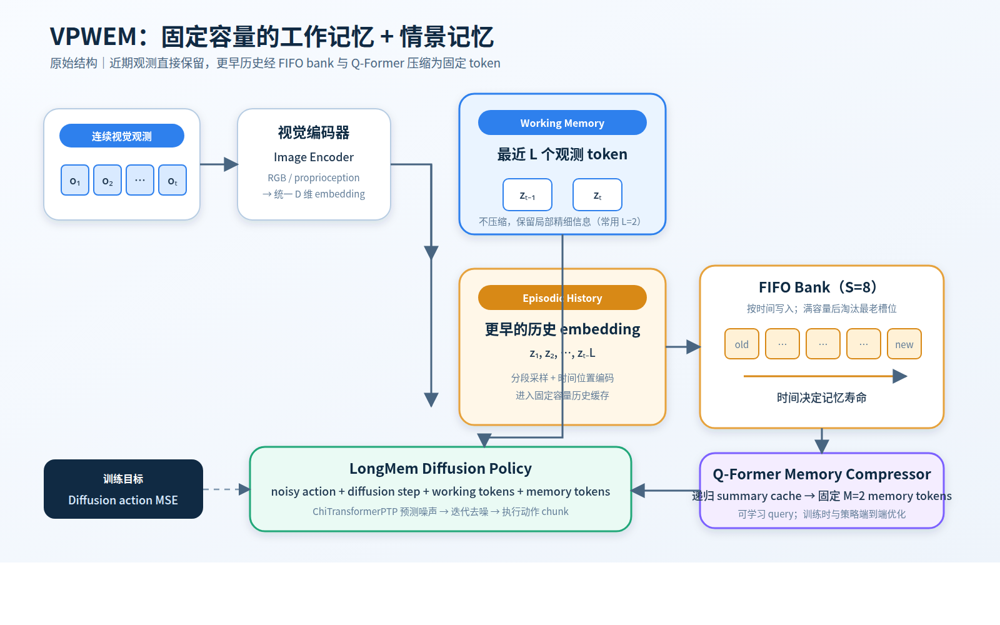

# VPWEM 零基础教程：阅读地图与学习目标

> 适合谁：会一点 Python，但不要求学过深度学习、Transformer 或 Diffusion Policy。
>
> 对应代码：当前工作区 `/home/wjr/code/vpwem`，核对日期 2026-09-10。
>
> 阅读方法：按 00 → 06 顺序。每章控制成一篇独立飞书文档的长度。

## 先知道最终答案

VPWEM 是一个“看图像、记历史、生成机器人未来动作”的网络。它不是单独一层，而是三个网络加一个训练外壳：

```text
观测 ──> ① Condition Encoder（把图像/状态变成 token）
                      │
            ┌─────────┴─────────┐
            │最近 To 帧          │更早历史
            ▼                    ▼
       Working Memory     ② QFormerMemory
       （直接保留）        （压成固定 Tm 个 token）
            └─────────┬─────────┘
                      ▼
              ③ LongMemChiTransformerPTP
              （给带噪动作去噪）
                      ▼
                 未来动作序列

训练和采样由 ④ LongMemDDPM 统一编排。
```



## 学完必须能做到的 7 件事

1. 看懂 `[B,T,C,H,W]`、`[B,T,D]`、`[B,Ta,A]`，不再把 `C/H/D` 混为一谈。
2. 用“查询—目录—内容”解释 Q/K/V，并能指出谁是 Q、谁是 K/V。
3. 说清 working memory、episodic memory、cache、memory token 的区别。
4. 沿真实源码讲出一次训练：样本切分 → 编码 → 压缩 → 加噪 → 预测 → loss。
5. 讲出 Q-Former 单层和动作 Transformer decoder 单层各做了什么。
6. 从 YAML 追到构造函数，知道一个数字究竟控制层数、宽度还是时间长度。
7. 修改网络后写出形状契约、最小测试和公平对照，不靠“先跑起来再说”。

## 六章路线与飞书入口

| 章节 | 解决的问题 | 读完产物 |
| --- | --- | --- |
| [01 地基](https://ccnuoe6sry36.feishu.cn/docx/XN8Zd3wXdoGTvTxtR4Pcr7Gvnth) | tensor、维度、token、Linear、QKV、残差是什么 | 能读层和形状 |
| [02 总架构](https://ccnuoe6sry36.feishu.cn/docx/SqiCdK3HHoStGvxHwxtcGkybnLc) | VPWEM 为什么拆成三块 | 能画总数据流 |
| [03 感知与记忆](https://ccnuoe6sry36.feishu.cn/docx/TByOdIbsVosS5rxVyQqc5B0Wnyd) | ResNet、cache、Q-Former 如何工作 | 能解释历史如何变成 Tm 个 token |
| [04 动作与扩散](https://ccnuoe6sry36.feishu.cn/docx/PW11driSFoqB7mxvUq2cj0VinYe) | PTP Transformer 和 DDPM 如何生成动作 | 能解释训练目标与两个 mask |
| [05 训练与推理](https://ccnuoe6sry36.feishu.cn/docx/VSiVdETdeof2bSx0dYecMaxtn6d) | 离线训练和在线 rollout 为什么不同 | 能追真实调用链 |
| [06 改网络](https://ccnuoe6sry36.feishu.cn/docx/G08MdjVNhoW1BdxZ5tqcz66wnZf) | 改哪里、同时改什么、如何验证 | 能安全做结构实验 |

## 全教程只用这一套形状字母

| 字母 | 含义 | 例子 |
| --- | --- | ---: |
| `B` | 一批样本数 batch size | 64 |
| `T` | 泛指时间长度 | 可变 |
| `To` | 最近观测数量，working memory 长度 | 2 |
| `Th` | 压缩前历史长度 | 0～16（按 batch 补齐） |
| `Tm` | 压缩后的 memory token 数 | 4 |
| `Ta` | 训练动作序列长度 | 9 |
| `A` | 单步动作维度 | 8 |
| `D` | token/embedding 宽度 | 256 |
| `C` | 图像通道数 | RGB 为 3 |
| `H,W` | 图像高、宽 | 如 128,128 |
| `L` | 网络层数；只在明确语境使用 | 如 decoder 8 层 |

本教程的主例子采用 `RememberColor5` 配置：`To=2, Tm=4, Ta=9, A=8, D=256`。

## 三条阅读纪律

- 看到变量先问“形状是什么”，再问“语义是什么”。
- `memory` 这个词在 PyTorch Transformer 中有时只是“decoder 的条件序列”，不一定指长期记忆；必须结合形状判断。
- 先分清“原始 VPWEM 基线”和后续实验扩展。`gated`、`control_indexed`、PER、直接空间历史、反事实 loss 都不是最小原始基线。

## 配套材料

- 需要更完整的论文、实验和证据边界时，再读 `docs/VPWEM_完全讲解_论文原理源码实验_飞书版.md`。
- 需要比较 No-History、VPWEM、Direct History 时，读 `docs/VPWEM历史架构与直接空间历史完整梳理_2026-09-09.md`。

---

下一篇：`01_先补地基_张量到QKV.md`
