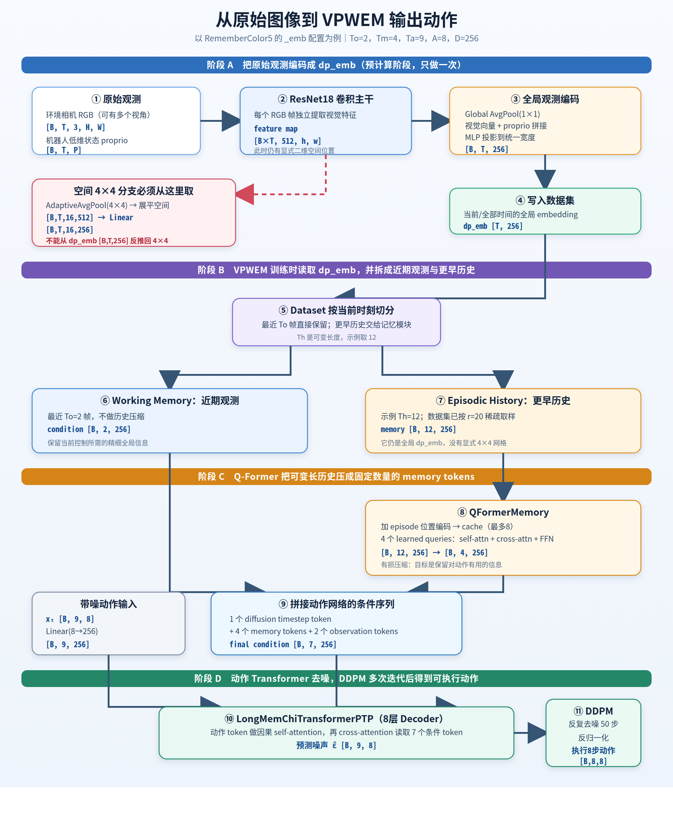

# 07 从原始图像到 VPWEM 动作：全流程图

> 这张图对应 `RememberColor5` 的 `_emb` 配置。按阶段 A → B → C → D 阅读。



## 看图时只抓住四件事

1. 原始 RGB 先经过 ResNet18，得到仍有空间轴的 feature map `[B×T,512,h,w]`。
2. 原配置随后进行全局池化并生成 `dp_emb [B,T,256]`；VPWEM 训练读取的是这个预计算结果。
3. 最近 `To=2` 帧直接保留，更早历史由 Q-Former 从可变 `Th` 压成 `Tm=4` 个 token。
4. `[1 timestep + 4 memory + 2 observation]` 组成 7 个条件 token，动作 Transformer 与 DDPM 最终生成 8 步、每步 8 维的动作。

## 红色虚线分支表示什么

真正的 4×4 空间池化必须接在 ResNet feature map 后面：

```text
[B,T,512,h,w]
    -> AdaptiveAvgPool2d(4,4)
    -> [B,T,512,4,4]
    -> 展平并投影
    -> [B,T,16,256]
```

已经得到的全局 `dp_emb [B,T,256]` 没有 `H/W` 空间轴，不能可靠地反推成 4×4 token。

可编辑矢量原图：`docs/assets/vpwem_beginner/raw_image_to_vpwem_action.svg`。
