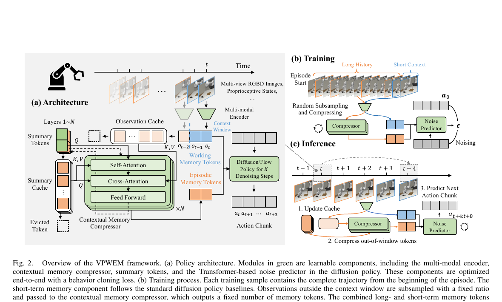
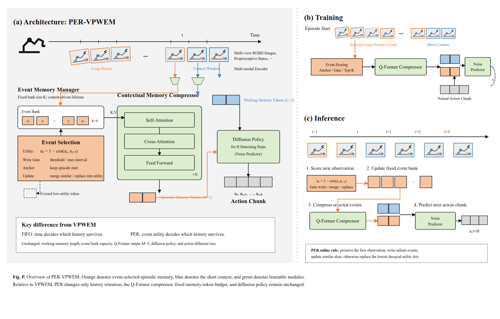

# VPWEM 与 PER-VPWEM 结构图（论文原图风格修订版）

## 1. 原始 VPWEM 结构

VPWEM 将观测历史分为两条路径：最近 `L` 个观测作为 working memory 直接进入策略；更早的历史写入容量为 `S` 的 FIFO bank，再由 Q-Former 压缩为固定 `M` 个 episodic memory tokens。两类 token 共同条件化 LongMem Diffusion Policy，预测并执行动作序列。

## 2. PER-VPWEM 结构

PER-VPWEM 不增加策略接收的 memory token 数，也不替换 Q-Former 或 diffusion policy。它只修改固定容量 memory bank 的管理方式：

1. 用相邻视觉 embedding 的 cosine delta 计算事件效用；
2. 保留 episode 起点 anchor；
3. 只有达到分数阈值或最长等待间隔时才写入；
4. 相似事件更新已有槽位；
5. bank 满时替换衰减效用最低的非 anchor 槽位。

## 3. 两者的核心差异

| 结构项 | VPWEM | PER-VPWEM | 是否改变 |
| --- | --- | --- | --- |
| Working memory | 最近 `L=2` 个观测 | 相同 | 否 |
| 历史 bank 容量 | `S=8` | `K=8` | 否 |
| 写入原则 | 按时间顺序写入 | 事件分数达到阈值或最长等待间隔写入 | **是** |
| 满容量淘汰 | 淘汰最老槽位 | 淘汰低效用非 anchor 槽位 | **是** |
| 起点保护 | 无显式保护 | 始终保留 episode 起点 | **是** |
| Q-Former | 压缩为 `M=2` tokens | 使用相同 Q-Former，仍为 `M=2` | 否 |
| Diffusion policy | LongMem ChiTransformerPTP | 相同 | 否 |
| 正式训练目标 | action diffusion MSE | action diffusion MSE | 否 |

一句话概括：**VPWEM 让“时间”决定哪些历史留下，PER-VPWEM 尝试让“视觉事件效用”决定哪些历史留下；压缩器与动作策略保持不变。**
