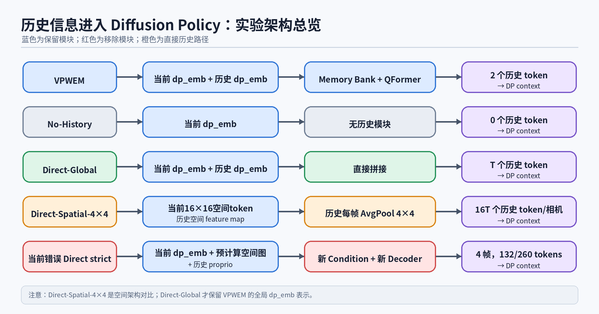
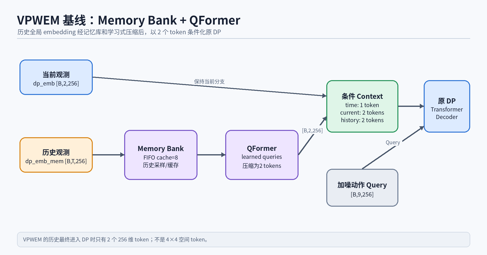
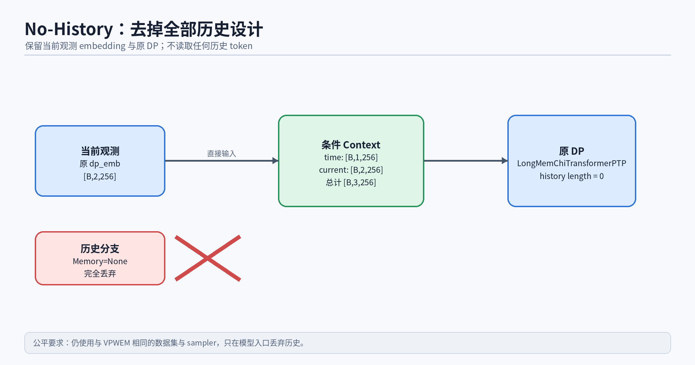
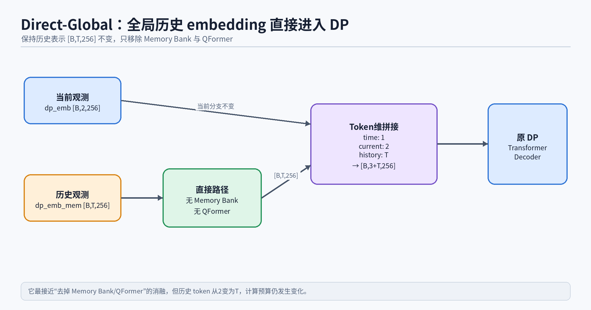
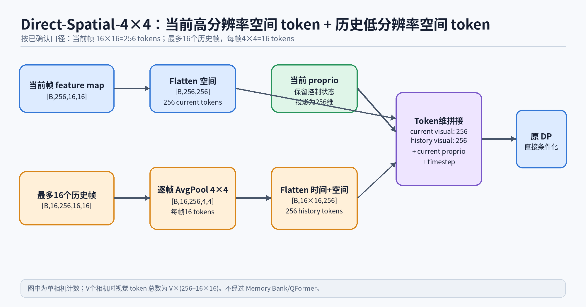
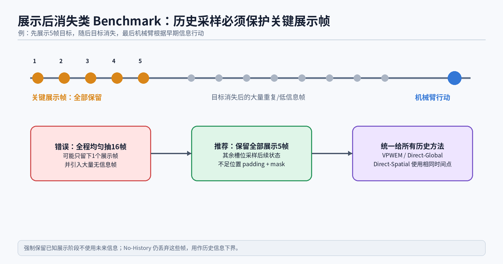
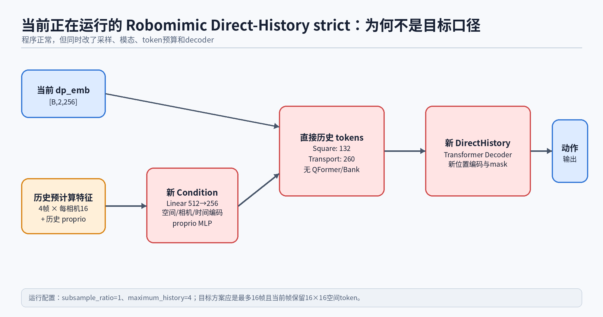

# VPWEM 历史架构与直接空间历史：完整网络流程和实验口径

> 更新时间：2026-09-09  
> 本文目的：把本次讨论涉及的 VPWEM、No-History、Direct-Global、Direct-Spatial-4×4、QFormer token 数对照，以及当前错误 Direct strict 的结构一次性分清楚。



## 一、首先统一三个容易混淆的概念

### 1. token 数不等于 embedding 维度

`[B,N,256]` 中：

- `B` 是 batch size；
- `N` 是 token 数；
- `256` 是每个 token 的特征维度。

因此，“256 个 token，每个 token 256 维”写成 `[B,256,256]`。前一个 256 是 token 数，后一个 256 是维度。

### 2. 动作长度 9 与历史 token 数无关

DP 的 noisy action Query 是 `[B,9,256]`；其中 9 是动作 horizon。当前视觉和历史视觉属于条件 Context，是 Transformer Decoder 的 Key/Value。两类序列不会直接拼成同一条 token 序列。

### 3. AvgPool 4×4 是空间池化，不是时间池化

对单帧空间特征：

```text
[B,256,16,16]
→ AdaptiveAvgPool2d(4,4)
→ [B,256,4,4]
→ flatten spatial
→ [B,16,256]
```

它表示每帧从 `16×16=256` 个空间位置压成 `4×4=16` 个空间位置；不是把历史压成4帧，也不是把256维压成16维。

## 二、DP Transformer 到底接收什么

DP 有两组输入：

```text
Noisy action Query: [B,9,256]
Condition Context:  [time token, current observation tokens, optional history tokens]
```

Transformer Decoder 用 action tokens 做 Query，用 condition context 做 Key/Value，输出 `[B,9,action_dim]` 的去噪预测。

不同实验的核心区别只应体现在 Context 如何构建；动作扩散流程、训练目标、action horizon、DP 层数等都应保持一致。

## 三、VPWEM 基线



当前代码中的 VPWEM 使用全局 embedding：

```text
当前观测：dp_emb [B,2,256]
历史观测：dp_emb_mem [B,T,256]
```

历史路径：

```text
dp_emb_mem
→ Memory Bank / FIFO cache
→ QFormer learned queries
→ [B,2,256]
```

最终 DP context：

```text
timestep             [B,1,256]
current dp_emb       [B,2,256]
QFormer history      [B,2,256]
--------------------------------
context              [B,5,256]
```

所以 VPWEM 最后接入 DP 的历史部分是2个256维 token，不是 `[B,T,16,256]` 的空间历史。

### VPWEM-QFormer-K 对照

讨论中提出“2个历史 token 可能太少”。这应当单独形成 QFormer 容量实验：

| 实验 | QFormer 输出历史 token 数 | 回答的问题 |
|---|---:|---|
| VPWEM-QFormer-2 | 2 | 当前基线 |
| VPWEM-QFormer-4 | 4 | 少量增加容量是否有效 |
| VPWEM-QFormer-8 | 8 | 与 cache 长度接近时效果如何 |
| VPWEM-QFormer-16 | 16 | 更高输出容量是否弥补信息瓶颈 |

改变 QFormer query 数时，其余历史采样、输入 embedding、训练配置必须不变。

## 四、No-History：完全去掉历史设计



No-History 保留当前 `dp_emb`，完全丢弃过去历史：

```text
current dp_emb [B,2,256]
→ 原 DP
```

DP context：

```text
timestep       [B,1,256]
current        [B,2,256]
-------------------------
context        [B,3,256]
```

它回答：没有任何历史信息时，任务性能是多少？

为了排除训练数据顺序差异，No-History 应继续使用与 VPWEM 相同的 LongMem dataset 和 sampler，只在模型入口丢弃 `dp_emb_mem`。当前正在运行的 Robomimic No-History 使用普通 shuffle，因此可以保留为系统级无历史下界，但若用于论文级严格单变量对照，最好按统一 sampler 重跑。

## 五、Direct-Global：全局历史 embedding 直接进入 DP



Direct-Global 保持 VPWEM 的历史表示不变：

```text
current dp_emb      [B,2,256]
history dp_emb_mem  [B,T,256]
```

只删除：

- Memory Bank；
- FIFO cache；
- QFormer；
- learned history compression。

直接构建：

```text
context = [timestep; current_dp_emb; history_dp_emb_mem]
shape   = [B,3+T,256]
```

它回答：保留相同的全局历史表示，取消 Memory Bank/QFormer 后会怎样？

这是最接近“去掉记忆模块”的消融。不过它仍把历史 token 数从 VPWEM 的2个增加为T个，所以计算预算发生变化。若要严格匹配 token 数，应增加 `Direct-Global-Pool2`：对同一组 `dp_emb_mem` 做无参数时间平均池化，固定输出2个 token。

## 六、Direct-Spatial-4×4：最终确认的目标结构



最终确认的口径不是“当前全局 dp_emb + 历史空间 token”，而是：

```text
当前帧：保留16×16完整空间特征，共256个token
历史帧：最多16帧，每帧池化成4×4，共16个token
当前与历史在token维拼接后输入DP
```

### 单相机张量流程

当前帧：

```text
current feature map  [B,256,16,16]
→ flatten
→ current tokens     [B,256,256]
```

历史帧：

```text
history feature map  [B,16,256,16,16]
→ per-frame AdaptiveAvgPool2d(4,4)
→                     [B,16,256,4,4]
→ flatten time + spatial
→ history tokens      [B,16×16,256]
→                     [B,256,256]
```

视觉 token 拼接：

```text
[current 256 tokens; history 256 tokens]
→ [B,512,256]
```

之后加入 timestep token 和当前机器人控制状态。历史 proprio 不应添加，以免改变历史模态定义；但当前 proprio/joint state 必须保留，否则机械臂缺少当前控制状态。

### 多相机 token 数

若有 `V` 个相机，并且每个相机都保留相同空间分辨率：

```text
visual token count = V × (256 + 16×16) = 512V
```

| 相机数 | 当前视觉 | 历史视觉 | 合计视觉 token |
|---:|---:|---:|---:|
| 1 | 256 | 256 | 512 |
| 2 | 512 | 512 | 1024 |
| 4 | 1024 | 1024 | 2048 |

### 256通道的实现说明

若 backbone 在全局池化前实际输出512通道，应加入共享的通道投影 `Linear/1×1 Conv(512→256)`，再形成256维 token。该投影只负责维度对齐，不进行时间选择，也不属于 Memory Bank。

### 与 VPWEM 的关系

Direct-Spatial-4×4 不经过 Memory Bank/QFormer，但它同时改变了历史表示、当前视觉表示和 token 数量。因此它是目标空间架构对比，不是严格的单模块消融。论文中应与 Direct-Global 同时报告，才能判断收益来自“取消记忆压缩”还是“保留空间信息”。

## 七、为什么不能把131个历史帧全部展开

如果单相机把131帧全部输入：

```text
current: 256 tokens
history: 131×16 = 2096 tokens
total:   2352 visual tokens
```

相机数增加后：

| 相机数 | 全部131帧时视觉 token |
|---:|---:|
| 1 | 2352 |
| 2 | 4704 |
| 4 | 9408 |

因此 Direct-Spatial 必须先做时间采样，最多选择16个历史帧，再做逐帧4×4空间池化。时间采样不是 Memory Bank；它是数据输入协议，不包含可学习记忆更新或压缩。

## 八、展示5帧后消失的 Benchmark



对于“先展示5帧目标，随后目标消失，最后机械臂行动”的任务，简单从131帧均匀抽16帧会有明显问题：关键前5帧可能只保留1帧，大量 token 却来自目标消失后的重复画面。

推荐协议：

```text
全部保留5个展示帧
+ 最多选择11个后续状态帧
= 最多16个历史帧
```

若后续视觉完全无信息，可以只保留5个展示帧：

```text
5 frames × 16 spatial tokens/frame = 80 valid history tokens/camera
```

batch 内其余位置使用 padding，并用 attention mask 屏蔽；不能复制展示帧凑满16帧，否则会人为增加其权重。

同一 benchmark 的 VPWEM、Direct-Global 和 Direct-Spatial 必须使用相同历史时间点：

```text
同一组历史帧
├─ VPWEM：global emb → Bank/QFormer → 2 tokens
├─ Direct-Global：global emb → direct T tokens
└─ Direct-Spatial：spatial map → 4×4 → 16T tokens/camera
```

No-History 则丢弃这些帧，作为历史信息下界。已知展示阶段是环境协议的一部分时，因果地保存已经出现过的前5帧不属于使用未来信息。

## 九、当前正在运行的错误 Direct strict 到底是什么



当前4个 Robomimic Direct-History strict 的实际流程是：

```text
current dp_emb [B,2,256]
+ 最多4帧历史预计算空间特征
+ 每帧每相机16个空间token
+ 每帧1个历史proprio token
→ 新 PrecomputedSpatialHistoryCondition
→ 新 DirectHistoryChiTransformerPTP
```

实际配置：

```text
dataset_memory_subsample_ratio = 1
dataset_maximum_memory_length = 4
history_pool_size = 4
nn_memory = None
```

其历史 token 数：

| 任务 | 相机数 | 每帧 token | 4帧总 token |
|---|---:|---:|---:|
| Square PH/MH | 2 | `2×16+1=33` | 132 |
| Transport PH/MH | 4 | `4×16+1=65` | 260 |

它与最终目标的主要差异：

| 部分 | 当前错误 Direct strict | 最终目标 Direct-Spatial |
|---|---|---|
| 当前视觉 | 全局 `dp_emb [B,2,256]` | 当前帧16×16，共256空间tokens/相机 |
| 历史帧数 | 最多4 | 最多16 |
| 历史采样 | ratio=1 | 与统一实验协议相同，并保护展示帧 |
| 历史 proprio | 加入 | 不加入 |
| decoder | 新 DirectHistory decoder | 尽量复用原 DP，仅扩展context长度/mask |
| 历史 token | Square 132 / Transport 260 | 每相机 `16×16=256` |

因此这些进程程序运行正常，但不能作为最终目标架构的结果。

## 十、推荐最终实验矩阵

### 必跑核心组

| 实验 | 当前输入 | 历史输入 | 历史输出规模 | 回答的问题 |
|---|---|---|---:|---|
| No-History | 原 current `dp_emb` | 无 | 0 | 无历史下界 |
| VPWEM-QFormer-2 | 原 current `dp_emb` | global `dp_emb_mem` | 2 | 当前VPWEM基线 |
| Direct-Global | 原 current `dp_emb` | global `dp_emb_mem` | T | 直接去掉Bank/QFormer的影响 |
| Direct-Spatial-4×4 | 当前16×16 spatial tokens | 历史4×4 spatial tokens | 16T/相机 | 直接空间历史架构效果 |

### 强烈建议的解释性对照

| 实验 | 作用 |
|---|---|
| VPWEM-QFormer-4/8/16 | 判断VPWEM是否受2-token瓶颈限制 |
| Direct-Global-Pool2 | 与QFormer-2进行相同历史token预算对比 |
| Direct-Spatial-TokenMatched | 判断空间版本提升是否仅来自更多token |

## 十一、公平性固定项

所有对比至少固定：

1. 数据集与 train/eval split；
2. 每个样本的历史候选时间点；
3. 最大历史帧数与展示阶段保留规则；
4. backbone来源、初始化与是否冻结；
5. embedding维度256；
6. 原 DP Transformer、动作 horizon 和扩散参数；
7. 有效 batch size、gradient steps、seed、scheduler；
8. checkpoint和配对评测episode seeds；
9. 同时报告成功率、历史token数、显存、训练速度和推理延迟。

## 十二、一句话总结

```text
VPWEM：历史全局emb → Memory Bank/QFormer → 2 tokens → DP
No-History：只有当前emb → DP
Direct-Global：历史全局emb不压缩，直接拼接 → DP
Direct-Spatial-4×4：当前16×16空间tokens + 16帧历史×每帧4×4空间tokens → DP
```

其中，Direct-Global 用来隔离 Memory Bank/QFormer 的作用；Direct-Spatial-4×4 用来验证最终想要的直接空间历史设计。两者必须同时存在，不能互相替代。
