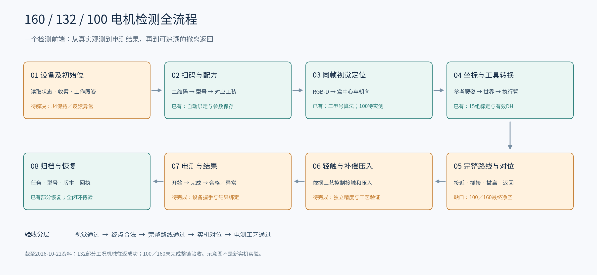

# 160／132／100电机机器人检测：全流程审查与解决方案

版本：2026-10-22，北京时间；用途：项目整体判断、后续实施和验收。本文追加既有飞书全流程报告，保留所有原始实验。**本轮完成的是全量资料和源码审查、问题重排及方案设计，没有运行新的机器人动作，也没有宣称以下建议已修复或已实测通过。**

## 一、先给结论：已经能做什么，距离目标还差什么

你的目标是让同一台机器人在工控机检测前端完成三型号的扫码、接线盒定位、对应工装对位、轻触与补偿压入、电气检测、撤离返回，并尽量使用同一工作腰姿。现阶段已完成大部分感知、坐标转换、运动控制和部分恢复链路；**132普通工况已有多次完整机械往返，160／100仍没有当前工位的完整验收，三个型号都没有完成电测闭环的证据。**

当前要优先解决四件事：

1. 查清腰J4下电后的保持／反馈异常，恢复可信且稳定的实际姿态。
2. 核实100／160的真实局部几何，统一终点、插接生成和最终CPU净空检查的要求。
3. 补100真实目标，在同一腰姿下取得三个型号的完整可执行去返路线，而非只取得终点解。
4. 用独立测量完成对位精度验收，再接通轻触、补偿压入和电测结果握手。

其中前两项可以并行：设备问题阻止新的受控运动验收，但不妨碍离线几何、坐标和规划审计。没有必要等设备修好才开始全部软件工作。

## 二、本次看过的范围与依据

- 本仓库85份机器人专题记录，共6559行，覆盖2026-10-12至10-22。按日期：12日3份、13日5份、14日1份、15日9份、17日10份、19日13份、20日12份、21日21份、22日11份。
- 既有飞书报告完整读取4290个块，其中2656个文本块、约14.2万字符；核对其独有补充与本地记录，保留后续更正。
- 本机索引中检出的44个相关历史会话、352条用户消息，追溯UR阶段到珞石迁移；混入的其他机器人、端盖／螺丝／力控课题不作为本项目能力证据。
- 统一源码`jinlong-motor-arm-control`本次HEAD为`829b9f7c9d18c7b1e6af5d1e7047d50ff8fdfa32`，工作树干净；结合`r435`历史项目和本仓库诊断脚本交叉核对。`r435`存在预存改动，未覆盖。
- 实时回读[Issue #14](https://github.com/thedaosheng/jinlong-motor-arm-control/issues/14)与[Issue #15](https://github.com/thedaosheng/jinlong-motor-arm-control/issues/15)，均为open。当前设备状态以最新现场读取为准；本文最后的物理证据来自22日已有记录，不冒充本轮实时SDK状态。

生产依赖和活动配置不全部内置于统一仓库；本机另有规划源码副本，本文没有重新执行生产仿真。8mm检查的运行结果来自已保存实验，源码审查确认了生成与最终复核的不同判据。不能把版本号、默认YAML或本次文档检查当作现场部署验收。

## 三、完整流程：从型号到电测结果



图1为本次整理的系统流程示意。绿色表示已有对应能力，橙色表示当前主要缺口；绿色不意味着所有型号和摆放均已验收。

| 阶段 | 系统实际要做的事 | 当前情况 |
|---|---|---|
| 设备与初始位 | 获取新鲜关节／报警／电源状态，确认可执行的收臂与工作腰姿 | 接口和监护已有；J4异常未闭环 |
| 扫码与选型 | QR、视觉型号、产品编码和工装一致，沿用前端保存参数 | 自动绑定已修；160真实扫码成功 |
| 同帧视觉 | RGB-D采集、外框／平面定位、朝向消歧、质量评估，输出`camera_T_box` | 方案5支持三型号；100当前同条件数据尚缺 |
| 坐标转换 | 从参考标定传播到固定世界相机，再转当前执行臂；绑定活动标定和有效DH | 已实现；跨腰姿精度需独立验证 |
| 工装与路线 | 选对应工装矩阵，换算法兰目标，求完整接近／插接／退出／返回并复核 | 132部分工况通过；100／160、倾斜132仍有缺口 |
| 执行与监护 | HMI唯一持有SDK，复核任务身份、反馈、心跳与速度，处理退出状态 | 已有多次机械循环；J4退出异常阻断新验收 |
| 接触与电测 | 轻触→按已确认补偿压入→电测开始／完成／结果握手 | 当前额外压入0，电测未连接，尚未交付 |
| 退出与追溯 | 原路撤离、返回初始位、保存结果和异常、基于可信停点恢复 | 部分复位已修；通用故障续检尚未实现并验收 |

HMI历史入口为`127.0.0.1:50168`，检测为`127.0.0.1:8765`，两者分工而非两个程序同时抢SDK。用户入口应是检测前端；临时诊断脚本和独立控制页不能替代最终产品流程。工装、补偿、限位和速度应直观常显，填写保存后持续有效到用户覆盖；简化重复确认，并逐按钮验证真实调用链和重启后的参数消费。

## 四、必须固定的坐标链和型号参数

### 4.1 坐标定义

`A_T_B`把B系坐标变换到A系。齐次矩阵平移用米；界面位置用毫米；模型关节角用弧度。盒原点是四角孔矩形中心；物理LT→RT为+X、LT→LB为+Y，+Z=X×Y。靠接地螺丝的孔边用于物理上边消歧；画面上边不自动等于物理上边。外框推导出的角点不能冒充实测孔中心。

外置固定相机的正确传播为：

```text
W_T_C       = W_T_L(reference_waist) × Lref_T_C
W_T_box     = W_T_C × C_T_box
Lnow_T_box  = inverse(W_T_L(current_waist)) × W_T_box
W_T_flange  = W_T_box × box_shift
              × inverse(TCP_T_fixture_adjusted)
              × inverse(flange_T_TCP)
```

旧UR链通常输出TCP目标；珞石完整规划输出法兰目标，所以末项逆变换有明确用途。不能将示教器实时TCP直接等同于盒体中心，也不能把旧腰姿下的`base_T_box`直接送入新腰姿。腰J2模型角比控制器原始角多π/2，模型四轴数组不能直接下发SDK。

源码依据：统一仓库`arm_control/helios_hmi/kinematic_reference.py`、`controller_kinematics.py`，以及`vision/app/hk_pointcloud_registration/robot/corridor_worker.py`。动态观察标定和世界坐标重投影已存在；`waist_alignment=false`不能单独证明所有新腰姿都不支持。

### 4.2 当前证据中的参数基线

| 项目 | 本次应采用的事实 | 不能误读为 |
|---|---|---|
| 手眼 | 15组ANDREFF，活动SHA `e8a7ee509c0764c6214df5d424f40d1f93f28e0d02232443a322ffdb8d2d2c9b` | 旧会话名仍在，所以仍是7组PARK |
| 运动学 | 规划采用控制器有效DH，摘要`75a9fc3ace6fbe874b17d71b34896a4393f6ef0d5d7e2e074a53ed06600bf3a9` | 重新辨识或改写控制器DH |
| 工具安装 | 当前真实安装按`Rz(-90°)`处理 | 为恢复旧仿真回退到−120° |
| 100 | 原工装矩阵，额外工具Z补偿−18mm | 把盒体高度差一起扣入工具补偿 |
| 132 | 原矩阵的29.23mm保留，额外Z补偿已改0 | 将原工具高度全部清零，或继续按默认YAML的−22mm |
| 160 | 原工装矩阵，盒局部X补偿−2mm | 沿世界X任意平移2mm |
| 方案编号 | 当前源码4=`rokae_depth_multiplane`（100／132），5=`rokae_depth_fast_recovery`（三型号） | 10月13日一处文档所写4=fast、5=icp |

原始工装矩阵的平移／绕Z旋转分别为：100 `[89.25,0,29.23]mm / 0°`；132 `[-43.75,75.78,29.23]mm / 120°`；160 `[-58.97,-102.15,55.23]mm / 60°`。额外补偿与原矩阵分开管理；这些数值是理解现有配置的基线，不是未经现场核对即可写入的指令。

## 五、三型号现状与证据层级

| 型号／工况 | 视觉与终点 | 完整机械运动 | 独立精度与电测 |
|---|---|---|---|
| 132普通工况 | 已成功 | 19日完整循环；20日3轮共78步；21日修复后20目标、新视觉22目标循环成功 | 尚未形成独立量具精度验收；没有电测通过证据 |
| 132倾斜约13.65° | 视觉成功、合法终点 | 扩展搜索600秒仍未得到完整通路，见#14 | 未验收 |
| 160 | 真机扫码定位成功；共用候选有合法终点 | 最新实际腰姿未找到合格终点；候选腰姿仍无合格完整路线 | 未验收 |
| 100 | 软件接入；按估计盒位有合法终点 | 当前候选末端未过最终CPU检查；缺同条件真实采集 | 未验收 |

20日三轮复用了同一次视觉结果，且版本条件不同，证明的是相应条件下的运动重复性。21日新视觉成功增加了新观测下的机械证据，但仍不是全部工作区或电测验收。


图2沿用既有实测图。不能用它证明绝对定位误差为零，也不能证明22日新的腰姿没有下电异常。

## 六、当前问题与具体解决方案

### P0：J4下电保持／反馈异常，先恢复可信状态

22日进入共用腰姿的执行只完成左臂收回及部分腰轴动作，J1尚未执行。末段退出日志有116帧下电状态，J4仍从约−2.14592变至−2.37906rad，末帧速度约−0.04154rad/s；最终`SAFE_EXIT_UNCONFIRMED`，锁存为true。随后J4约−143.274°，偏候选约20.358°；后续记录约−158.32°，中间有一次未解释的−122.873°、body on单帧。用户明确说没有调整。

这证明保持／状态链存在必须解决的异常，**尚不能确诊是抱闸、驱动、电源、控制顺序还是反馈映射问题**。此前19日原厂界面手动下电也记录到位移，因此不能仅归咎自研退出逻辑。头部伺服历史报警31015／0x3110、安全板配置提示35654及身体上电−514需分别追踪，不能直接当作本次J4根因。

解决步骤与交付：

1. 电控／厂家与软件共同对齐同一时间基准的q、qd、电源请求／实际状态、伺服使能、抱闸实际信号、退出阶段、原始报警；确认J2偏置和power枚举语义。
2. 在厂家认可的受控条件下区分“真实转动”与“反馈跳变”，对照原厂监控、SDK及独立位置观察；保留当前负载和候选姿态条件。
3. 针对证实原因修复，再验正常退出、异常停止及下电保持。通过条件是按设备规定的保持能力和事先确定容差满足要求，退出回执与实际状态一致；不能只凭静止5秒或某次清警成功关闭问题。

不得靠清锁循环重试、增大被动轴速度阈值、扩大到位容差或长期保持上电掩盖异常。以上是下一步实施方案，本轮未执行这些设备试验。

### P1：100／160的局部几何与最终净空不一致

已找到三型号同用的候选模型腰角：`[-25.507413,15.901926,35.563485,-122.916206]°`。100盒位来自132沿世界Z降低100mm，依据用户40／35／25按cm理解，XY和姿态继承132；这是研究估计，不能视为100实测。

| 型号 | 终点模型间隙 | 最差配对 | 30mm局部生成 | 生产最终CPU关节线复核 |
|---|---:|---|---|---|
| 160 | 5.022920mm | 工具针／盒壁：`tool_pin_JM160 / box_wall_ny` | 成功 | 失败，低于8mm |
| 132 | 9.994119mm | 端子／工具凸台 | 成功 | 通过，12检查帧 |
| 100 | 4.230037mm | 盒壁／末端连杆：`box_wall_nx / AR5-5_07L_link7` | 成功 | 失败，低于8mm |

终点当前使用≥0mm规则；局部生成采用局部净空floor；最终`cr.check_line`仍套8mm。接触配对白名单已有实现，但这两个失败配对没有被豁免。**既不是完全没有接触规则，也不是已经可以执行。**

一个直接影响解决方向的工程推论：固定盒位、工装关系和最终法兰目标后，160工具针相对盒壁的位置固定；源码的link7到TCP也是固定末段，因此100的上述局部间隙同样基本固定。仅换腰／肘冗余分支通常不能把这两对4／5mm变成8mm；冗余分支仍可改善上游连杆、相机干涉及途中通路。依据为`Wheel_Robot.urdf`中的`AR5-5_07L_tcp_joint`固定关节及`controller_kinematics.py`的第8行固定DH；仍应在生产模型核对具名碰撞体挂载，以两个不同冗余解交叉核验距离。该判断以当前刚性模型和固定目标为前提，不是实物测量结论。

建议按以下顺序处理：

1. **测几何并分型号建模。** 对100／132／160分别核实盒内外轮廓、开口、壁厚、端子高度、工具针和本体包络、法兰安装、TCP。优先查160盒壁是否错误覆盖真实开口，以及100盒壁与link7是否真实接近；复核−18mm和−2mm补偿。
2. **在搜索入口提前应用最终必要条件。** 已有诊断脚本支持生产30mm复核；生产候选筛选也应在昂贵全路线搜索前拒绝最终非接触配对不达8mm的候选，并输出具体配对。保留最后的CPU检查，避免反复给出注定失败的“合法终点”。
3. **让各层采用同一阶段与配对策略。** 终点、局部跟踪、离散化和最终复核共用明确规则。普通自由空间／中转原有10／20mm等要求分别保留；最终非配合件8mm也保留。仅真正配合的针／端子可按已确认接触模型处理，不能把100 link7／盒壁或160针／盒壁随意加入豁免。
4. **模型正确仍不足时改物理方案。** 在实物与定位误差预算支持下调整工具几何、安装或允许的相对对位姿态；若确需阶段特定净空，必须给测量依据和验收边界，再统一实现。不能全局降至0／4／5mm来消除报错。

以上为待实施方案，未在本轮改动生产代码或门限。旧共用腰姿在旧−120°安装下确能复现三终点；控制变量实验表明改真实−90°足以重现160失败。应保留真实安装，重新验证共同方案，不能回滚错误角度。

### P1：区分实际腰姿、候选腰姿与完整通路

| 对照 | 已有结果 | 含义 |
|---|---|---|
| 实测J4约−158.289° | 独立780次调用、171次收敛，无合法终点；一个候选相机禁入模型侵入约66.828mm | 这是模型碰撞问题，不是5mm和8mm的差值 |
| 候选J4=−122.916° | 独立审计有合法终点，最新约5.022651mm；生产完整规划仍失败 | 有终点，但仍无可执行路线 |
| 132倾斜约13.65° | 合法终点；搜索预算600秒耗尽，无完整通路 | 不能与普通132已成功或160失败混为一谈 |


图3沿用22日已有离线图：相机禁入区／link4模型干涉。它不是实物碰撞照片，也不是成功路径动画。

解决方案是把“共用腰姿”升级为完整路线验收目标：同一个腰姿下，三个真实目标都需通过终点、法向接近、外侧通道、撤离返回；再验证实际起点进入共同腰姿和换型调姿。候选排序同时考虑最差型号净空、限位余量、腕部、腰部进入代价，而非只优化某一型号终点残差。

对132倾斜，继续核查法向接近途中腕部／肘高／相机限制与空旷调姿区；已有按型号端子选择及普通IK分支修复，不能重复当作新方案。生产与独立审计的种子、边界和求解顺序不同，应保存相同输入和种子清单后对照。一次0解只是该轮未找到；“收敛次数”也不是唯一分支数或路线数。

### P2：独立精度、轻触与电测闭环

历史约3mm局部Y偏差不能直接归于当轮腰滑移：对应往返记录中的腰变化影响约0.02mm；有效DH修正、新15组标定与关节到位残差各有不同方向和口径，不能简单相加。SDK笛卡尔getter接近指令关节FK，不能充当独立实物量具。新标定内部离散、视觉平面RMSE和IK残差都不是最终工装对位精度。

建议先固定型号、盒体、腰姿及相机，测“自动停稳位－正确人工／量具对位”的盒局部XYZ和姿态误差；记录上电、停止、下电阶段，确认误差是否随工装旋转或固定于空间。再用未参与标定且覆盖作业区的非共线点验证外参，必要时用执行左臂在目标工作腰姿补标定，减少跨臂／腰部传播依赖。先找误差来源，再决定外参、TCP、机械或模型修正，不直接追加3mm补偿。

轻触／压入本来就是用户目标，当前`additional_press_mm=0`、`electrical_test_connected=false`说明仍缺工艺闭环。最近已执行路线按名义零间隙对位计算；元数据中的历史约4mm观察间隙没有作为当前自动退让量，不能把它当作执行保护距离。应把机械到位事件和电测开始、完成、合格／不合格、超时绑定同一任务和QR；建立接触／压入的工艺依据及异常撤离，并核实旧设备接口是否可复用。停留20秒只是一段机械等待，不能充当电测结果；其他项目的力控搜孔能力不能当作本工位已有能力。

## 七、哪些旧问题已修，哪些仍需保留

| 历史问题／表述 | 本版结论 |
|---|---|
| 各段名义起点不同造成接缝 | 已统一实际起点，后续实机循环通过 |
| 示教记录不匹配、无法启动 | 保存入口已补；历史记录改为可选，不能继续列当前主阻塞 |
| QR与人工工装不一致 | 自动绑定已实现；不等于三型号物理验收 |
| 检测位不能撤离、重复生成／重启丢来源 | 对应场景已修；通用故障续检尚未形成生产功能，不能将特定辅助返回等同续检 |
| 左臂速度监测误停 | 调整后新22目标循环通过；不覆盖腰部被动保持异常 |
| 全程仍用7组、名义DH | 已切15组及有效DH；独立精度仍待验 |
| 整个右边框完全没有深度 | 应准确说算法预测恢复边缺少拟合平面支撑；不能无依据否定全部真实边 |
| 相机超时／曝光不一致 | 重建采集、重写保存参数后恢复过；长期一致性及根因尚需回归 |
| 每小步都12秒冷却 | 原生已是1秒且支持连续段；readiness旧文案／相关测试需统一 |
| 三型号有共同终点即适配完成 | 100／160最终CPU未过，完整进场及去返仍未完成 |

## 八、实施顺序与完成标准

| 阶段 | 负责人类型 | 交付物 | 完成标准 |
|---|---|---|---|
| A 设备与状态链 | 厂家电控＋执行软件 | 同步日志、原因定位、修复记录 | 负载／工作姿态下保持及退出符合设备规范，反馈可信 |
| B 三型号真实基线 | 视觉＋机械 | 三组新`camera_T_box`、实测尺寸、安装／工具参数及版本 | 100不再只用高度估计；目标和碰撞模型一致 |
| C 统一规划判据 | 规划 | 同阶段／配对规则、失败分类、种子复现、完整候选 | 三型号同腰姿完整CPU路线通过；非配合件不误豁免 |
| D 独立无接触精度 | 计量＋集成 | 多点多次XYZ／角度偏差、过程漂移 | 达到依据真实配合间隙确定的工艺容差；容差未确定前不宣称合格 |
| E 轻触／压入／电测 | 工艺＋电测＋软件 | 检测握手、结果、超时及撤离逻辑 | 真正读到电测结果，合格／不合格／超时可区分且关联任务 |
| F 连续与异常验收 | 集成＋现场 | 连续三型号循环、切换、暂停／故障回归、参数持久化、逐按钮检查及节拍 | 一前端完成，无临时脚本接力；按已实现并验证的恢复策略退出或续检 |

每条验收记录至少保存：型号／QR、视觉task_id、原始`camera_T_box`、实际腰姿与时间戳、标定／工具／有效DH／代码摘要、路线ID、各阶段状态、独立测量、电测结果及异常退出。建议正常工况先各做至少5次独立重新采集循环用于诊断，再按正式工艺确定覆盖范围和样本量；5次只是起始建议，不是统计可靠性认证。

后续优化节拍应在上述能力稳定后进行，分别统计采集、规划、换型调姿、运动、检测等待和退出时间；不靠取消检查或隐去失败来缩短节拍。旧UR的速度诉求不能直接成为珞石的新限速。

## 九、后续可直接恢复的资料入口

已将用户目标、坐标约定、当前版本、已修／未修状态和优先级保存到[长期上下文入口](jinlong_project_context.md)，并在仓库AGENTS.md加入必读入口。后续工作可从此继续，不依赖记住当前聊天，也不将历史设备快照视为最新状态。

关键原始报告（路径用于源码核对，不冒充飞书附件）：

| 主题 | 本仓库记录 |
|---|---|
| 安装与坐标链 | `docs/jinlong_installation_chain_validation_20261020.md`、`docs/taizhou_controller_kinematics_alignment_20261020.md` |
| 新标定与精度来源 | `docs/jinlong_calibration15_switch_and_inspection_attempt_20261020.md`、`docs/jinlong_inspection_error_sources_and_remedies_20261020.md` |
| 已成功机械循环 | `docs/jinlong_three_round_repeatability_20261020.md`、`docs/jinlong_shared_planning_anchor_execution_20261021.md`、`docs/jinlong_reset_redetect_20261021.md` |
| 三型号共同方案 | `docs/jinlong_common_waist_regression_20261022.md`、`docs/jinlong_shared_waist_current_20261022.md` |
| J4与最新实际腰姿 | `docs/jinlong_shared_waist_entry_route_20261022.md`、`docs/jinlong_current_waist_reachability_20261022.md` |
| 倾斜132 | `docs/jinlong_tilted_motor_expanded_search_20261021.md`、`docs/jinlong_tilted_motor_route_issue_20261021.md` |

飞书保留旧正文、原图与附件，本版补充系统全貌、纠正过时判断并明确实施和验收边界。本轮新增流程图，沿用两张历史证据图；未生成新的实机实验数据。
