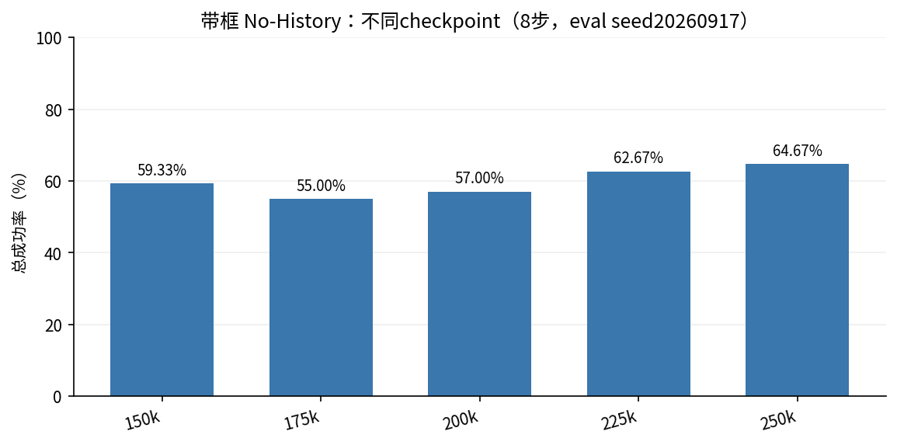
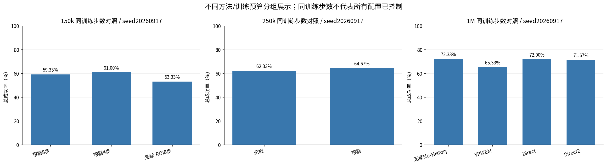
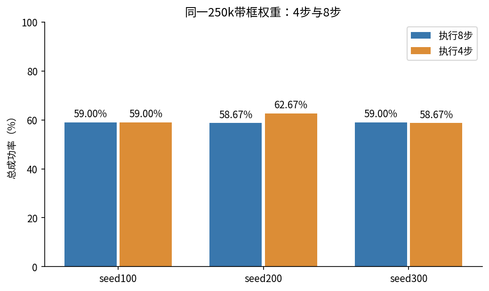
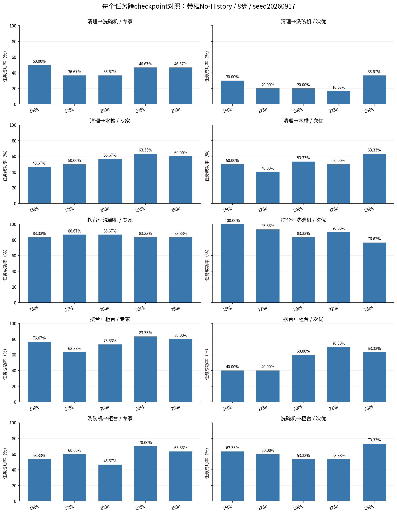

# MoMaRT 实验结果重整：按checkpoint归并

历史分项编排，已按用户纠正撤下展示。当前仅总成功率版见 `docs/momart_total_success_20261029.md` 和[飞书](https://feishu.cn/docx/A4mVdzwCZovWOlxKxXNci1fynze)。

原始结果核验时间：2026-10-29T15:25:53.033621+08:00。全部表格仅显示成功率（%），不列成功次数、奖励、方差或GPU日志。每个配置包含相同十个任务配置；总成功率按全部回合汇总，各任务等量，因此也等于十项均值。

同一训练步数的结果归入一张表；不同权重仍单列方法标签，不能把“同为250k”当作同一个权重。s表示评测seed；带框模型训练seed均为100。所有历史快照和失败过程保留在原审计报告，本页只展示当前完整成绩。

## 总体柱状图

四步三seed总体60.11%，八步三seed总体58.89%，差1.22个百分点。八步seed100取R1一次参与跨seed平均，R2/R3不重复加权；三个R的成功标志完全一致。这个结果不证明显著稳定优势。

## 每个checkpoint的统一表格

每表行是任务，列是该训练步数下的全部方法/执行步数/评测seed，最后一行是总成功率。250k的R3含原GPU6八项与GPU0补齐两项。

### 150k

| 任务 / 成功率% | 带框·8步·s20260917 | 带框·4步·s20260917 | 带框+坐标/ROI·8步·s20260917 |
|---|---|---|---|
| 清理→洗碗机 / 专家 | 50.00 | 43.33 | 43.33 |
| 清理→洗碗机 / 次优 | 30.00 | 20.00 | 0.00 |
| 清理→水槽 / 专家 | 46.67 | 46.67 | 56.67 |
| 清理→水槽 / 次优 | 50.00 | 30.00 | 43.33 |
| 摆台←洗碗机 / 专家 | 83.33 | 80.00 | 86.67 |
| 摆台←洗碗机 / 次优 | 100.00 | 90.00 | 73.33 |
| 摆台←柜台 / 专家 | 76.67 | 93.33 | 73.33 |
| 摆台←柜台 / 次优 | 40.00 | 63.33 | 43.33 |
| 洗碗机→柜台 / 专家 | 53.33 | 63.33 | 63.33 |
| 洗碗机→柜台 / 次优 | 63.33 | 80.00 | 50.00 |
| **总成功率** | **59.33** | **61.00** | **53.33** |

### 175k

| 任务 / 成功率% | 带框·8步·s20260917 |
|---|---|
| 清理→洗碗机 / 专家 | 36.67 |
| 清理→洗碗机 / 次优 | 20.00 |
| 清理→水槽 / 专家 | 50.00 |
| 清理→水槽 / 次优 | 40.00 |
| 摆台←洗碗机 / 专家 | 86.67 |
| 摆台←洗碗机 / 次优 | 93.33 |
| 摆台←柜台 / 专家 | 63.33 |
| 摆台←柜台 / 次优 | 40.00 |
| 洗碗机→柜台 / 专家 | 60.00 |
| 洗碗机→柜台 / 次优 | 60.00 |
| **总成功率** | **55.00** |

### 200k

| 任务 / 成功率% | 带框·8步·s20260917 |
|---|---|
| 清理→洗碗机 / 专家 | 36.67 |
| 清理→洗碗机 / 次优 | 20.00 |
| 清理→水槽 / 专家 | 56.67 |
| 清理→水槽 / 次优 | 53.33 |
| 摆台←洗碗机 / 专家 | 86.67 |
| 摆台←洗碗机 / 次优 | 83.33 |
| 摆台←柜台 / 专家 | 73.33 |
| 摆台←柜台 / 次优 | 60.00 |
| 洗碗机→柜台 / 专家 | 46.67 |
| 洗碗机→柜台 / 次优 | 53.33 |
| **总成功率** | **57.00** |

### 225k

| 任务 / 成功率% | 带框·8步·s20260917 |
|---|---|
| 清理→洗碗机 / 专家 | 46.67 |
| 清理→洗碗机 / 次优 | 16.67 |
| 清理→水槽 / 专家 | 63.33 |
| 清理→水槽 / 次优 | 50.00 |
| 摆台←洗碗机 / 专家 | 83.33 |
| 摆台←洗碗机 / 次优 | 90.00 |
| 摆台←柜台 / 专家 | 83.33 |
| 摆台←柜台 / 次优 | 70.00 |
| 洗碗机→柜台 / 专家 | 70.00 |
| 洗碗机→柜台 / 次优 | 53.33 |
| **总成功率** | **62.67** |

### 250k

| 任务 / 成功率% | 无框·8步·s20260917 | 带框·8步·s20260917 | 带框·8步·s100·R1 | 带框·8步·s100·R2 | 带框·8步·s100·R3 | 带框·8步·s200 | 带框·8步·s300 | 带框·4步·s100 | 带框·4步·s200 | 带框·4步·s300 |
|---|---|---|---|---|---|---|---|---|---|---|
| 清理→洗碗机 / 专家 | 43.33 | 46.67 | 43.33 | 43.33 | 43.33 | 36.67 | 46.67 | 56.67 | 53.33 | 46.67 |
| 清理→洗碗机 / 次优 | 33.33 | 36.67 | 26.67 | 26.67 | 26.67 | 30.00 | 13.33 | 30.00 | 36.67 | 23.33 |
| 清理→水槽 / 专家 | 66.67 | 60.00 | 66.67 | 66.67 | 66.67 | 60.00 | 53.33 | 50.00 | 53.33 | 43.33 |
| 清理→水槽 / 次优 | 66.67 | 63.33 | 46.67 | 46.67 | 46.67 | 56.67 | 50.00 | 60.00 | 60.00 | 53.33 |
| 摆台←洗碗机 / 专家 | 90.00 | 83.33 | 90.00 | 90.00 | 90.00 | 86.67 | 90.00 | 83.33 | 73.33 | 73.33 |
| 摆台←洗碗机 / 次优 | 83.33 | 76.67 | 83.33 | 83.33 | 83.33 | 83.33 | 90.00 | 86.67 | 86.67 | 83.33 |
| 摆台←柜台 / 专家 | 80.00 | 80.00 | 56.67 | 56.67 | 56.67 | 70.00 | 66.67 | 60.00 | 76.67 | 66.67 |
| 摆台←柜台 / 次优 | 50.00 | 63.33 | 53.33 | 53.33 | 53.33 | 40.00 | 70.00 | 53.33 | 46.67 | 63.33 |
| 洗碗机→柜台 / 专家 | 50.00 | 63.33 | 66.67 | 66.67 | 66.67 | 60.00 | 50.00 | 56.67 | 70.00 | 63.33 |
| 洗碗机→柜台 / 次优 | 60.00 | 73.33 | 56.67 | 56.67 | 56.67 | 63.33 | 60.00 | 53.33 | 70.00 | 70.00 |
| **总成功率** | **62.33** | **64.67** | **59.00** | **59.00** | **59.00** | **58.67** | **59.00** | **59.00** | **62.67** | **58.67** |

### 1M

| 任务 / 成功率% | 无框No-History·8步·s20260917 | VPWEM·8步·s20260917 | Direct·8步·s20260917 | Direct2·8步·s20260917 |
|---|---|---|---|---|
| 清理→洗碗机 / 专家 | 53.33 | 63.33 | 63.33 | 60.00 |
| 清理→洗碗机 / 次优 | 40.00 | 13.33 | 20.00 | 30.00 |
| 清理→水槽 / 专家 | 73.33 | 70.00 | 73.33 | 60.00 |
| 清理→水槽 / 次优 | 66.67 | 33.33 | 86.67 | 70.00 |
| 摆台←洗碗机 / 专家 | 93.33 | 83.33 | 96.67 | 90.00 |
| 摆台←洗碗机 / 次优 | 96.67 | 80.00 | 93.33 | 96.67 |
| 摆台←柜台 / 专家 | 93.33 | 100.00 | 93.33 | 96.67 |
| 摆台←柜台 / 次优 | 60.00 | 76.67 | 70.00 | 80.00 |
| 洗碗机→柜台 / 专家 | 83.33 | 80.00 | 66.67 | 63.33 |
| 洗碗机→柜台 / 次优 | 63.33 | 53.33 | 56.67 | 70.00 |
| **总成功率** | **72.33** | **65.33** | **72.00** | **71.67** |

## 各任务跨checkpoint对照

固定带框No-History、执行8步、eval seed20260917；每行可横向比较同一个任务的不同checkpoint，每列可纵向比较不同任务的对应checkpoint。

| 任务 / 成功率% | 150k | 175k | 200k | 225k | 250k |
|---|---|---|---|---|---|
| 清理→洗碗机 / 专家 | 50.00 | 36.67 | 36.67 | 46.67 | 46.67 |
| 清理→洗碗机 / 次优 | 30.00 | 20.00 | 20.00 | 16.67 | 36.67 |
| 清理→水槽 / 专家 | 46.67 | 50.00 | 56.67 | 63.33 | 60.00 |
| 清理→水槽 / 次优 | 50.00 | 40.00 | 53.33 | 50.00 | 63.33 |
| 摆台←洗碗机 / 专家 | 83.33 | 86.67 | 86.67 | 83.33 | 83.33 |
| 摆台←洗碗机 / 次优 | 100.00 | 93.33 | 83.33 | 90.00 | 76.67 |
| 摆台←柜台 / 专家 | 76.67 | 63.33 | 73.33 | 83.33 | 80.00 |
| 摆台←柜台 / 次优 | 40.00 | 40.00 | 60.00 | 70.00 | 63.33 |
| 洗碗机→柜台 / 专家 | 53.33 | 60.00 | 46.67 | 70.00 | 63.33 |
| 洗碗机→柜台 / 次优 | 63.33 | 60.00 | 53.33 | 53.33 | 73.33 |
| **总成功率** | **59.33** | **55.00** | **57.00** | **62.67** | **64.67** |

## 阅读口径

相同checkpoint表中的不同方法可能有不同数据处理、batch和输入结构；尤其1M VPWEM使用预计算embedding，其他基线使用原始图像。250k无框与带框是否完全公平仍需对照训练配置，不能仅凭步数相同归因于画框。不同seed只在各自标注的列比较；不要将1M无框与150k带框当作同预算对照。

250k四步/八步使用同一带框权重、旧combined_blend检测器、相同计分规则；都未应用reset补帧修复。所有恢复结果现已完整，旧OOM及未启动状态不再作为当前结果展示。

数据来源：本次重新读取所有已列原始result.npy。生成脚本：`tools/reorganize_momart_results_20261029.py`。原始证据：`artifacts/momart_reorganized_20261029/evidence.json`（不提交Git）。

飞书重整版：https://feishu.cn/docx/A4mVdzwCZovWOlxKxXNci1fynze
