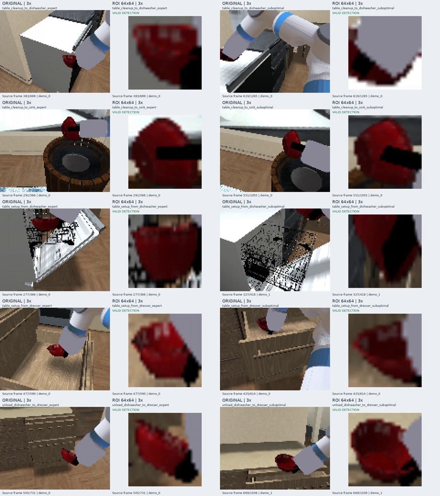

# MoMaRT 十个任务：原图与ROI三倍速视频｜2026-10-29

飞书视频及独立文件下载：https://feishu.cn/docx/QZ0rdrBJloHhqqxrJXFcISKinue

用户后续要求改为两倍速；新版十任务视频见 docs/momart_roi_2x_20261029.md 和 https://feishu.cn/docx/CYdidYMf7oJKD3xjc2HcnRrjnFb 。本页三倍速版本保留为历史记录。

已补齐10个任务配置（5类任务×expert/suboptimal）。每项有原图、ROI、同屏对照3份视频；本页附10份同屏对照及两个压缩包，压缩包共含20份独立原图/ROI视频。

## 黑色画面的核查与改进

旧版 table_cleanup_to_sink_expert 的原图566帧均非黑帧；ROI实际473帧可见、93帧因检测无效输出零图像，其中开头36帧在三倍速下持续0.6秒。文件本身不是全黑；这不能排除客户端播放或预览显示问题。此前未标明缺框状态，容易把模型零输入误认成视频损坏。

新版使用H.264 baseline、yuv420p、30fps和faststart；无有效框时用灰底显示“NO VALID DETECTION / Model ROI input = zeros”。灰底与文字只是展示说明，模型实际收到的ROI仍为零，不以旧框、原图或生成图填充。原图始终展示同一时刻的完整画面。同屏版可直接核对原图与ROI。

## 视频清单

| 编号 | 任务配置 | 原始帧数 | 有框帧数 | 缺框帧数 | 三倍速时长 |
|---|---|---|---|---|---|
| 1 | table_cleanup_to_dishwasher_expert | 699 | 631 | 68 | 11.67秒 |
| 2 | table_cleanup_to_dishwasher_suboptimal | 1265 | 1084 | 181 | 21.10秒 |
| 3 | table_cleanup_to_sink_expert | 566 | 473 | 93 | 9.43秒 |
| 4 | table_cleanup_to_sink_suboptimal | 1055 | 916 | 139 | 17.60秒 |
| 5 | table_setup_from_dishwasher_expert | 366 | 179 | 187 | 6.10秒 |
| 6 | table_setup_from_dishwasher_suboptimal | 418 | 187 | 231 | 6.97秒 |
| 7 | table_setup_from_dresser_expert | 590 | 228 | 362 | 9.83秒 |
| 8 | table_setup_from_dresser_suboptimal | 614 | 376 | 238 | 10.23秒 |
| 9 | unload_dishwasher_to_dresser_expert | 731 | 457 | 274 | 12.20秒 |
| 10 | unload_dishwasher_to_dresser_suboptimal | 1039 | 725 | 314 | 17.33秒 |

附件 tasks_01_05_original_roi_3x.zip 包含表中1–5项的独立原图与ROI视频；tasks_06_10_original_roi_3x.zip 包含6–10项。各任务 comparison_3x.mp4 为左原图、右ROI的同屏版本。文件名保留完整任务配置，防止混淆。

## 数据与验证

全部来自同一套训练演示及其离线Grounding DINO框，不是新模型rollout或在线跟踪实验。每个任务选择既有视频manifest中的首条演示，任务未按检测质量筛选。主图原生120×90，ROI按训练规则裁剪并缩放至64×64，展示时最近邻放大。

以既有演示20fps为原速，三倍速相当于60源帧/秒；新版每隔一帧取样、30fps编码，保持原图与ROI同步。奇数帧轨迹的时长取整误差不超过一个输出帧。无音轨。

全部30份MP4已由ffprobe检查帧数、帧率与时长，并逐份完整解码；十个任务各抽取有框帧检查，另检查了缺框状态文字。飞书12份附件（10份同屏视频、2份独立视频压缩包）已逐一回读文件块并重新下载核验字节数和SHA256，全部一致。旧单任务飞书文档已追加新版入口与黑屏说明，保留旧附件。

原始数据：/home/jrw/vpwem_data/momart_zarr/<task>.zarr；检测框：/home/jrw/vpwem_data/momart_bbox_gdino_red_v1/<task>.bbox.zarr；演示选择依据：/home/jrw/vpwem_outputs/momart_bbox_videos_20261009/manifest.json。

脚本：tools/export_momart_roi_ten_tasks.py，ROI共用tools/export_momart_roi_video_pair.py。视频、原始数据和核验清单位于Git忽略目录artifacts/momart_roi_ten_tasks_20261029/，不提交媒体或数据。

历史单任务版：https://feishu.cn/docx/F64rdnIUJoPkrNxCXGScLb1ynEN
