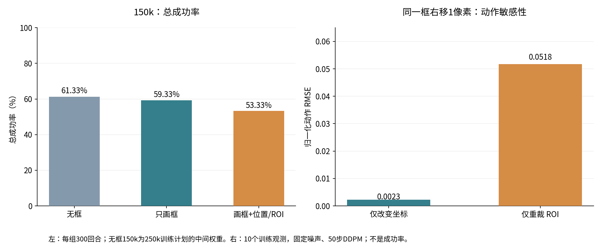

# MoMaRT：位置与 ROI token 为何降分｜2026-10-29

飞书图文报告：https://feishu.cn/docx/GU6adqL59oGoNqxyCMOcsy7rn94

最新判断：**优先验证用户指出的“固定碗目标与当前操作阶段不匹配”。** 现有ROI和位置token始终围绕红碗，操作柜门、把手或篮架时并未切换目标。下文关于框抖动的测量保留为第二层机制证据；尚未通过阶段消融确定6个百分点下降的唯一原因。详见文末更新。

## 先确认下降的比较对象

| 150k 版本 | 总成功数/回合 | 总成功率 |
|---|---|---|
| 无框 No-History | 184/300 | 61.33% |
| 只画框 | 178/300 | 59.33% |
| 画框+位置及ROI token | 160/300 | 53.33% |

此次重新读取三组各10个原始 result.npy，检查150k、eval seed20260917、二值成功标志及每组300回合。对象版相对只画框下降18次成功，即6.00个百分点。无框150k来自250k训练计划的中间权重，不能把它与150k终点权重当完全同优化计划。此前250k画框64.67%高于无框62.33%，也不能推广成“画框在所有训练阶段都有效”。

只画框与对象版都是训练seed100、150k、batch256、执行8步。对象版并非只多输入四个数：它增加位置和外观两个256维条件token，把原来的3个条件token变为5个，并让ROI反向传播到主RGB所用的同一个ResNet。

## 本次新增：真实权重的分支干预

CPU加载原150k EMA权重，SHA256为 263f25f6452db9253d1619006a9fa0113c005bbb4881d8ace2da6491253a175b。10个任务配置各选一个靠近数据集中点、最新帧有框的真实训练样本；场景像素保持不变，评测模式固定中心裁剪，所有干预使用相同扩散噪声。先在扩散时刻5/25/45测去噪MSE，再执行完整50步DDPM，比较实际执行的后8个动作位置。没有启动环境rollout或训练，不占用GPU。

| 干预 | 去噪 MSE（越低越好） | 相对完整输入的归一化动作RMSE |
|---|---|---|
| 完整位置+ROI | 0.058421 | 0.000000 |
| 屏蔽位置 token | 0.058812 | 0.010886 |
| 屏蔽 ROI token | 0.066862 | 0.076946 |
| 屏蔽两个对象 token | 0.067279 | 0.075010 |
| 只把位置框右移1像素 | 0.058361 | 0.002296 |
| 只用右移1像素的框重裁ROI | 0.064642 | 0.051766 |
| 位置和ROI同时右移1像素 | 0.064605 | 0.051248 |

关键结果：

- 只重裁ROI的动作变化是仅改坐标的 **22.55倍**（0.051766 对 0.002296）；两者一起改变的结果接近只改ROI。
- 关闭ROI比关闭位置token对动作影响大（0.076946 对 0.010886）。这说明该权重对ROI分支依赖更强，不等于ROI在所有场景都有害。
- ROI平移1像素后去噪MSE从0.058421升至0.064642，约增加10.65%；同样平移坐标没有使本批MSE变差。高频坐标存在表示敏感性，但目前证据不支持先把它认作主要降分源。

这些是训练观测上的功能诊断，不是独立测试集或闭环成功率；归一化动作RMSE不是米或关节角，也不能换算为掉了多少百分点。屏蔽分支会改变模型训练时的输入分布，屏蔽后的模型不能当作重新训练的基线。

## 为什么 ROI 比画框更容易放大问题

**最值得优先验证：ROI把微小框误差变成独立外观输入变化。** 画框是在整张图像里增加提示，目标与手、容器及背景仍共同出现。ROI版还会按框用floor/ceil取整数边界，紧裁剪并拉伸到64×64；边界变化会改变整块局部图像及缩放后的纹理、目标位置。新测量确认这条路径能比坐标分支带来更大的动作变化。先前同图检测审计中，离线框与在线combined_blend框平均单坐标差0.30像素、最大0.97像素；这与本次1像素扰动同量级，但只来自7帧片段，不能代表全部测试分布。

**已确认的结构问题：多路空间参考没有统一。** 场景主RGB从90×120裁为75×100；坐标token仍表示原图位置，ROI来自原图紧裁剪。训练时RGB与深度、最近两帧还分别抽取随机窗口。网络需要在不同空间参考之间自行学习关系；画在图里的框则天然跟随对应RGB裁剪。这种额外学习负担是可信机制，尚无消融量化其贡献。

**待验证的训练机制：ROI和场景共用可训练ResNet。** ROI并非额外的无害输入，它也更新原场景编码器；紧裁ROI与整图的尺度、上下文不同，可能改变场景特征或造成梯度冲突。本次只确认共享和分支依赖，没有测得梯度冲突，不能把“可能”写成定论。

此前110个固定帧/固定框样本的训练评测预处理逐字段相等，原始权重严格加载、路由和mask测试已通过。因此普通坐标单位错误、帧路由错误目前不是主要证据方向。reset重复推进tracker的错误已在隔离版本修复，但同时影响两组，尚无修复后的成功率，不能用它解释6个百分点。

## 下一步怎样判定，而不同时改太多东西

1. 最先用同一个对象版权重、相同在线框与评测seed，比较原ROI和轻微扩边ROI的总成功率；冻结场景像素与坐标分支。它可快速检验紧裁剪是否影响闭环控制，但属于推理分布改变，不能单独证明训练机制。
2. 正式训练消融先做“只加位置”和“只加ROI”，与只画框比较，固定150k预算、学习率计划、数据、执行块和评测seed；先分清是哪条分支及其组合带来下降。
3. 若ROI分支确认为问题，再分别测试训练ROI框抖动增强、独立/冻结ROI backbone；另用同步裁剪与坐标变换实验检验空间参考差异。不要把这些修改捆绑后只报一个提分结果。

验收指标仍是**总成功率**；离线MSE和动作差异仅用来选择实验。没有新增训练或在线评测，因此此报告不宣称已经修复降分。

历史详细审计：https://feishu.cn/docx/ACTLdfMHCoVVsyxqhNycPrq1nm4

代码：tools/probe_momart_object_tokens.py。原始诊断、样本索引、逐样本度量和成功率哈希保存在Git忽略的 artifacts/momart_token_diagnosis_20261029/；运行日志 probe.log，原始数据 probe.json 和 totals.json。本地旧审计见 docs/momart_boxed_token_audit_20261028.md。

## 用户指出的新机制：固定碗目标与操作阶段不匹配

2026-10-29更新。用户从对照视频指出：任务不仅需要移动碗，还需要操作门、把手或篮架；这些阶段ROI仍然围绕碗。此前分析集中在框的抖动和空间参考，遗漏了“当前框住的是否是当前操作目标”这一层，现将其列为第一优先验证假设。

已确认的实现事实：检测提示词为 `a red bowl.`；两个新增token分别是该碗框的二维位置和对应ROI外观。输入有效性表示有没有碗框，不表示当前是否应该操作碗。任务embedding区分五类任务，未显式提供阶段标签或阶段目标切换；模型仍可从全景推断阶段，但新增对象分支不会主动切换到把手或篮架。

因此，即使碗框检测完全准确、几何裁剪完全一致，也可能给当前动作提供不合适的强提示：拉门需要门/把手及机械手的关系，拉篮架需要篮架/拉手及其运动状态，此时碗的位置不等于当前接触目标的位置。新增位置token并非直接动作指令，但模型可能学到过度依赖碗空间位置的关联；ROI分支又突出碗外观，进一步强化这一偏向。全景仍然存在，故这是潜在干扰或错误归纳偏置，不能描述成模型完全看不到把手，也不能仅凭视频确定注意力实际分配。

已有离线测量说明该权重对ROI分支有明显依赖，这与新假设相容，但没有给样本标注操作阶段，不能据此证明非碗阶段受到更大干扰。固定碗token与阶段不匹配是设计事实；它是否主导6个百分点下降仍是待验证的因果结论。

验证优先级调整为：先标注少量视频中的操作碗、操作门/把手、操作篮架阶段；以同一权重、相同评测协议对比始终启用碗token与仅在碗操作阶段启用碗token。门/篮架阶段只屏蔽位置与ROI两个token，全景观测保留。主要验收仍为完整任务总成功率，阶段失败点用于解释；若使用人工阶段标签，应明确这是诊断用oracle，不冒充可部署策略。推理屏蔽是初筛，最终还需同预算的阶段门控训练或多目标训练对照。没有新训练或rollout启动，没有新增成功率。

## 在线多目标：检测准确不等于阶段选择准确

2026-10-29补充。用户指出，离线人工阶段标注不能解决在线选择目标的问题。此前“操作碗时启用碗token，操作门/篮架时切换目标”只是期望行为，尚未包含实现该切换所需的在线判断；不能据此声称方案已经可部署。人工标签也需检查切换边界与过渡阶段，不能默认绝对准确。

在线需要分别处理三件事：发现并定位多个对象/可操作部件；跨帧识别同一实例；结合任务与当前状态判断下一步操作。检测置信度仅反映检测结果的可信程度，不是当前操作对象的概率。框住整个洗碗机，也不等于定位到门把手或篮架拉手；两个同类把手同时出现时，仅有类别名称也不足以区分实例。

更值得首先验证的候选设计是保留全景，同时输入少量任务相关候选对象，由动作策略结合场景和任务学习利用它们，不在检测端强制只选一个目标。候选可包括碗、门把手、篮架/拉手，各自携带ROI、统一参考系的位置、类别/部件信息及有效性；若使用跨帧关联，应保持实例对应，避免按每帧检测分数重排导致语义变化。跟踪只帮助维持身份，不能替代阶段理解，也不能消除遮挡后的串ID。找不到的对象应显式标为缺失，不把长时间未更新的位置当成当前可靠观测。全景保留不自动保证策略会正确回退，缺失/误检情况需在训练和评测中覆盖。该设计需要重新训练，不能把门或篮架的ROI直接塞入只见过碗的现有权重并视为等价输入。

若坚持单目标硬切换，需要另行训练阶段/子目标预测器，使用在线可获得的全景、机器人状态以及必要历史；切换依据应包含门是否打开、篮架是否拉出、抓取是否完成等可观测状态，而不是固定时间表或“离手最近”。这些状态信号是否可用、精度如何，需要实际核验。失败重试会使预设阶段顺序失效；检测连续稳定也不代表阶段判断正确。

当前短观测窗口下，某些画面可能无法区分“尚未抓取”和“放下后返回”等历史不同的状态。若实测存在这种歧义，可增加短期历史或循环状态，但这会改变No-History条件，必须作为独立实验标明。多目标输入的第一轮比较应保持现有观测窗口，不能同时增加记忆再将收益全部归因于ROI目标切换。

训练数据的对象输入应使用与上线一致的因果检测/跟踪流程重放生成；人工阶段、真值框及使用未来帧修正的轨迹只能单列为诊断条件。检测器若需训练或选阈值，应与策略评测数据隔离。可先用现有十段视频检查小部件漏检、遮挡和实例关联，作为工程可行性检查；这些训练示范不能替代独立在线评估。最终仍按同预算、同评测协议比较全景基线、固定碗token与多候选token的完整任务总成功率，不将离线检测准确率或人工阶段结果当最终指标。

文献依据仅支持设计方向：VIMA将检测对象编码为token，并结合交互历史预测动作；其检测器做过场景适配，且使用误检增强，完美检测另列oracle条件。因此它不能证明现成通用检测器在MoMaRT的门把手/篮架上足够准确，也不能保证增加对象token就能提分。原论文：https://proceedings.mlr.press/v202/jiang23b/jiang23b.pdf （第4节、视觉token消融、附录C.4与D）。

本次仅澄清在线设计与验证条件，未修改策略、未启动检测批处理、训练或rollout，没有新增成功率。
