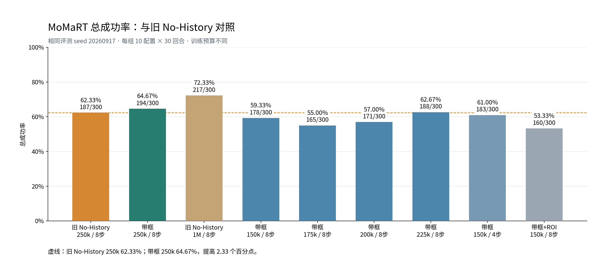

# MoMaRT 总成功率对照｜2026-10-29

飞书图文报告：https://feishu.cn/docx/RXj4dQ7gHoPAJvxzKB1cTwwMnZd

按最新要求，仅汇报总成功率，并以旧 No-History 为对照；不展开任务分项、逐回合一致性或额外方法排名。
数据快照：2026-10-29T09:26:50.460590+08:00；各项均由原始 result.npy 的成功标志复算。

旧 No-History 250k：**187/300，62.33%**；带框 250k 八步：**194/300，64.67%**，提高 **2.33 个百分点**（多成功7回合）。旧 No-History 1M 的72.33%保留为较长训练预算参考。

| 版本 | 总成功数/回合 | 总成功率 | 相对旧 No-History 250k |
|---|---|---|---|
| 旧 No-History 250k / 8步 | 187/300 | 62.33% | +0.00 个百分点 |
| 带框 250k / 8步 | 194/300 | 64.67% | +2.33 个百分点 |
| 旧 No-History 1M / 8步 | 217/300 | 72.33% | +10.00 个百分点 |
| 带框 150k / 8步 | 178/300 | 59.33% | -3.00 个百分点 |
| 带框 175k / 8步 | 165/300 | 55.00% | -7.33 个百分点 |
| 带框 200k / 8步 | 171/300 | 57.00% | -5.33 个百分点 |
| 带框 225k / 8步 | 188/300 | 62.67% | +0.33 个百分点 |
| 带框 150k / 4步 | 183/300 | 61.00% | -1.33 个百分点 |
| 带框+ROI 150k / 8步 | 160/300 | 53.33% | -9.00 个百分点 |

主图各组使用相同评测 seed 20260917；250k无框与带框组有效 batch 均为256，旧 No-History 1M 为64。250k训练步数一致，但带框组由150k续训并调整学习率计划，不能仅凭这一次对照把增益全部归因于画框。总成功率 = 所有配置成功回合数之和 ÷ 所有配置回合数之和。

## 250k 其他评测 seed：仅列总成功率

| 版本 | 评测 seed | 总成功数/回合 | 总成功率 |
|---|---|---|---|
| 带框250k / 4步 | 100 | 177/300 | 59.00% |
| 带框250k / 4步 | 200 | 188/300 | 62.67% |
| 带框250k / 4步 | 300 | 176/300 | 58.67% |
| 带框250k / 8步 seed100_repeat1 | 100 | 177/300 | 59.00% |
| 带框250k / 8步 seed100_repeat2 | 100 | 177/300 | 59.00% |
| 带框250k / 8步 seed100_repeat3 | 100 | 125/240 | 未完成，不列最终成功率 |
| 带框250k / 8步 seed200 | 200 | 0/0 | 未完成，不列最终成功率 |
| 带框250k / 8步 seed300 | 300 | 0/0 | 未完成，不列最终成功率 |

不同评测 seed 与主图分开呈现；同 seed100 重复执行不计作独立 seed。补跑完成后按完整300回合更新总成功率。

历史详细记录：https://feishu.cn/docx/LJD4dbDkTo8jwsxuPVTch9RunSz

旧 No-History 250k 原始结果：/home/jrw/vpwem_outputs/fair_history_momart_no_history_bs256_250k/seed100/eval_curve_20260922/step_250000。已核验10个配置、各30回合、checkpoint_step=250000、eval_seed=20260917。

复算：tools/collect_momart_evaluation_20261029.py --include-nohistory-250k；制图：tools/report_momart_total_success.py。原始快照：artifacts/momart_evaluation_20261029/evidence_with_nohistory250k.json（Git忽略）。
