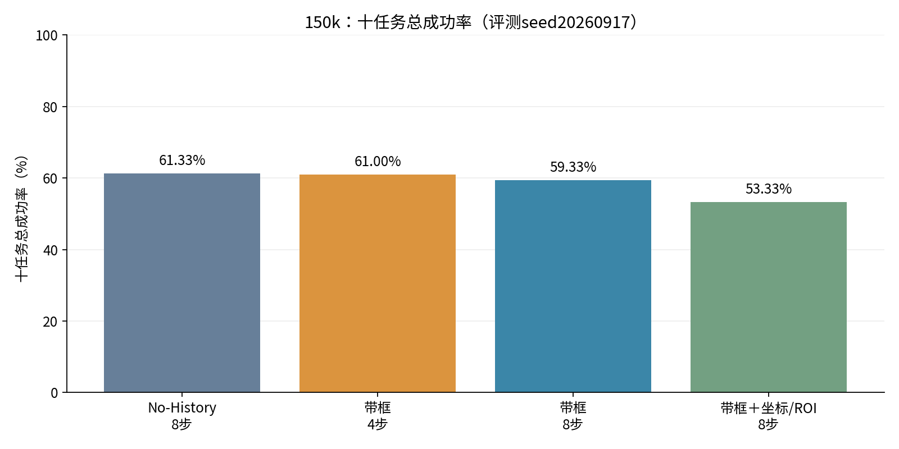
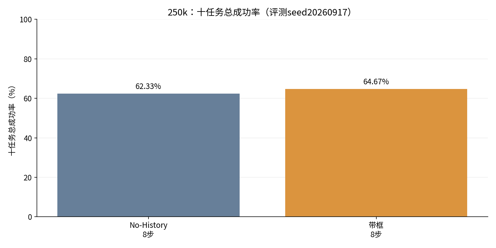
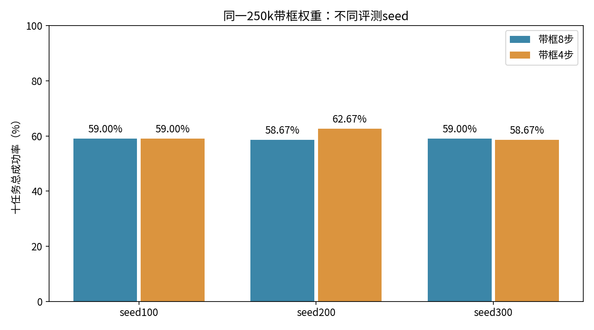
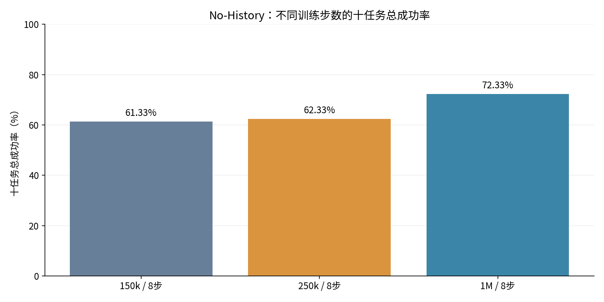

# MoMaRT：仅汇总十任务总成功率

每个数值均为全部10个任务配置的总成功率；不展示任何单任务结果。下列表格仅列百分比，不列成功次数、奖励、方差。

## 150k：各方案总成功率

评测seed统一为20260917。你所指的“带框带历史”按本轮确认，对应带框＋坐标/ROI版本；它没有长期历史记忆，以下使用真实名称。

| 方案 | 执行步数 | 总成功率 |
|---|---|---|
| No-History（无框） | 8 | 61.33% |
| 带框No-History | 4 | 61.00% |
| 带框No-History | 8 | 59.33% |
| 带框＋坐标/ROI | 8 | 53.33% |

## 250k：各方案与不同seed总成功率

“—”表示没有该配置的完整评测，不是0%。不同seed不混在同一比较中。

| 方案 | 执行步数 | seed20260917 | seed100 | seed200 | seed300 |
|---|---|---|---|---|---|
| No-History（无框） | 8 | 62.33% | — | — | — |
| 带框No-History | 8 | 64.67% | 59.00% | 58.67% | 59.00% |
| 带框No-History | 4 | — | 59.00% | 62.67% | 58.67% |

三个不同seed等权汇总：带框8步 **58.89%**，带框4步 **60.11%**。八步seed100的三次重复均为59.00%，汇总时只计一次，不重复加权。

250k带框＋坐标/ROI未找到完整评测，因此不补数、不画零值柱。

## 无框No-History：150k、250k和1M总成功率

评测seed统一为20260917，执行8步。150k/250k来自250k训练链，1M来自另一条历史训练链；不将它们冒充同一个模型文件。

| 训练步数 | 总成功率 |
|---|---|
| 150k | 61.33% |
| 250k | 62.33% |
| 1M | 72.33% |

## 必要口径说明

这里把“1M和250k”解释为两个训练步数的No-History对照。若指的是1M训练链在250k时保存的那个checkpoint，其完整评测尚未找到，不能拿另一条250k训练链替代。

带框150k与250k方案还存在续训及学习率计划差异；历史1M无框的有效batch与250k不同。上述是实际总成绩对照，不单独证明画框或执行步长的因果效果。带框4/8步沿用同一权重和旧检测协议，均未混入reset修复。

本报告只重新汇总已完成结果，没有新启动实验。原始结果、单任务证据及审计记录仍留在历史报告中，但本页不展示分项。

飞书汇总：https://feishu.cn/docx/A4mVdzwCZovWOlxKxXNci1fynze
