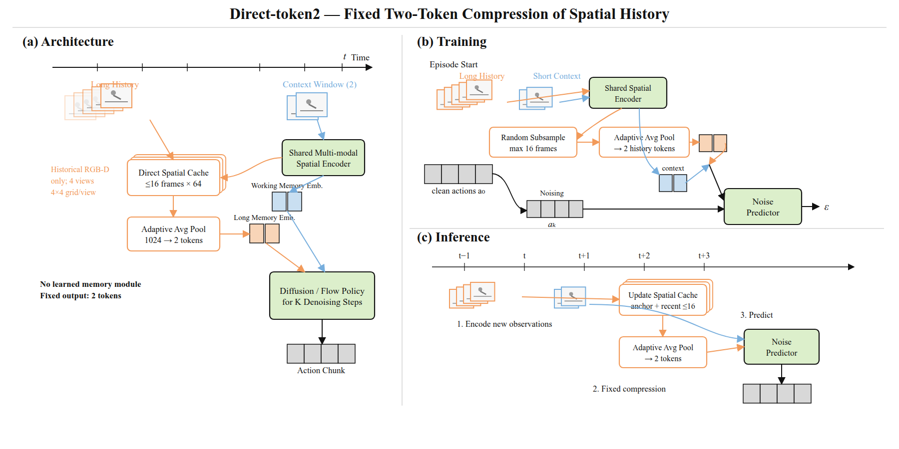
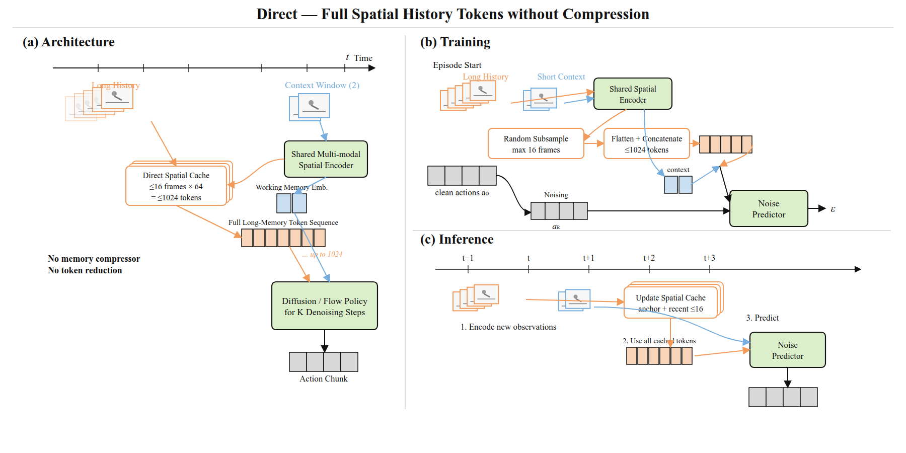
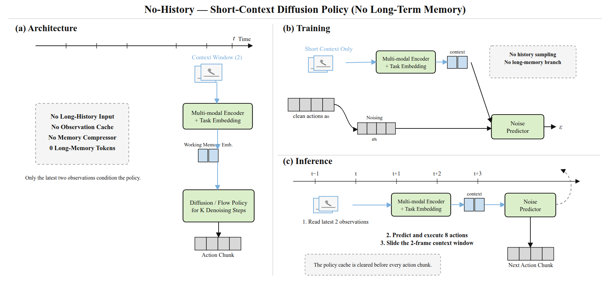

# MoMaRT 1M 四种历史信息方案阶段汇报

> **一句话结论**：四种方法的 1M 评测现已全部完成。No-History 为 **72.33%**，Direct 为 **72.00%**，Direct-token2 为 **71.67%**，VPWEM 为 **65.33%**。前三种 raw-image 方法只相差 0.66 个百分点；VPWEM 的观测编码器和有效 batch size 不同，因此它与前三者的差距只能用于阶段性定位，不能直接归因于记忆机制。

更新时间：2026-09-20（CST）  
实验范围：MoMaRT，多任务混合训练，1M（100 万）训练步  
汇报对象：不要求具备机器人学习、深度学习或扩散模型背景

---

## 1. 这项实验到底在研究什么？

我们希望机器人完成一组厨房整理任务，例如：把物品从洗碗机取出并放进柜子、把桌面物品收进水槽或洗碗机、从洗碗机或柜子取出物品并完成桌面布置。

这类任务有一个共同难点：**机器人当前看到的画面，往往不足以决定下一步动作。**

可以把它想成一个人整理厨房：如果你只看眼前一秒，就可能忘记“盘子刚才来自哪里”“哪些物品已经处理过”“抽屉之前是否打开过”。机器人也一样，需要利用过去的视觉信息。四种方法的核心区别，就是回答同一个问题：

> 机器人应该怎样保存和使用过去看到的内容？

本实验保持动作生成骨干相近，重点比较四种历史信息方案：

- **VPWEM**：先学习哪些历史信息重要，再把历史压缩成 2 个记忆 token。
- **Direct-token2**：不使用可学习记忆模块，直接把历史做固定的平均池化，压成 2 个 token。
- **Direct**：尽量保留全部空间历史 token，不主动压成 2 个 token。
- **No-History**：完全不使用长期历史，只依赖最近的观测。

这里的 **token** 可以理解成“交给动作模型的一小包数字化信息”。token 越多，保留的信息可能越细，但计算和显存开销通常也越大。

---

## 2. 当前总览

| 方法 | 1M 状态 | 已完成评测 | 当前结果 | 结果级别 |
|---|---|---:|---:|---|
| **VPWEM** | 已训练、已评测 | 10 个任务配置 × 30 episodes = 300 | **65.33%**（196/300） | C：诊断级 |
| **Direct-token2** | 已训练、已评测 | 10 个任务配置 × 30 episodes = 300 | **71.67%**（215/300） | C：诊断级 |
| **Direct** | 已训练、已评测 | 10 个任务配置 × 30 episodes = 300 | **72.00%**（216/300） | C：诊断级 |
| **No-History** | 已训练、已评测 | 10 个任务配置 × 30 episodes = 300 | **72.33%**（217/300） | C：诊断级 |

阶段性数字：No-History、Direct、Direct-token2 分别比 VPWEM 高 **7.00、6.67、6.34 个百分点**。三个 raw-image 方法彼此非常接近：No-History 比 Direct 多成功 1 次，Direct 比 Direct-token2 多成功 1 次。

这里的等级含义：

- **C（诊断级）**：结果文件有效，可以帮助判断方向，但存在架构、数据表征或训练口径混杂，不能直接形成严格因果结论。
- **D（未完成/不可比较）**：训练或评测尚未完成，当前不能报告成功率。本表当前四种方法均已完成，因此没有 D 级条目。

---

## 3. 先看懂几个关键词

### 3.1 1M、checkpoint 和 episode

- **1M**：训练进行了 1,000,000 个更新步，不是 100 万条独立数据。
- **checkpoint**：训练过程中保存的模型快照。比如 900k checkpoint 是第 900,000 步保存的可加载模型。
- **episode**：一次从任务开始到结束的完整机器人尝试。
- **成功率**：成功 episode 数 ÷ 总 episode 数。

### 3.2 为什么是“10 × 30 episodes”？

实验包含 5 类语义任务，每类任务各有 expert 和 suboptimal 两种数据配置，因此共有 **10 个任务配置**。每个配置独立运行 30 次，共计：

> 10 个配置 × 30 次 = 300 episodes / 方法

最终平均成功率采用 10 个配置的宏平均；因为每个配置都是 30 次，它也等价于 300 次测试的总体成功比例。

### 3.3 expert 与 suboptimal 是什么？

- **expert**：来自质量较高的专家示范数据。
- **suboptimal**：示范质量相对不完美，更接近带有次优行为的数据。

它们不是评测时给机器人“简单模式/困难模式”的开关，而是该任务配置所对应的数据类型。

---

## 4. 四种方法逐一解释

### 4.1 VPWEM：学习式的紧凑记忆

**直观比喻**：像一个会做笔记的人。它不会把过去每一帧都原样带着，而是学习把重要内容整理成两张“摘要卡片”。

工作流程：

1. 将历史观测编码成 256 维特征。
2. 给历史特征加入 episode 内的时间位置信息，让模型知道先后顺序。
3. 使用 2 层 Q-Former，从历史中提炼信息。
4. 内部使用 FIFO（先进先出）缓存，缓存容量为 8；较旧信息会按规则移出。
5. 无论历史多长，最终都输出 **2 个记忆 token** 给动作扩散模型。

主要配置：

| 项目 | 设置 |
|---|---|
| 历史摘要 token 数 | 2 |
| Q-Former 层数 | 2 |
| 内部缓存策略 | FIFO |
| 缓存最大长度 | 8 |
| 位置编码 | 正弦位置编码 |
| 历史采样间隔 | 20 |
| 本次训练步数 | 1,000,000 |
| 训练 seed | 100 |
| 有效 batch size | 256 |

潜在优点：

- 输出固定为 2 个 token，长历史下的下游计算量稳定。
- 压缩过程可学习，理论上能保留与任务相关的信息。
- 在线执行时可以持续更新记忆，而不是每次重放全部历史。

潜在风险：

- 可学习压缩器本身需要训练；如果训练不足或目标不够明确，可能丢掉关键信息。
- 缓存重置必须正确。此前 MIKASA 评测中曾发现 episode reset 后未同时清空 online/EMA memory 的问题；当前 MoMaRT 评测入口已显式在每批 episode 开始时重置容器缓存和记忆模块。
- 当前 1M VPWEM 使用预计算 embedding 与任务对应的 context encoder，并非与 raw-image Direct 系列完全相同的输入链路。

当前结果：**196/300 成功，平均成功率 65.33%**。

### 4.2 Direct-token2：无参数的两 token 压缩

**直观比喻**：也把过去整理成两张摘要卡片，但不是让模型学习怎么记笔记，而是按固定规则把历史分段求平均。

工作流程：

1. 对历史 RGB、腕部 RGB、深度、腕部深度图保留空间特征。
2. 每个视觉输入被池化成 4 × 4 的空间网格。
3. 4 路视觉输入合计每帧 64 个空间 token。
4. 最多 16 个历史帧原本对应 16 × 64 = **1,024 个空间 token**。
5. 使用无参数的 adaptive average pooling，将整个历史固定压缩为 **2 个 token**。

“无参数”意味着这一压缩规则自身不学习；训练仍然会学习视觉编码器、任务嵌入和动作生成模型。

主要配置：

| 项目 | 设置 |
|---|---|
| 原始历史预算 | 最多 16 帧、每帧 64 个空间 token |
| 输出历史 token 数 | 2 |
| 压缩方式 | adaptive average pooling |
| 是否有独立可学习记忆模块 | 否 |
| 本次训练步数 | 1,000,000 |
| 训练 seed | 100 |
| 有效 batch size | 64 |

潜在优点：

- 结构简单，少了独立记忆模块的训练难度。
- 同样只向动作模型提供 2 个历史 token，计算预算紧凑。
- 当前阶段成功率最高。

潜在风险：

- 平均池化可能把短暂但关键的事件冲淡。
- “2 个 token”与 VPWEM 数量相同，不代表两者接收到的信息、编码器或训练条件相同。
- 当前高分不能单独证明“无参数池化优于学习式记忆”，因为两者还存在观测编码器和 batch size 差异。

当前结果：**215/300 成功，平均成功率 71.67%**。

#### Direct-token2 网络结构

图中沿用 VPWEM 原论文 Figure 2 的三段式逻辑：左侧为总体架构，右上为训练，右下为推理。绿色表示可学习模块；白色橙边框表示无参数固定操作。Direct-token2 与 VPWEM 都向动作模型提供 2 个长期历史 token，但前者使用固定 adaptive average pooling，不包含 Q-Former 或其他可学习记忆压缩器。

### 4.3 Direct：保留全部空间历史

**直观比喻**：像把过去拍下来的大量照片全部摊在桌上，再让动作模型自己找重点。

工作流程与 Direct-token2 的前四步相同，但不把历史压成 2 个 token。按完整 16 帧计算，动作模型最多接收 **1,024 个历史空间 token**。

潜在优点：

- 最大限度保留历史细节。
- 避免压缩器提前丢失信息。

潜在风险：

- token 数量远高于另外两种记忆方法，显存和计算开销大。
- “信息更多”不等于“更容易学习”；大量冗余历史可能干扰动作模型。
- 训练速度与资源占用更高，也使严格公平比较更难。

当前结果：1M checkpoint 和 10 × 30 评测均已完成，**216/300 成功，平均成功率 72.00%**。评测于 2026-09-20 18:06 CST 完成，平均单次策略推理时间约 0.400 秒。

#### Direct 网络结构

Direct 的历史视觉编码方式与 Direct-token2 相同，但跳过最终的两 token 池化步骤。最多 16 个历史帧、每帧 4 路视觉输入各保留 4 × 4 空间网格，因此最多将 1,024 个长期历史 token 直接交给动作模型。图中没有独立的绿色 memory compressor，是因为该方法不学习额外的历史压缩模块。

### 4.4 No-History：不使用长期历史

**直观比喻**：每次只根据眼前和最近一小段画面做决定，不保留更早发生的事情。

技术上，它仍使用最近 **2 个 observation steps** 作为当前条件，但长期记忆 token 数为 **0**，也没有独立记忆模块。评测时每个 action chunk 前清空 LongMemDDPM 容器缓存，确保它按无状态的 DP-PTP 策略运行。

潜在优点：

- 结构最简单，是判断“长期历史到底有没有帮助”的关键基线。
- 计算与缓存负担小。

潜在风险：

- 如果任务需要记住早期事件，模型只能依赖当前画面中的间接线索。
- 对部分看似长时序、但当前状态已包含充分信息的任务，它仍可能表现很好；因此 No-History 的结果能帮助判断 benchmark 是否真的需要记忆。

当前结果：1M checkpoint 和 10 × 30 评测均已完成，**217/300 成功，平均成功率 72.33%**。评测 seed 为 20260917；任务曾分片到两张 GPU 并行执行，每个配置均保留完整 30 episodes。

#### No-History 网络结构

No-History 只有蓝色短期上下文路径：最近 2 个观测经过多模态编码器和任务 embedding 后直接条件化动作去噪网络。它没有橙色长期历史输入、历史采样、缓存或压缩器，长期历史 token 数为 0；评测入口会在每个 action chunk 前清空策略容器缓存。

---

## 5. 四种方法放在一起看

| 对比维度 | VPWEM | Direct-token2 | Direct | No-History |
|---|---|---|---|---|
| 使用长期历史 | 是 | 是 | 是 | 否 |
| 历史处理方式 | 可学习 Q-Former 压缩 | 固定平均池化 | 基本不压缩 | 丢弃长期历史 |
| 交给动作模型的历史 token | 2 | 2 | 最多 1,024 | 0 |
| 独立记忆模块 | 有 | 无 | 无 | 无 |
| 主要目的 | 学习保留重要历史 | 测试简单压缩是否足够 | 测试保留全部细节 | 测试长期历史是否必要 |
| 1M 完成状态 | 已训练、已评测 | 已训练、已评测 | 已训练、已评测 | 已训练、已评测 |
| 当前 1M 成功率 | 65.33% | 71.67% | 72.00% | 72.33% |

这四个方法构成一条很清晰的研究链：

> 不用历史（No-History） → 使用全部历史（Direct） → 固定压缩历史（Direct-token2） → 学习压缩历史（VPWEM）

四个当前系统的结果已经补齐，但训练入口仍未完全统一。下一轮统一口径后，才能可靠回答三个真正重要的问题：

1. 长期历史是否比不使用历史更好？
2. 历史需要完整保留，还是压成少量 token 就够？
3. 学习式压缩是否优于简单的固定压缩？

---

## 6. 统一实验设置

### 6.1 任务与数据

5 类语义任务、每类 2 种数据配置：

| 缩写 | 完整任务名 | 通俗说明 |
|---|---|---|
| dwclean | table_cleanup_to_dishwasher | 将桌面物品整理到洗碗机 |
| skclean | table_cleanup_to_sink | 将桌面物品整理到水槽 |
| dwsetup | table_setup_from_dishwasher | 从洗碗机取物并布置桌面 |
| dssetup | table_setup_from_dresser | 从柜子取物并布置桌面 |
| unload | unload_dishwasher_to_dresser | 从洗碗机取物并放入柜子 |

每类任务分别使用 expert 与 suboptimal 配置，得到 10 个配置。多任务训练中，5 个语义任务分别带有 task ID；同一语义任务的 expert/suboptimal 数据共享 task ID。

### 6.2 观测和动作

raw-image 训练链路使用：

- 主视角 RGB：3 × 90 × 120
- 腕部 RGB：3 × 90 × 120
- 主视角深度：1 × 90 × 120
- 腕部深度：1 × 90 × 120
- 机器人本体状态 proprio：10 维
- scan：1 × 100
- 动作：10 维

图像由 ResNet-18 处理，训练时裁剪到 75 × 100，并使用随机裁剪和 GroupNorm。

### 6.3 时间与动作生成

| 项目 | 设置 |
|---|---:|
| 最近观测步数 obs_steps | 2 |
| 每次执行动作数 action_steps | 8 |
| 预测 horizon | 9 |
| 扩散采样步数 | 50 |
| 动作 Transformer 层数 | 8 |
| 模型维度 | 256 |
| 注意力头数 | 4 |
| 学习率 | 1e-4 |
| EMA rate | 0.999 |
| 优化器 beta | (0.9, 0.999) |
| 训练 seed | 100 |

### 6.4 历史采样

- 历史来源：从完整 episode 历史中采样。
- 历史最大长度：16 帧。
- 采样间隔参数：20。
- 保留 episode anchor，避免完全丢失开端信息。
- 历史采样 seed：100。

### 6.5 评测

- 评测 seed：20260917。
- 每个任务配置：30 episodes。
- 并行环境数：10（No-History 分片运行时每进程 5 个环境，但每配置总量仍是 30）。
- 每个 episode 最长约 1,500 environment steps。
- 每次从预测序列中执行 8 个动作。
- 成功判据：episode 内只要环境 success condition 曾经为真，即记为成功。
- 每批新 episode 都重置策略缓存；VPWEM 还会重置在线与 EMA 记忆模块。

---

## 7. 四种方法的逐任务结果

| 任务配置 | VPWEM 1M | Direct-token2 1M | Direct 1M | No-History 1M |
|---|---:|---:|---:|---:|
| dwclean / expert | 63.33%（19/30） | 60.00%（18/30） | 63.33%（19/30） | 53.33%（16/30） |
| dwclean / suboptimal | 13.33%（4/30） | 30.00%（9/30） | 20.00%（6/30） | 40.00%（12/30） |
| skclean / expert | 70.00%（21/30） | 60.00%（18/30） | 73.33%（22/30） | 73.33%（22/30） |
| skclean / suboptimal | 33.33%（10/30） | 70.00%（21/30） | 86.67%（26/30） | 66.67%（20/30） |
| dwsetup / expert | 83.33%（25/30） | 90.00%（27/30） | 96.67%（29/30） | 93.33%（28/30） |
| dwsetup / suboptimal | 80.00%（24/30） | 96.67%（29/30） | 93.33%（28/30） | 96.67%（29/30） |
| dssetup / expert | 100.00%（30/30） | 96.67%（29/30） | 93.33%（28/30） | 93.33%（28/30） |
| dssetup / suboptimal | 76.67%（23/30） | 80.00%（24/30） | 70.00%（21/30） | 60.00%（18/30） |
| unload / expert | 80.00%（24/30） | 63.33%（19/30） | 66.67%（20/30） | 83.33%（25/30） |
| unload / suboptimal | 53.33%（16/30） | 70.00%（21/30） | 56.67%（17/30） | 63.33%（19/30） |
| **平均** | **65.33%（196/300）** | **71.67%（215/300）** | **72.00%（216/300）** | **72.33%（217/300）** |

### 7.1 可以直接观察到的现象

- 三个 raw-image 方法的总分几乎相同：No-History 217 次成功、Direct 216 次、Direct-token2 215 次。
- Direct 在 skclean / suboptimal 最突出，达到 86.67%，但在 dwclean / suboptimal 只有 20.00%。
- No-History 在 unload / expert 达到 83.33%，高于三种使用长期历史的方法；这提示部分任务可能从当前状态就能获得足够线索。
- VPWEM 在 dssetup / expert 达到唯一的 30/30，但其宏平均最低。
- 四种方法在不同任务上的输赢并不一致，说明“平均分更高”不能替代逐任务和配对统计分析。

### 7.2 与论文数字的关系

论文 Figure 4 报告的平均值约为：DP-VPWEM **69%**、MaIL-VPWEM **71%**。本次 VPWEM、Direct-token2、Direct、No-History 分别为 65.33%、71.67%、72.00%、72.33%。但必须注意：

- 论文逐任务实验报告的是 3 个随机种子的均值与标准差。
- 本次是单个训练 seed（100）的多任务混训模型。
- 本次 Direct-token2 **不是** MaIL-VPWEM，只是数值接近。
- 论文是逐任务训练/评测，本次是多任务混训后逐任务评测。

因此，这些论文数字只能作为大致定位，不是严格复现对照。

---

## 8. 为什么当前不能直接宣布某种记忆机制获胜？

这是本次汇报中最重要的实验诚信说明。

### 8.1 输入表征不同

- 当前 VPWEM 1M 使用预计算的 256 维 `dp_emb`，并在在线评测时加载任务对应的 context encoder。
- 当前 Direct-token2、Direct 和 No-History 使用 raw visual policy，从 RGB/深度图像直接提取空间特征。

### 8.2 有效 batch size 不同

- VPWEM：effective batch size = 256。
- Direct-token2、Direct、No-History：effective batch size = 64。

### 8.3 训练协议与论文不同

当前是单 seed、多任务混训；论文数字是不同的训练组织方式并汇总多个 seed。

所以目前能够严谨表达的是：

> 在各自当前训练链路和相同 1M 训练步、相同 10 × 30 评测框架下，No-History、Direct、Direct-token2、VPWEM 分别得到 72.33%、72.00%、71.67%、65.33%。其中前三者共享 raw-image、effective batch 64 的主训练口径；VPWEM 使用 embedding、effective batch 256。

目前不能严谨表达的是：

> No-History 或 Direct 的机制已经被证明比 VPWEM 更好。

要回答机制优劣，下一轮应让四种方法使用相同的 observation encoder、相同 embedding 数据、相同 effective batch、相同训练 seed 和相同 paired episodes。

---

## 9. 当前阶段可得出的结论

### 可以说

1. 四种方法的 1M checkpoint 和各自 300-episode 评测均已落盘，四个总分是有效的阶段性结果。
2. 三个 raw-image 方法总分只相差 0.66 个百分点：No-History 72.33%、Direct 72.00%、Direct-token2 71.67%。
3. Direct 比 Direct-token2 只多成功 1 次；当前数据没有显示保留最多 1,024 个历史 token 带来明显宏平均优势。
4. No-History 暂居第一，提示当前 MoMaRT 配置对长期历史的依赖可能弱于预期，值得进一步检查 benchmark 的记忆需求。
5. 方法差异具有明显任务依赖性，不能只看平均值。

### 暂时不能说

1. 不能说 No-History、Direct 或 Direct-token2 已在严格公平实验中战胜 VPWEM。
2. 不能推断“可学习记忆没有用”，因为编码器、batch 和训练链路尚未统一。
3. 不能因 No-History 暂居第一就断言长期历史无用；当前只有一个训练 seed，且评测量有限。
4. 不能用单训练 seed 代表稳定的论文级结论。

---

## 10. 下一步计划与验收标准

### P0：当前四方法表已补齐

四种方法的 1M checkpoint、10/10 个 `result.npy`、总分与逐任务成功数均已完成审计。下一步不再重复当前混合口径评测，而是进入统一训练入口的单变量比较。

### P1：做真正的单变量公平比较

四种方法全部统一为：

- 同一份 `dp_emb` 数据；
- 同一 observation encoder；
- effective batch size = 256；
- 1M 训练步；
- train seed = 100；
- 相同任务初始条件与 paired episodes；
- 每个配置至少 100 episodes。

### P2：形成论文级证据

- 增加 train seed 200、300。
- 汇报三 seed 的 mean ± std。
- 同时给出 Wilson 置信区间、paired bootstrap 或 McNemar 检验。
- 补齐参数量、峰值显存、训练速度和推理延迟。
- 预先固定 checkpoint 选择规则，禁止评测后挑最好节点。

---

## 11. 面向非技术听众的汇报话术

可以用下面这段话做口头汇报：

> 我们在研究机器人做厨房长任务时，应该怎么记住过去。四种方案分别是不记历史、保留全部历史、把历史固定压成两个摘要，以及让模型自己学习压成两个摘要。现在四种方案都已完成 100 万步训练和各 300 次测试：No-History 72.33%，Direct 72.00%，Direct-token2 71.67%，VPWEM 65.33%。前三种 raw-image 方法几乎打平，这说明当前任务上增加长期历史并没有表现出稳定的宏平均收益。不过 VPWEM 的图像编码和训练 batch 与前三者不同，而且当前只有一个训练 seed，因此还不能宣布哪种记忆机制最终获胜。下一轮会统一输入、batch 和随机种子后再比较。

---

## 12. 常见问题

### Q1：71.67% 是不是说明机器人已经很可靠？

不是。它表示在当前模拟器、当前 10 个任务配置和 300 次测试中成功了 215 次。它不能自动推广到真实机器人、新厨房、新物体或不同初始状态。

### Q2：为什么不直接多测几次，就能解决公平性问题？

增加评测次数只能减少“测试抽样”的随机误差，不能消除模型输入、batch size 和训练链路不同带来的系统差异。公平性需要从训练配置层面统一。

### Q3：Direct 保留信息最多，为什么不一定最好？

动作模型要从最多 1,024 个历史 token 中寻找重点，计算更重，也可能被冗余信息干扰。压缩方法的价值就是在保留关键线索的同时减少负担。

### Q4：Direct-token2 既然不学习压缩，为什么可能更好？

简单规则更稳定，也更容易优化；但它也可能恰好受益于不同的视觉编码器或训练设置。只有严格同协议实验才能区分这些原因。

### Q5：No-History 如果也很高，意味着什么？

可能意味着部分任务的当前画面已经包含足够信息，或者环境中存在可以替代记忆的状态线索。它会提醒我们进一步检查 benchmark 是否真的要求长期记忆。

### Q6：为什么只用一个训练 seed 不够？

神经网络训练受初始化、数据顺序等随机因素影响。一个 seed 可能碰巧偏高或偏低；至少三个训练 seed 才能初步估计稳定性。

---

## 13. 可追溯信息

本报告主要依据：

- `reports/momart_1m_eval/comparison.md`：1M 逐任务结果与论文图表定位。
- `experiments/history4/registry.json`：四方法状态、证据路径和有效性等级。
- `reports/history4/README.md`：自动生成的 History-4 状态面板。
- `configs/dp/momart/fair_history_multitask/base.yaml`：raw-image 四方法公共训练配置。
- `configs/dp/momart/fair_history_multitask_emb/base.yaml`：embedding VPWEM 配置。
- `pipelines/fair_history_momart_multitask.py`：Direct、Direct-token2、No-History 的方法构建与训练入口。
- `pipelines/fair_history_momart_multitask_emb.py`：embedding VPWEM 训练入口。
- `pipelines/eval_fair_history_momart_multitask_emb.py`：统一在线评测入口。
- `tools/run_fair_history_momart_1m_eval.sh`、`tools/run_fair_history_momart_no_history_1m_eval.sh`：1M 评测队列。

说明：本文中的方法通俗解释用于帮助非专业听众理解；具体数值、状态和限制均按上述仓库记录整理。头图为本报告专门生成的概念图，不代表实验截图或结果可视化。
